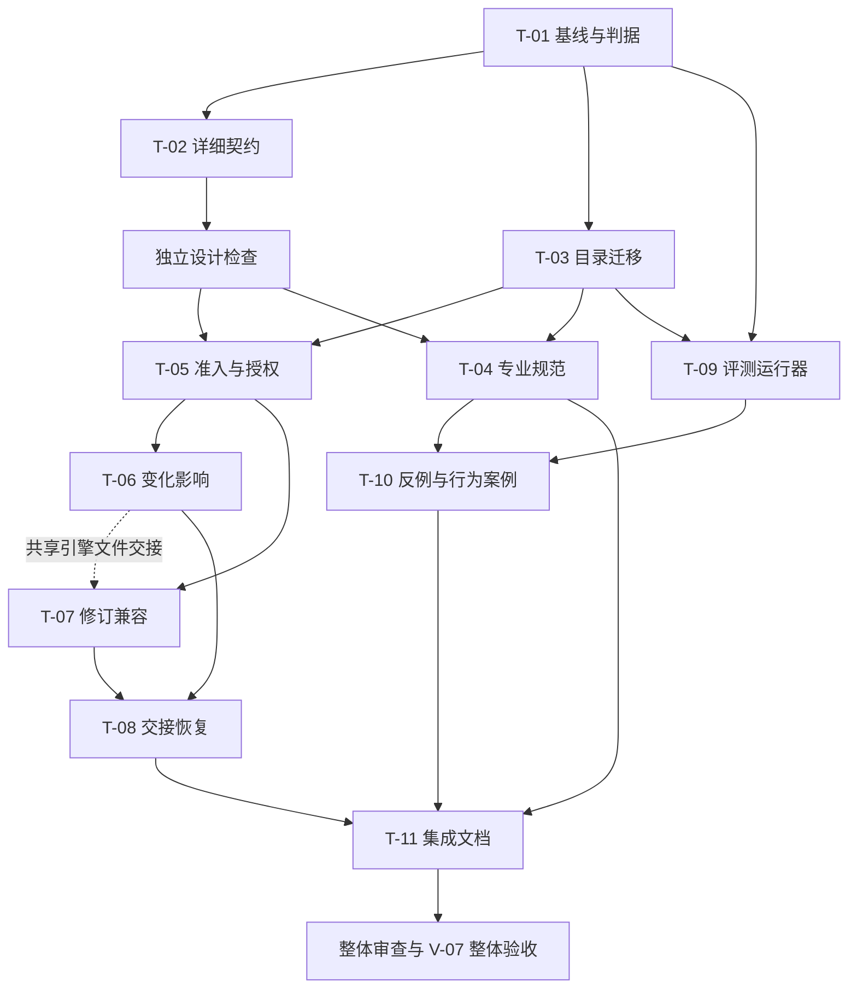

# Delivery 组合质量增强与目录迁移实施计划

## 1 计划定位与设计承接

### 1.1 交付身份与基线

| 项目 | 内容 |
| --- | --- |
| 计划版本、日期与状态 | 1.1；2026-10-16；用户已明确批准按本计划执行，原话见 authorization.md；本文件仍是计划定义 |
| 交付身份 | 独立 `delivery-plan` 活动；语义契约 1；保存于 `.delivery/2026-10-16-delivery-suite-improvements/plan.md` |
| 使用的 skill 修订 | 工作树内 `delivery-plan/`，11 个源文件相对路径排序，逐项以路径、NUL、内容 SHA-256 合成的树摘要为 `a2e18865c6a77118481f61c4574984e76141aaadb7b7b60fa5bafba927914078`；未提交来源的可恢复快照见 `evidence/planning-inputs/` |
| 代码基线 | `/Users/cm/workspace/github/skills`；HEAD `15aabb99b2666d213ea83dcaa7b16855b4f128b5`；六个 delivery skill 中有 18 个已修改文件，包含前轮默认路径与恢复改进；不是干净 HEAD |
| 其他工作 | 仓库另有 delve、原设计 skill、research-router、新增其他 skill 和文档等既有修改；实施前重新采集，不以本计划列表替代实时检查 |
| 目标 | 六个 skill 统一归入 `delivery/`；保持五项能力独立可用；补齐大任务的计划准入、变化影响、版本续接和行为评测，使完成判断有可追溯证据 |
| 设计依据 | 本章内嵌的用户约束和上一轮能力矩阵 B1—B11；当前实现是现状依据，不视为所有机制都已充分验证 |
| 范围 | 六个 delivery skill 的说明、各自规范/模板/示例/测试；编排契约与脚本；仓库导航与 12 个既有安装软链；必要的新测试设施 |
| 排除项 | 不修改原 `task-workflow`、`design-tech-doc`、`plan-implementation`；不接管 `.workflow`；不做通用工作流平台、常驻 daemon、分布式调度或自动同步所有专业文档 |
| 执行入口 | 本目标已经进入实施；沿用本目录，稳定 v1 控制器管理 runtime，候选版本在隔离 fixture 验证 |
| 当前设计阻塞 | 无；T-02 的 design.md v1.1 已通过 design-reviews/002.md 定向复核，字段、兼容、失效和未知运行解除已明确；真实实现与行为仍待实际验证 |

### 1.2 已确认约束与推荐执行规则

以下 U 项承接用户原话或此前明确决定；M 项是本计划提出的执行办法，不能写成已获用户批准。

| 标识 | 来源与要求 | 对实施的约束 |
| --- | --- | --- |
| U1 | 用户：质量优先，效率其次 | 正确性、证据有效性、独立审查和兼容性是门槛；时间/token 只在质量达标后比较 |
| U2 | 用户：适合固定执行的工作更多用脚本，但不为脚本而脚本 | 复用现有引擎与检查器；脚本处理确定规则，模型处理语义判断；不把自然语言“已确认”伪装为可认证布尔值 |
| U3 | 用户：所有产出满足人和模型可读 | 专业正文是 Markdown；结构化事件保留明确字段语义，并提供同源可读视图和原始证据链接 |
| U4 | 用户：组合 skill 全部移入仓库根的 `delivery/` | 五项能力和编排共六个目录整体迁入；skill 名称仍为 `delivery-*`；任务工作目录继续用 `.delivery/` |
| U5 | 此前确认：每项能力可人为主动独立调用 | 单项不依赖编排器、Git、其他 delivery skill 或 `.workflow`；安装后的触发名称保持不变 |
| U6 | 此前确认：独立调用默认不提交；完整编排可自动本地提交，不 push | 提交按任务/交付边界组织，保护已有未提交及暂存内容；用户和项目规则优先 |
| U7 | 此前确认：五个 skill 会持续更新，原有两项保留 | 区分 skill 修订、语义契约、专业文档和产品版本；不能让活动流程静默切换规则 |
| U8 | 此前确认：按质量选择主 agent 或子 agent | 不固定全部委派；独立审查排除全部相关作者及其实现上下文；多写入者须有明确资源交接 |
| M1 | 推荐：先记录基线与评测判据，再改机制 | 避免根据改后表现反向修改“通过”标准；原版和候选版使用同一组适用案例 |
| M2 | 推荐：新增强制准入语义使用编排契约新版本 | 当前 v1 严格拒绝未知字段/版本，不能把强制门禁偷偷塞进 v1；仅受影响的专业契约升级，不强制六项一起升号 |
| M3 | 推荐：目录迁移与行为改动分开留痕 | 保留六个 basename；不留下第二套根目录源码；历史证据原位保留；安装脚本能复用就不改 |
| M4 | 推荐：历史 v1 按原规则解释，活动 v1 不自动升级 | 新引擎保留明确的 v1 兼容入口；需要新保证时显式重接纳/迁移，保留旧事件和映射，不原地改写历史 |

用户已批准按本计划执行，包含 M1—M4；具体授权原文见 authorization.md。T-02 在此边界内完成细化；若后续需要扩大规则或降低保证，呈现原约束、证据和影响后另行确认。

### 1.3 目标目录与材料分工

```text
skills/
├── delivery/                         # 本轮迁移的 skill 源码
│   ├── README.md                     # 组合导航、独立入口、维护说明
│   ├── delivery-design/
│   ├── delivery-plan/
│   ├── delivery-implement/
│   ├── delivery-review/
│   ├── delivery-verify/
│   └── delivery-orchestrate/
├── .delivery/                        # 真实任务产物，继续按目标分目录
│   └── 2026-10-16-delivery-suite-improvements/
├── task-workflow/                    # 原体系保留
├── design-tech-doc/                  # 原独立设计 skill 保留
├── plan-implementation/              # 原独立规划 skill 保留
└── install-skill.sh                  # 已支持子目录，优先原样复用
```

`delivery/` 不新增 `SKILL.md`，不成为第七个 skill。五个专业 skill 不引用兄弟目录才能工作的共享规范；各自内容约束仍随包自足。组合接入规范和公共编排测试设施放在 `delivery-orchestrate/`，专业案例仍归各自 skill。总导航引用各包即可，不复制专业标准。

当前安装事实：`~/.agents/skills/` 与 `~/.claude/skills/` 各有六个有效软链，均指向仓库根的同名目录。`install-skill.sh` 使用入参绝对路径及 basename；`check_suite.py --skills-root` 已接受共同父目录。迁移不需要先重写这两个通用入口。

### 1.4 脚本、模型与人的边界

| 工作 | 确定性脚本承担 | 模型/独立审阅承担 | 人的必要决定 |
| --- | --- | --- | --- |
| 迁移与基线 | 清单、内容摘要、路径/链接有效性、保护对象差异 | 旧路径命中是否是当前入口或历史证据 | 异常目标为真实目录且处理会影响未知内容时决定处置 |
| 文档准入 | schema、ID、引用、版本、来源指纹、声明覆盖、身份冲突 | 真实需求是否被覆盖；JSON 映射是否保持正文含义 | 重要目标、契约、验收或风险取舍变更 |
| 变化影响 | 发现新增/删除/修改、绑定变化集与判断、计算已声明依赖传播 | 范围外变化是否相关；哪些证据确实受影响 | 原授权之外的工作或风险接受 |
| 恢复与诊断 | 事件重放、未完成操作、过期来源、阻塞原因、下一可选节点 | 实际副作用、正文启动条件、重新诊断策略 | 无法在已有授权内处理的阻塞 |
| skill 更新 | 实际文件来源采集、指纹比较、版本支持检查 | 兼容声明是否成立；行为是否改变 | 不兼容的活动流程迁移和重要规则变化 |
| 行为评测 | 隔离 fixture、调用适配、结果采集、确定断言、对比汇总 | 需求实现、文档可读性、证据质量的盲评/独立评审 | 无可用执行环境等导致最终验收无法完成的处置 |

优先扩展现有 `delivery.py` 的统一状态计算及 CLI；只有职责不同且便于复用/测试时拆模块。新评测运行器与领域引擎分开。Markdown 和 JSON 输出由同一结果对象生成，不能维护两套判定逻辑。版本号、字段非空和退出码 0 均不是语义通过。

## 2 交付分解与覆盖关系

### 2.1 任务总表

| 任务 ID | 交付成果 | 设计引用 | 主要前置 | 验收与验证归属 |
| --- | --- | --- | --- | --- |
| T-01 | 可恢复基线、保护清单、评测判据与案例协议 | U1、U3、U6；M1；B11 | 本计划获实施确认 | AC-01、AC-11；V-01、V-06 |
| T-02 | 新旧契约、门禁、来源与失效机制的可审查详细设计 | U5、U7；M2、M4；B1、B2、B5、B6、B10 | T-01 基线 | AC-02；V-02 |
| T-03 | 六个源码目录迁移、调用路径及安装链接接通 | U4、U5；M3 | T-01 保护清单 | AC-03；V-01、V-06 |
| T-04 | 五项专业规范和编排调用边界补齐 | U3、U5；B1、B3、B8、B9 | T-02 接入边界、T-03 路径 | AC-04；V-02、V-06 |
| T-05 | 独立设计/计划审阅、映射复核与变更授权准入 | B1、B2、B5 | T-02 设计门禁、T-03 路径 | AC-05；V-03、V-06 |
| T-06 | 范围外变化发现、影响判断与证据失效接入 | B6 | T-05 新准入基础 | AC-06；V-03、V-06 |
| T-07 | 实际 skill 修订采集、兼容识别及恢复 | U7；B10 | T-05 新准入基础 | AC-07；V-04、V-06 |
| T-08 | 上下文交接、恢复诊断、共享资源和修复收敛 | U8；B4、B7、B8 | T-05 接口；T-06、T-07 提供状态原因 | AC-08；V-04、V-06 |
| T-09 | 可实际执行并留存证据的行为评测运行器 | U1、U2、U3；B11 | T-01 评测协议、T-03 路径 | AC-09；V-05 |
| T-10 | 专业与组合行为案例、反例 fixture 和迁移示例 | B1—B11，重点 B3、B8、B9 | T-01 判据；T-04 规范；T-09 harness 接口 | AC-10、AC-11；V-05、V-06 |
| T-11 | 集成说明、更新/迁移指南及最终安装交付材料 | U3、U4、U5、U7 | T-03、T-04、T-05、T-06、T-07、T-08、T-09、T-10 可接入 | AC-12；V-01、V-07 |

测试执行、独立审查和最终验收在第 5 章组织，不虚构成仅勾选完成的编码任务。T-09、T-10 独立列任务，是因为它们交付长期可复用的测试设施与案例资产。

### 2.2 已有能力与具体改动归属

| 矩阵项 | 已有内容与本次增量 | 唯一主责任及协作 | 任务与验收 |
| --- | --- | --- | --- |
| B1 独立前置审阅 | 已有设计/计划审阅方法；补大任务首次实施和重大重规划的独立计划审阅门禁，设计按风险触发；纠正“自检不能声称独立”与真正独立审阅的表述混淆 | design/plan 定义专业标准；orchestrate 决定触发、身份及推进；实现 review 不接管这两项 | T-04、T-05；AC-04、AC-05 |
| B2 正文到准入映射 | 已有引用/摘要/结构检查；补独立语义映射复核及明确覆盖差异 | orchestrate；与 B1 可同次审阅，但分列专业计划与接入映射结论 | T-05；AC-05 |
| B3 阶段真实成果 | 已有分阶段细化、联合验证和提前门禁；补可观察阶段结果、真实消费者接入示例 | plan 定义；verify 证明；orchestrate 使用已有依赖推进，不另造阶段状态机 | T-04、T-10；AC-04、AC-10 |
| B4 交接与恢复解释 | 已有 dispatch 模板、journal、status/next；补完整必需输入清单、缺口原因和下一步建议 | orchestrate；五项能力消费专业材料，不依赖运行时格式 | T-08；AC-08 |
| B5 授权变更 | 已有来源摘录和规则；补变更分类、确认绑定及新基线接纳 | orchestrate 管授权与推进，design 管决策，plan 管任务/依赖变更 | T-04、T-05；AC-05 |
| B6 范围外影响 | 已有声明范围内指纹失效；新增声明范围外变化清单、影响判断绑定与定向传播 | orchestrate 发现和接纳；review/verify 判断专业影响 | T-06；AC-06 |
| B7 资源并发 | 已有不冲突才并行的文字；补工作树、index、共享测试库和生成物的具体交接 | orchestrate 排程；plan 声明资源；implement 遵守并报告冲突 | T-04、T-08；AC-08 |
| B8 修复收敛 | 已有稳定问题 ID、定向复审和两轮无新事实停止原样循环；补持久化诊断/策略与客观关闭条件，允许等价正确修复 | review 管问题与关闭证据；implement 修复；orchestrate 管循环和恢复 | T-04、T-08、T-10；AC-04、AC-08、AC-10 |
| B9 验证有效性 | 已有审查、验证标准；主要增加反例、实际入口及实际交付对象的案例证明 | review 判断测试能否抓回归；verify 判断证据覆盖实际对象；implement 修改正式测试 | T-04、T-10；AC-10 |
| B10 更新兼容 | 已声明四类版本；当前 skill_revision 仍靠调用方填；补真实采集、可恢复来源、更新差异与兼容处理 | orchestrate 管接入和恢复；每个专业 skill 维护自身契约与案例 | T-02、T-07；AC-02、AC-07 |
| B11 真实评测 | 已有静态行为案例、单元回归和小样本；新增真实 agent 执行、评审、同环境比较和原始记录 | orchestrate 维护组合运行器；各 skill 维护专业案例 | T-01、T-09、T-10；AC-09、AC-11 |

保留现有联合依赖、历史失败、操作 ID、独立作者排除、命令回执与验收分离、close/reopen 等机制；为新能力补边界，不重复制造另一套任务状态。节点拆分血缘的大规模自动迁移、长期多 worker 和自动合并长期规格不进入本计划。

### 2.3 验收要求

| 验收 ID | 可观察的通过要求 | 关联任务 | 验证组 |
| --- | --- | --- | --- |
| AC-01 | 基线包含未提交来源和保护对象；可重建被评测旧版本；实施没有覆盖原体系、用户修改、旧证据或暂存内容 | T-01、T-03 | V-01、V-07 |
| AC-02 | 新旧契约、必需门禁、来源绑定、失败/未知/过期、兼容及迁移有一致设计；专业标准与编排状态无双重权威 | T-02 | V-02 |
| AC-03 | 六包只在新父目录保留一份活动源码；12 个链接有效且名称不变；单包搬至独立 fixture 后仍可用；历史目录未搬移 | T-03 | V-01、V-06，分别证明迁移结构与独立实际调用 |
| AC-04 | 五项内容规范各自自足；设计/计划审阅归属正确；实现自检、独立审查、验证与收尾不混用；修复允许满足要求的不同方案 | T-04 | V-02、V-06 |
| AC-05 | 缺独立必需审阅、遗漏正文要求的映射、过期批准及未获授权降低验收无法推进；已授权局部修改不重复索要批准 | T-05 | V-03、V-06 |
| AC-06 | 声明范围外的相关共享配置变化会触发待判断；不相关变化可据绑定判断复用证据；判断过期拒绝复用；不能直接全放行或全重验 | T-06 | V-03、V-06 |
| AC-07 | 实际 skill 来源可恢复；纯路径变化可区分；中途更新不静默换规则；不兼容更新阻塞受影响接纳；合法 v1 历史和活动流程按原规则处理 | T-07 | V-04、V-06 |
| AC-08 | 新会话能从文件恢复；必需约束不因摘要被裁掉；未知运行不盲重跑；共享写资源交接可查；既有暂存内容受保护；重复失败触发新诊断且不会自动豁免 | T-08 | V-04、V-06 |
| AC-09 | harness 真正运行可用的 agent 接口，保存输入/输出/产物/评审；隐藏缺陷答案与被测输入隔离，泄露运行不计有效证据；环境缺失如实 not-run；超时/损坏结果不会通过；Markdown 与 JSON 同源且结果可追溯 | T-09 | V-05 |
| AC-10 | 案例能检出入口未接入、空跑/跳过测试、mock 未覆盖真实集成及交付对象不一致；同时接受客观达标的替代修复，正常联合验证不自锁 | T-10 | V-05、V-06 |
| AC-11 | 五项独立调用及完整组合真实运行有证据；必需负例均被拦截；旧 workflow、当前 delivery、优化版按同一适用任务比较；优化版未出现可复现的质量退化 | T-01、T-10 | V-06 |
| AC-12 | 安装、调用、恢复、升级、兼容边界与证据索引可按文执行；所有必需审查/验收对最终交付版本有效；没有以机械通过冒称整体质量通过 | T-11 | V-07 |

## 3 依赖、阶段与启动条件

### 3.1 阶段安排

| 阶段 | 目标与成果 | 包含任务 | 细化状态与检查点 |
| --- | --- | --- | --- |
| 准备与契约 | 冻结比较对象和质量标准，确定新规则怎样接入与兼容 | T-01、T-02 | 已给可执行步骤；详细设计经独立审阅后才进入新契约编码 |
| 布局迁移 | 路径、安装、包自足性先接通，建立唯一新入口 | T-03 | 已细化；迁移校验后专业文档、运行器可分工推进 |
| 能力增强 | 专业规范和编排代码按同一契约实现 | T-04、T-05、T-06、T-07、T-08 | T-05—T-08 已按 design.md v1.1 细化；共享引擎文件顺序写入 |
| 评测设施与案例 | 真实可运行的评测、反例和代表性长任务 | T-09、T-10 | 设施可与机制增强并行；案例先依据需求确定，候选版最终执行在集成后 |
| 集成交付 | 汇总使用和维护入口，独立全局审查及整体验收 | T-11 | 文档可先写；最终交付必须等待全部必需证据有效 |

阶段不是默认串行屏障。资源没有冲突、输入满足的工作可以并行；同一验证组内达到可接入条件即可继续，不要求组的全部任务先完成最终验证。



### 3.2 关键条件表

| 前置对象 | 后续对象 | 依赖类型 | 满足条件 |
| --- | --- | --- | --- |
| T-01 | T-02 | 产物可接入 | 当前源文件、v1 历史样本和受保护内容可定位，评测判据已留存 |
| T-01 | T-03 | 产物可接入 | 所有待迁移文件与安装目标盘点完成；当前用户修改归属清楚 |
| T-02 | T-04 | 产物可接入 | 专业/编排责任和新增门禁语义确定，独立设计检查通过 |
| T-02 | T-05 | 产物可接入 | 新契约、授权与映射接纳协议确定，独立设计检查通过且无关键未决项 |
| T-03 | T-04 | 资源交接 | 新目录已形成唯一源码入口，迁移校验通过 |
| T-03 | T-05 | 资源交接 | 新目录已形成唯一源码入口，迁移校验通过 |
| T-03 | T-09 | 资源交接 | 运行器目标包位置固定且旧版本快照可用 |
| T-01 | T-09 | 产物可接入 | 评测输入、断言、环境协议和原始输出保存格式固定 |
| T-05 | T-06 | 产物可接入 | 新准入事件与来源绑定可测试；不必等待包含 T-06 的 V-03 最终通过 |
| T-05 | T-07 | 产物可接入 | 版本分发和接纳边界可接入；v1 回归未发现阻断缺陷 |
| T-06 | T-07 | 资源交接 | 交还共享引擎文件写权限；此边用于本仓库顺序修改，不是业务依赖 |
| T-06 | T-08 | 产物可接入 | 变化原因、待判断和受影响对象可被统一状态读取 |
| T-07 | T-08 | 产物可接入 | 修订差异、兼容结论和恢复入口可被诊断使用 |
| T-04 | T-10 | 产物可接入 | 专业规范已形成可测试版本；案例从 T-01 判据继承而非反向放宽 |
| T-09 | T-10 | 产物可接入 | harness 案例接口可运行并生成真实原始记录 |
| T-04 | T-11 | 产物可接入 | 独立使用说明与专业规范已可引用 |
| T-08 | T-11 | 产物可接入 | 编排公开行为和命令已实现，已知限制明确 |
| T-10 | T-11 | 产物可接入 | 示例和评测入口可引用；运行结论只从真实报告读取 |
| T-03 | V-01 | 验证前置 | 目录迁移与软链接通后检验 |
| T-04 | V-02 | 验证前置 | T-02 设计和 T-04 专业规范都已形成，完成责任/内容一致性检查 |
| T-06 | V-03 | 验证前置 | T-05、T-06 新准入与失效链条可联合验证 |
| T-08 | V-04 | 验证前置 | T-07、T-08 更新、资源和恢复链条可联合验证 |
| T-09 | V-05 | 验证前置 | harness 实现及其独立回归测试就绪 |
| T-10 | V-05 | 验证前置 | 代表性正反 fixture 可检验运行器是否误判 |
| V-01 | V-06 | 验证通过 | 路径/安装前提已核实，避免入口损坏污染行为结果 |
| V-02 | V-06 | 验证通过 | 专业标准、契约、质量判据一致 |
| V-03 | V-06 | 验证通过 | 新门禁与变化传播的确定性行为回归通过 |
| V-04 | V-06 | 验证通过 | 恢复和兼容回归通过 |
| V-05 | V-06 | 验证通过 | harness 没有已知误通过/遗漏执行问题 |
| T-11 | V-07 | 验证前置 | 当前版导航、维护说明、安装证据和整体审查材料齐全 |
| V-06 | V-07 | 验证通过 | 真实独立与组合行为评测达到质量门槛，无未关闭的关键退化 |

独立审查门禁见第 5 章；现有计划检查器不理解全部审查语义，不能把本表的机械无环等同所有条件已证明无环。

## 4 任务说明

本章路径以仓库根为基准。T-03 前使用根目录 `delivery-*`；迁移后的专业文件位置统一为 `delivery/delivery-*/`。每个新增路径均以“拟新增”标明；相对路径允许新执行者在本仓库直接定位。

### T-01 基线、保护清单与评测判据

| 字段 | 内容 |
| --- | --- |
| 细化状态 | 已细化 |
| 目标与产物 | 本目标 `evidence/baseline/` 源码/版本清单、安装链接清单、保护对象摘要；`evaluation-spec.md` 记录案例、判据和比较协议 |
| 设计依据 | 第 1 章 U1、U3、U6、M1；B11 |
| 范围与约束 | 复制或记录真实来源，不创建伪造完成事件；不把用户无关文件纳入提交；敏感环境内容只记录必要标识 |
| 前置与启动条件 | 用户确认本计划实施；重新核对工作区和暂存区；未发现正在修改同一包的其他写入者 |
| 必读材料 | 本计划；`delivery-orchestrate/references/contracts.md`、`orchestration.md`；五专业包现有 `tests/behavior-cases.json`、编排现有测试和组合证据；旧 workflow 适用规范及当前实际格式 |
| 代码位置 | 已有六包、`task-workflow/`、`install-skill.sh`；拟新增本目标基线和评测说明，不修改旧体系 |
| 验收与验证归属 | AC-01、AC-11；V-01、V-06 |
| 反馈触发条件 | 发现活动流程无法识别规则、保护对象归属冲突或评测必须使用不可隔离外部数据时，暂停受影响部分并提交证据 |

1. 记录 HEAD、六包实际文件摘要与差异、当前 index 内容摘要、12 个链接实际目标、旧工作目录及历史关闭样本。基线必须包括未提交改动，不能只用 Git HEAD。
2. 形成旧 workflow、当前 delivery 的可恢复快照；只复制必要源文件和 fixture，不改原记录、不清理用户目录。区分稳定旧格式和试验性格式，不混算基线。
3. 在改代码前确定第 5 章的场景、硬性失败条件、语义评分维度、环境与重复策略。将公开任务要求/验收标准/正常测试与评审私有的隐藏缺陷标注/参考答案分开；前者完整提供，后者不进入被测 agent 可见输入。发现当前能力缺口属于基线结果，保留，不为比较强行补齐旧版。
4. 固定相关历史记录与保护文件清单，后续比较相对于该清单及内容摘要；新出现的用户修改由实施者重新识别，不误判为本任务产物。

### T-02 细化新旧契约与接入设计

| 字段 | 内容 |
| --- | --- |
| 细化状态 | 已细化 |
| 目标与产物 | 本目标拟新增 `design.md`，包含新增事件/字段语义、状态转换、失效规则、旧记录解释及版本矩阵；独立设计审阅记录 |
| 设计依据 | B1、B2、B5、B6、B10；M2、M4；AC-02 |
| 范围与约束 | 设计文档不预写代码成功事实；专业规则仍由各专业 skill 负责；不引入第二套权威状态 |
| 前置与启动条件 | T-01 可恢复基线和判据可用 |
| 必读材料 | `delivery-orchestrate/references/runtime-api.md`、`contracts.md`、`scripts/delivery.py` 中 version/configure/record/state/close/inspect；现有恢复测试 |
| 代码位置 | 已有契约与运行时；拟新增设计和必要的协议示例，代码暂不修改 |
| 验收与验证归属 | AC-02；独立设计检查先行；V-02 补查规范落地一致性 |
| 反馈触发条件 | 无法同时保留合法 v1 行为与新保证，或需要新增跨项目依赖、身份认证服务、长期后台进程时，不自行扩范围 |

1. 分开定义专业审阅、映射审阅、用户确认、实现审查、验收五类依据；确定必需触发条件、覆盖版本、身份限制和失败去向。B1/B2 可合并委派，记录结论不得混为一个“approved”。
2. 明确授权内局部实现、计划组织调整、关键范围/契约/验收变化三类处理；哪些可重接纳，哪些须新确认，哪些旧证据失效。
3. 定义变化清单范围、忽略策略、基线与增量、影响判断的版本绑定、未知影响如何阻塞；可疑漏项不能由模型一句“不相关”直接消失。
4. 定义实际 skill 来源采集和可恢复对象、路径搬迁与内容变化区分、兼容声明与行为验证关系；定义 v1 读取/续接和显式升级入口。升级不篡改旧事件，不倒补新门禁已通过。
5. 给出一条成功链和失败/未知/变化/恢复链的完整样例；把新强制行为归入新的编排契约，确认哪些专业契约实际受影响。
6. 由非作者独立检查设计。依据确认设计细化 T-05—T-08 的字段、文件和回归断言；关键偏离用户约束时先提交待决定项。

### T-03 迁移源码、入口与安装链接

| 字段 | 内容 |
| --- | --- |
| 细化状态 | 已细化 |
| 目标与产物 | 根目录 `delivery/` 及六个同名子包；正确的脚本调用路径和安装软链；迁移前后对照记录 |
| 设计依据 | U4、U5、M3；AC-01、AC-03 |
| 范围与约束 | 不迁移 `.delivery/`、旧 `docs/delivery/`、`.workflow`；不全仓库替换历史路径；不留下重复活动源码 |
| 前置与启动条件 | T-01 完成清单；六个目标位置无碰撞；安装目标确认仍为所盘点软链 |
| 必读材料 | `install-skill.sh`；六包入口与内部链接；`delivery-orchestrate/scripts/check_suite.py`；现有测试的模块定位 |
| 代码位置 | 已有根目录六包 → 拟新增 `delivery/` 下同名目录；root README 导航由 T-11 完善 |
| 验收与验证归属 | AC-01、AC-03；V-01 检查迁移及结构，V-06 检查独立实际调用；V-01 通过不要求 AC-03 整项先关闭 |
| 反馈触发条件 | 发现目标为未知真实目录、活动流程依赖已记录的旧路径命令、原记录必须改写才能继续时，先隔离分析，不覆盖 |

1. 按基线清单整体迁移六包，包含已跟踪和未提交文件。先验证仅路径变化的内容一致性，再调整当前有效文档、入口命令和测试引用。
2. 包内相对链接和 `Path(__file__)` 定位若仍有效保持原样；`check_suite.py` 改用新父目录参数，不为迁移增加递归发现引擎。
3. 对 12 个已验证软链重新运行安装入口或等价精确重链；操作前再次检查目标种类。若是未知实际目录，保留并反馈，不能使用安装脚本的覆盖逻辑删除它。
4. 搜索旧路径引用，分类为活动入口、代码引用、历史命令或证据。只修正当前入口；旧事件、快照和历史命令保持原文，通过迁移说明给出新入口。
5. 对活动旧流程，区分“调用引擎路径变化”与“被记录的来源/产品/验收命令变化”；后者按真实重新接纳要求处理，不能因搬迁默认复用旧通过。
6. 运行迁移与包自足检查，保留安装对照。整体搬迁若需回退，仅依据本次清单逆向移动及恢复链接，不用全仓库 reset/clean。

### T-04 完善五项专业内容与责任边界

| 字段 | 内容 |
| --- | --- |
| 细化状态 | 已细化 |
| 目标与产物 | 五包各自规范、模板、示例、入口和契约的最小一致改动；编排触发规则与专业标准对应表 |
| 设计依据 | B1、B3、B7、B8、B9；U3、U5 |
| 范围与约束 | 不复制已有标准；不让实施 review 审阅设计/计划；不要求单项输出运行时 JSON；不新增仅为凑结构的字段 |
| 前置与启动条件 | T-02 责任与门禁设计经独立检查；T-03 新路径可用 |
| 必读材料 | 五包各自 `references/*-standard.md`、`delivery-contract.md`、模板/示例；design/plan 的 `references/review.md`；编排 `contracts.md` |
| 代码位置 | 迁移后的五包专业资源和 `delivery-orchestrate/references/orchestration.md`；专业行为案例由 T-10 补齐 |
| 验收与验证归属 | AC-04；V-02、V-06 |
| 反馈触发条件 | 需要改变独立调用输入或必需输出时，进入契约变更评估；不假定“文字调整”必然兼容 |

1. design：补真实独立审阅与作者自检的区别、风险触发、判断依据及 `design-reviews/` 记录；保留关键决定的来源和确认状态。
2. plan：补大任务/重大重规划审阅输入、目标到任务的反向检查、阶段可观察成果、必要资源及真实消费者接入；明确计划审阅和编排映射复核的分工。
3. implement：明确任务简报中的不可丢失约束、资源交接、执行中断点、修复依据；自检结论不升级为独立审查。
4. review：以要求和证据定义问题关闭，修复建议为可选建议；允许替代实现；补“此测试能否在真实消费者发生故障时失败”的检查例子，复审保持原问题与影响范围。
5. verify：补实际对象/版本/环境核对、空跑和跳过识别、真实入口/安装产物反例；逐项保留不符合和未验证，不能因总体测试绿而覆盖。
6. 同步必要模板和示例；每包自足，不引用兄弟规范才能正确执行；对新增必需质量条件明确是否升级该包契约。

### T-05 接入独立审阅、语义映射与授权变更

| 字段 | 内容 |
| --- | --- |
| 细化状态 | 已细化 |
| 目标与产物 | 新契约准入及来源绑定、独立身份核对、阻断原因、对应正反回归 |
| 设计依据 | B1、B2、B5；AC-05 |
| 范围与约束 | 脚本不假装理解全部正文或认证人；独立审阅与用户授权不能互相替代 |
| 前置与启动条件 | T-02 独立设计检查通过；T-03 迁移校验通过；本卡细化后才编码 |
| 必读材料 | T-02 设计；新路径 `scripts/delivery.py` 的 version/configure/reference/independent/record/close；现有测试与新协议例子 |
| 代码位置 | 已有编排脚本及 runtime-api/contracts；拟新增必要 schema 分发或模块，具体由 T-02 确定 |
| 验收与验证归属 | AC-05；V-03、V-06 |
| 反馈触发条件 | 任何把缺审阅/未知/来源过期写成通过的捷径，或新增字段需改写旧记录才能兼容时停止受影响实现 |
| 细化依据 | 依据 design.md 第 2—3、7 章；v1 保持原分支，v2 init 显式选择，configure 待准入，gate 绑定配置及来源，禁止手填 skill_revision；record/run/close 共用门禁 |

1. 先实现新旧版本分发和拒绝未知版本，再实现新增接纳结构；复用统一解析和状态派生，防止同一字段有两套解释。
2. 将真实专业审阅和映射复核记录绑定至相应正文、准入快照、作者集合及评审来源；必要时一个独立者一次完成两种检查，但结论分别记录。
3. 校验声明覆盖和引用，对自然语言遗漏由独立语义复核判断；正文、映射或授权范围变化后，按设计失效受影响接纳。
4. 接入变更分类及真实授权引用；明确对既有授权内改动不重复询问，对重要验收降低不允许仅改 JSON 绕过。
5. 增加缺审阅、同作者、自我改名、映射漏要求、过期批准和正常局部变更的回归，保留原 v1 行为测试。

### T-06 范围外变化与影响传播

| 字段 | 内容 |
| --- | --- |
| 细化状态 | 已细化 |
| 目标与产物 | 变化清单、可读影响报告、绑定版本的影响判断、定向失效及重接纳路径 |
| 设计依据 | B6；AC-06 |
| 范围与约束 | 不以全仓库有变化就全重验；不忽略未声明但相关的共享配置；不读取不必要的秘密/缓存内容 |
| 前置与启动条件 | T-05 新准入可接入；T-02 明确扫描边界和忽略策略；获得共享引擎写权限 |
| 必读材料 | T-02 设计；`snapshot/scopes/state/record_current`；当前范围失效测试；原 workflow 影响分析机制作为只读对照 |
| 代码位置 | 编排脚本、runtime-api、相关测试；拟新增影响报告模板（仅在现有报告不能承载时） |
| 验收与验证归属 | AC-06；V-03、V-06 |
| 反馈触发条件 | 非 Git 项目无法可靠定义扫描边界，或忽略规则会漏掉相关输入时先澄清，不默认全部安全 |
| 细化依据 | 依据 design.md 第 4 章及第 3.1 monitor；configure 采基线，每次状态/执行比较；impact 精确覆盖变化集并保存 invalidated_operations；新增 context 与依赖传播共享当前状态 |

1. 从项目实际受控范围生成新增/删除/修改清单，支持明确的非 Git 入口；生成物、证据目录和缓存分别说明是否计入，避免自激失效。
2. 保存未归属变化与既有任务/证据的关系候选；模型核对实际消费者并给出影响理由，脚本只接纳绑定当前变化集的判断。
3. 对相关变化失效受影响节点及下游；不相关变化明确依据后复用有效证据；未知保持待判断，不自动降为无影响。
4. 覆盖共享配置范围外变化、无关文档、变化判断后再次编辑、删除/重命名、忽略策略变化和检测过程中发生变化的情形。

### T-07 真实修订、兼容与升级恢复

| 字段 | 内容 |
| --- | --- |
| 细化状态 | 已细化 |
| 目标与产物 | 实际 skill 来源清单与可恢复快照；版本差异及兼容诊断；合法 v1 续接与显式升级路径 |
| 设计依据 | U7、B10、M2、M4；AC-07 |
| 范围与约束 | 来源摘要不能自动证明兼容；路径变化不等于语义变化；不静默升级或改写历史；五项独立技能不被迫使用编排采集器 |
| 前置与启动条件 | T-05 新版本边界可用；T-06 交还共享脚本；T-02 兼容设计通过 |
| 必读材料 | 四类版本约定；现有 `skill_revision` 使用位置；v1 历史 fixture；T-02 版本矩阵 |
| 代码位置 | 编排脚本、contracts/runtime-api、升级测试；各专业包契约说明按实际影响同步 |
| 验收与验证归属 | AC-07；V-04、V-06 |
| 反馈触发条件 | 无法取得旧来源、活动记录含无法迁移的命令或契约语义时，保留记录并提出明确恢复选择，不补造快照 |
| 细化依据 | 依据 design.md 第 2、5 章；采集普通源文件与对象，实际加载入口/模块核对 pin；source 恢复、source-update 分类，v1 不原地升级，以 transition 关联新 v2 目标 |

1. 由脚本采集实际调用路径、入口/生效引用/相关脚本与配置、内容摘要和可恢复来源；有未提交改动不能只存 HEAD。限定必要文件集，不复制无关秘密。
2. 接纳和恢复时比较声明与实际来源，区分只搬路径、兼容方法改进、语义门禁变化和未知版本；无法确认的兼容性不能自动放行。
3. 既有活动流程优先在原规则及可恢复来源下续接；选择采用新规则时记录变更范围和新的准入/审阅，保留原失败和关闭事实。
4. 增加纯路径变更、未提交 skill 更新、依赖规范改变、兼容与不兼容更新、缺来源、旧关闭记录只读解释、合法 v1 活动续接测试。

### T-08 交接、诊断、资源与修复收敛

| 字段 | 内容 |
| --- | --- |
| 细化状态 | 已细化 |
| 目标与产物 | 有来源清单的 dispatch、可解释 status/next、共享资源交接规则、持久化修复诊断与下一动作 |
| 设计依据 | B4、B7、B8；U8；AC-08 |
| 范围与约束 | 不用上下文摘要替代原始必要约束；不建设分布式锁服务；不按固定轮数自动接受问题 |
| 前置与启动条件 | T-05、T-06、T-07 的状态与原因可接入；资源协议明确且本卡完成细化 |
| 必读材料 | `assets/dispatch-template.md`；orchestration 的委派/问题/恢复/提交章节；inspect/next 及未完成 run 测试 |
| 代码位置 | 编排模板、协议、脚本诊断与测试；implement 消费要求由 T-04 提供 |
| 验收与验证归属 | AC-08；V-04、V-06 |
| 反馈触发条件 | 无法判断共享操作副作用、原进程是否仍运行、已有暂存内容归属时，停止受影响操作，不靠重试赌幂等 |
| 细化依据 | 依据 design.md 第 6—7 章；brief 同源视图、resource claim/release、attempt 与诊断、resolve-run/run-resolution 保留未知历史；仅解除不能 close，需新真实 run/verdict 形成替代链 |

1. 简报列任务目标、必读来源及版本、不可丢失约束、输入/产物、实际作者、资源、启动条件和证据要求；脚本装配清单，模型判断是否足以执行。
2. 从同一引擎状态生成机器和人可读的“为何等待/过期/未知、变化来源、缺少什么、建议下一步”；不让生成视图反写权威事件。
3. 对工作树写入、Git index、共享测试数据、生成目录分别设置占用与交接规则。允许无冲突只读并行；提交和有共享副作用的操作串行执行并检查前后差异。
4. 将已尝试修复、证据、根因假设和策略变化持久留存；同类失败连续两轮没有新事实或改善时停止原样循环，重新诊断/缩小复现/换合适执行者。
5. 演练未记录部分实现、init 后 configure 前、run 未结束、run 结束但未判断、技能变化后的恢复；保留待核实，不凭文件存在或命令退出码推断完成。

### T-09 构建真实行为评测运行器

| 字段 | 内容 |
| --- | --- |
| 细化状态 | 已细化 |
| 目标与产物 | 编排包拟新增 `scripts/evaluate_suite.py`、harness 说明、标准案例输入/输出及运行器测试；准确名称可在不改变职责下调整 |
| 设计依据 | U1、U2、U3、B11；AC-09 |
| 范围与约束 | 与领域状态引擎分离；评测在隔离 fixture 中运行；不隐含安装工具/购买服务；不能以静态文本断言冒称 agent 已执行 |
| 前置与启动条件 | T-01 已明确判据；T-03 路径就绪；先检查本机可用 agent/harness 接口及权限 |
| 必读材料 | 现有行为案例、check_suite.py 的能力边界、T-01 evaluation-spec；实际可用执行接口的本地帮助/契约 |
| 代码位置 | 拟新增编排评测脚本、tests 下 harness fixture 与测试；不把运行器依赖引入五项独立能力 |
| 验收与验证归属 | AC-09；V-05 |
| 反馈触发条件 | 没有真实调用接口时记录 not-run 及缺少条件；若必须新增外部依赖或付费资源，给出具体方案，不写伪适配器完成结论 |

1. 规定案例、fixture、输入提示、使用的 skill 快照、允许工具、模型/版本/配置、最大执行边界、预期行为与原始产物收集协议。公开需求、验收和正常测试不隐藏；用来验证自主发现能力的缺陷位置、注入说明和参考答案属于评审私有材料，不放入被测工程、提示词、可检索上下文或工具可访问的输入目录。
2. 对实际可用的执行接口做一个可运行适配；不可用环境返回可识别的未执行原因。fake adapter 只用于运行器单测，不计为行为证据。
3. 收集完整请求、模型回复/工具轨迹、实际文件变更、命令结果、运行 ID 和适用版本；原始记录不因评分失败而丢弃，敏感值按明确策略脱敏。
4. 对确定断言自动判断；语义质量由未参与实现的评审者依据冻结 rubric 评价并给证据，不让被测 agent 自评分后直接通过。核对实际被测输入和工具轨迹是否泄露私有答案；泄露或缺少所需隔离的运行不能证明自主发现，记录无效原因后修复评测环境再重跑，不混入质量通过统计。
5. 生成同源 JSON 结果及 Markdown 报告：逐案例执行事实、结论、失败原因、未覆盖项、原始记录和对比；测试超时、崩溃、空结果、部分执行、错误版本和中断恢复。

### T-10 构建专业、组合与失败案例资产

| 字段 | 内容 |
| --- | --- |
| 细化状态 | 已细化 |
| 目标与产物 | 五包更新的 `tests/behavior-cases.json`；编排包拟新增隔离项目 fixture、组合场景和预期 oracle；可读案例说明 |
| 设计依据 | B1—B11；AC-10、AC-11；T-01 冻结的评测协议 |
| 范围与约束 | 每个案例有真实输入和可观察行为；不能只检查 SKILL.md 是否包含某句话；不能用当前实现输出反向生成预期 |
| 前置与启动条件 | T-04 规范可用；T-09 案例接口可运行；旧版本快照可定位 |
| 必读材料 | 五包现有案例、各专业标准、T-01 evaluation-spec、新协议设计及第 5 章场景表 |
| 代码位置 | 各专业包 tests；编排包拟新增组合 fixture、case 清单及 README；实际运行记录放本目标 evidence 下 |
| 验收与验证归属 | AC-10、AC-11；V-05、V-06 |
| 反馈触发条件 | 案例在不同体系中语义不等价、缺真实工具或无法构造可靠 oracle 时，记录适用边界，不能强行算同分 |

1. 每个独立 skill 准备正常交付、必要信息不足、仅审阅不改原文和未授权不串联等适用案例；移除编排器及其他 skill 后真实运行。
2. 准备一个包含共享契约、两个可并行功能分支、实际消费者集成及联合验证的代表性多阶段任务。要求通过完整五能力组合，不以预填 JSON 演示代替。
3. 注入正文到准入漏项、实现作者改名评审、未授权降低验收、范围外共享配置变化、中途更新 skill、故障重试、证据过期和已关闭后继续修改等情况。
4. 准备实际入口未接、全部 skip、mock 绕过集成、错误安装产物等“命令可能绿但应拒绝通过”的反例；保留等价正确修复和合法证据复用的正例。
5. 将运行器自身单测、运行时模拟测试、真实模型行为评测分别标注；新增案例从失败可观察性出发，不追求数量。

### T-11 集成说明与交付入口

| 字段 | 内容 |
| --- | --- |
| 细化状态 | 已细化 |
| 目标与产物 | `delivery/README.md`、根 README 导航；编排维护/升级/恢复指引；最终版本与安装记录索引 |
| 设计依据 | U3、U4、U5、U7；AC-12 |
| 范围与约束 | 导航只引用专业规范；历史命令保持历史；不通过复制一份实时状态制造“整齐” |
| 前置与启动条件 | 所依赖专业/引擎/评测接口可接入；未定接口部分先明确暂不发布，最终验收前补齐 |
| 必读材料 | T-03 迁移记录、T-02 设计、已实现 CLI 帮助、各包入口、真实 V-01—V-06 证据 |
| 代码位置 | 拟新增 `delivery/README.md`；已有根 README、编排说明和安装入口示例；实际证据留在本目标目录 |
| 验收与验证归属 | AC-12；V-07；安装路径复核复用 V-01 |
| 反馈触发条件 | 说明与实际命令/安装结果冲突时修正实现或文档；缺行为证据则明确缺口，不写“质量无损已证明” |

1. 说明六个入口分别适用什么，怎样单独调用和组合，源码 `delivery/` 与产物 `.delivery/` 如何区分，已有目标如何恢复。
2. 维护按变更类别决定检查范围的表：纯说明、兼容扩展、语义变化、运行时变更、迁移变更；引用实际测试和行为评测命令。
3. 说明 v1 历史、活动 v1 与新契约流程的入口和限制；给出真实命令例子，未知命令不得照抄为可用。
4. 按实际版本汇总兼容结果、残留问题、安装链接及验证范围；组织整体独立审查和 V-07，阻塞问题修复后定向复审/重验。
5. 实施获授权后，按迁移、机制、测试/文档等可审查边界组织本地提交，逐次核对暂存差异；不 push，不把提交当成验收结论。

## 5 验证组织与完成判定

### 5.1 独立审查安排

| 审查组 | 覆盖与重点 | 独立性及启动条件 | 门禁作用与记录 |
| --- | --- | --- | --- |
| 设计检查 | T-02；责任、版本、兼容、未知/失败、授权和失效链 | 非设计作者，读取真实现状与设计；保留依据、问题和未覆盖项 | 阻塞 T-04 及新契约编码 T-05；`design-reviews/` |
| 迁移检查 | T-01、T-03；未提交文件、历史材料、12 个链接与包自足性 | 非迁移实现者；迁移前后清单及实际路径齐全 | 通过迁移校验后才交接新入口；`review/` |
| 专业规范检查 | T-04；五项边界、内容可读性、standalone、自检/审阅区分 | 非对应文档作者；按专业标准逐项检查；可与接口审查合并组织 | 阻塞 V-02 通过；`review/` |
| 编排核心检查 | T-05、T-06、T-07、T-08；准入、版本、失效、资源和恢复集成 | 排除相关全部实现者；读取真实 diff、测试及实际状态链 | 关键准入基础若有阻断缺陷，停止其消费者接入；`review/` |
| 评测设施检查 | T-09、T-10；是否真正执行、oracle 有效性、误通过、对比公平性 | 非 harness/案例作者；核对真实轨迹与负例 | 阻塞 V-05 与正式 V-06；`review/` |
| 整体实现检查 | 全部 T-01—T-11，尤其新目录/契约/评测/说明的跨组衔接 | 非相关实现者；可由最后一组承担，但明确全覆盖；规格和质量分别下结论 | 必须在最终 close 前通过；原问题定向复审，影响扩大时扩围 |

本计划自身的审阅归 `delivery-plan`，不放进以上实现审查冒充实施已经发生。审查和验证可以共享有效证据；同一人符合独立性时可合并相邻审查活动，不要求为每个表格行另开 agent。联合条件人工推演：设计检查只依赖 T-02；迁移检查只依赖 T-01/T-03；整体检查不反向阻塞其覆盖任务形成产物，避免自锁。

### V-01 目录、安装与保护性验证

覆盖 T-01、T-03，证明 AC-01 的迁移保护部分及 AC-03 的路径/安装/结构部分。使用迁移前后摘要、实际软链、包内链接、fixture 及安装入口检查。明确区分完整源码迁移与之后有意修改的差异；原体系、历史记录和用户原暂存内容保持不变。V-01 自身通过即可提供 V-06 的入口前提，不要求 AC-03 整项先关闭；AC-03 的独立实际调用部分由 V-06 补足，两个验证组共同满足该项。

迁移后的已核实可用命令形式：

```bash
python3 -B delivery/delivery-orchestrate/scripts/check_suite.py --skills-root delivery --json
python3 -B -m unittest discover -s delivery/delivery-design/tests -p 'test_*.py' -v
python3 -B -m unittest discover -s delivery/delivery-plan/tests -p 'test_*.py' -v
python3 -B -m unittest discover -s delivery/delivery-orchestrate/tests -p 'test_*.py' -v
```

这些命令当前源路径存在、迁移后语法不变。测试方法当前静态计数为 design 44、plan 14、orchestrate 63；这不是本轮重新运行结果，也不是必须保持不变的测试数量。路径和内部定位要在迁移后实测。独立单包抽取与实际调用属于 V-06，不能用包结构检查代替。

### V-02 契约与专业语义验证

覆盖 T-02、T-04，证明 AC-02、AC-04。按 B1—B11 核查“已有/补充/责任/验证”的对应，逐项检查设计、专业标准、模板和示例。确认原独立输入仍可工作，新增必需规则已进入正确版本。用一份漏关键要求但结构合法的计划，以及一种合法替代修复，核验规则能分别拒绝和接受。

证据为独立评审、具体反例推演和来源版本；不以文本搜索到关键句作为语义通过。T-02 的提前设计检查不等待 T-04，因此不形成循环。

### V-03 准入、授权与变化传播验证

覆盖 T-05、T-06，证明 AC-05、AC-06。运行新增的引擎回归、CLI 集成场景及原有效回归。必须覆盖：缺必需审阅、映射缺项、身份冲突、授权过期、降低验收、局部正常修改、范围外共享配置、无关变化、影响判断后再次编辑、当前通过到失败再到通过、历史失败保留。

脚本证明版本、结构、事件和声明传播；正文遗漏、授权语义与专业影响另由真实行为评测验证。证据保存完整输入、退出码、输出、事件和前后版本。V-03 是 V-06 的前提，不阻塞同组 T-06 使用已实现的 T-05 接口。

### V-04 兼容、资源与恢复验证

覆盖 T-07、T-08，证明 AC-07、AC-08。至少覆盖：合法 v1 关闭记录读取、合法 v1 活动续接、不支持版本、来源快照缺失、路径变化、兼容/不兼容 skill 更新、来源更改但 HEAD 未变、初始化未配置、运行开始无回执、运行完成未判断、部分实现未接纳、资源占用、用户已有 staged 文件、修复重复无新事实、close 后 reopen。

用故障注入和两个独立 CLI 进程验证确定行为；再用新 agent 从持久材料恢复验证交接质量。无法判定副作用时必须待核实，不能静默执行第二次。快照完整不代表外部环境可复现，报告需列明工具和环境限制。

### V-05 评测工具自身可信性

覆盖 T-09、T-10 的设施部分，证明 AC-09、AC-10 的 oracle 有效性。给运行器输入成功、失败、超时、中断、空输出、版本错配和无可用接口；检查 raw 产物、同源 Markdown/JSON、退出状态与未执行说明。检查 fake adapter 结果没有混入真实 agent 统计。验证公开输入与评审私有答案的隔离，注入一次答案泄露并确认该运行被判为不能用于质量证明；适配器无法满足所需隔离时明确缺口，不把该案例算通过。

对“实际入口未连接但单测通过”的 fixture，先确认未修复时 oracle 确实失败，正确修复后才通过；同样核实 skip、mock 和错误交付对象反例。这只能证明测试判据有辨别力；专业 agent 能否在不知道缺陷答案时自行发现，另由 V-06 真实运行证明。语义评审须引用原始记录，不能只读被测 agent 的成功总结。

### V-06 真实独立、组合与比较评测

覆盖全部行为增量，重点 AC-03—AC-11。前置为 V-01—V-05 和相应独立审查通过，实际执行接口可用。V-01 的部分证明即可满足入口前提，无需等待 AC-03 的独立调用结果。隐藏缺陷用例要求被测 agent 未见缺陷标注、注入说明和参考答案；公开需求/验收/正常项目测试保持完整。不能用 oracle 已能失败替代 agent 自主发现证据。运行分层如下：

| 场景组 | 必需行为与判据 | 原始证据 |
| --- | --- | --- |
| 五项独立能力 | 每项在无 orchestrate/其他 delivery skill、无 `.workflow` 的 fixture 中正常完成本职；适用案例无 Git 仍工作；不自动串联/提交；审阅不改被审文档 | 调用输入、文件、工具轨迹、报告与差异 |
| 全链成功 | 从需求经设计、规划、实施、独立实现审查、实际验收至收尾；多阶段任务有真实消费者和联合验证；正文→映射无漏项 | 五类产物、审阅记录、运行事件及实际最终行为 |
| 门禁负例 | 注入缺审阅、同作者、漏要求、未授权降低标准、过期证据时拒绝放行；修正后可正常推进 | 拒绝原因、修复输入、前后结果 |
| 中断与变化 | 中间步骤中断、换 agent、部分实现、范围外变化、中途 skill 更新均按证据续接；未知运行不盲重跑 | 中断点、磁盘状态、新会话输入、恢复结果 |
| 修复与审验 | 无效重复触发新诊断；合法替代修复被接受；假绿测试与错误产物不能通过 | 问题/修复关联、真实测试和独立评价 |
| 更新与对照 | 旧 workflow、当前 delivery、优化版对共同适用任务比较；新能力另列，不能给不支持者编造通过或混合统计 | 版本快照、环境、模型配置、case ID、评分依据 |

对照固定任务要求、数据、工具、模型及预算；每个候选使用其真实规范和入口，不强迫旧 workflow 使用新 JSON。旧 workflow 的稳定格式与试验格式分别报告。语义评审尽量隐藏候选标识，按同一 rubric 判断要求覆盖、实际行为、审验独立性、证据有效性、恢复正确性和文档可读性。

代表性的完整流程和中断恢复案例每个候选初始至少重复两次，检查可重复性；发生差异时增加诊断复跑并保留全部结果，不能挑最好一次。该数量是初始观察安排，不证明统计稳定或所有大任务质量。硬性负例要求所有已执行必要案例均被正确处理；任何可复现的质量退化阻塞交付。单次偶发结果须定位，不能用平均分掩盖违反门禁。

效率在质量通过后比较：时间、token、上下文大小、重复调用和人工介入次数均列出，不能以省资源补偿漏验收。工具不可用、预算/环境不足或未运行时明确未验证，不关闭 AC-11。

### V-07 整体验收

覆盖所有任务和 AC-01—AC-12；依赖 V-06、整体独立审查及当前有效证据。核查全部已实施产物、安装入口、当前规范和命令、例外/未验项、原体系保护、关键问题关闭和版本一致性。

复用仍有效的 V-01—V-06 证据，只补最后改动影响的检查；如果修复改了契约、harness 判据或消费者，重查对应行为，不因历史曾绿自动复用。收尾报告逐项区分机械测试、模拟状态链、真实模型行为、历史兼容以及未做的外部/人工检查。没有证据的项目保持未验证。

### 5.2 证据入口与复用

| 证据类别 | 计划入口 | 当前事实 |
| --- | --- | --- |
| 基线/迁移/保护 | `evidence/baseline/`、`evidence/migration/` | 待实施建立 |
| 设计与专业检查 | `design-reviews/`、实施后的 `review/` | 待实际审阅建立 |
| 确定性回归与 CLI | `evidence/runtime/`、对应 `verification/` | 待执行 |
| 行为运行与评分 | `evidence/behavior/<候选>/<case>/<attempt>/`，Markdown 汇总及 raw 入口 | 待执行；不以案例文件存在当运行过 |
| 最终交付 | `verification/`、`summary.md` | 待实际验收建立 |

每份证据至少有目标、来源/产品/skill 版本、环境、输入、方法、预期与实际、退出/异常、覆盖对象、原始输出和适用限制。同一事实不在计划和运行台账重复维护。范围变化先评估影响：明确无影响可复用，相关则失效，无法判断为待核实；历史原始输出不删除。

## 6 执行记录与恢复约定

### 6.1 权威来源

| 内容 | 权威入口与责任 |
| --- | --- |
| 目标、关键决定、契约 | 当前计划的内嵌依据及 T-02 形成的 `design.md`；有实质变更时保留确认原文和条件 |
| 任务/依赖/验收定义 | 本 `plan.md`；只记录计划，不实时勾选实现完成 |
| 真实实施及部分进度 | `implementation/` 按活动保存；作者、版本、已做/未做、偏差、自检明确 |
| 设计/计划审阅 | `design-reviews/`、`plan-reviews/`；不与实现审查混用 |
| 独立实现审查 | `review/`；规格/质量、问题、修复版本、独立性分别记录 |
| 验收事实与原始输出 | `verification/` 解释结论，`evidence/` 保存原始依据 |
| 推进、接纳、收尾 | 已建立稳定 v1 控制器管理的 `runtime/`；候选新契约在隔离测试中运行，实际状态以账本及活动记录为准 |
| 入口导航 | `index.md` 仅引用实际已有材料；不成为第二份状态表 |

本次是在修改编排器本身。实施时先使用 T-01 留存的稳定旧版编排来源管理本目标；候选引擎在隔离测试目录运行，不能在改到一半时直接管理自己的验收或改写自身账本。旧版不能机器表达的本计划新增门禁，由协调者和独立审阅按明确记录核对，列明人工执行边界，不伪称旧引擎已自动保证。用于管理本任务的协议与专业报告保持该稳定控制版本可接纳；候选新格式的测试报告留在隔离场景，不直接混写进旧账本。候选版自托管仅作为额外场景，不能替代独立证据。控制本目标的旧版源码路径即使源包迁移也应可恢复，不依赖旧根路径继续存在。

### 6.2 中断后的恢复步骤

1. 读取本目标 index、有效设计/计划、最近活动报告及明确的稳定引擎入口；不依赖原 agent 内存。
2. 核对当前文件、暂存区、安装链接、控制本任务的 skill/引擎版本和最后持久事件；区分实施中断与候选测试中断。
3. 检查已有 init/configure、未完成操作和当前证据；未记录的修改先核对，不能猜成完成或无条件重做。
4. 从实际状态重建下一任务简报、共享资源归属和剩余验证；已失效来源先处理，仍有效的证据不因换会话全部重跑。
5. 处理未完成命令前确认进程和副作用；必要时用新操作 ID 重新运行，保留原未知结果。恢复后立即补真实活动记录。

长步骤在可安全停下的边界留存进展；突发终止只能恢复到已落盘信息，不能声称可重建未保存推理。两轮相同失败无新事实的诊断计数及策略须随持久记录恢复。

## 7 计划检查、细化与变更

### 7.1 本计划的检查

| 层次 | 检查安排与当前结论 | 不能证明的内容 |
| --- | --- | --- |
| 事实核查 | 已读取六包相关契约、规划标准、编排 API/协议和脚本入口；确认 12 个软链、当前 HEAD 与脏工作区；当前测试方法静态计数 121 | 本轮未重跑项目测试，不能据此声称当前全部通过 |
| 机械检查 | 初稿检查识别 30 个 ID、7 张细化卡、31 条依赖，见 `evidence/plan-check.json`；实施细化后检查识别 11 张已细化任务卡并通过，见 `evidence/plan-refinement-check.json` | 两次结果对应各自文档时点；不证明外部来源真实、语义覆盖、Mermaid 或全部审查依赖、质量不退化 |
| 语义自检 | 按 B1—B11 和用户四项原则核对完整覆盖、职责分离、脚本边界、版本/历史保护、真实评测和联合门禁 | 作者自检不是用户批准或独立审查 |
| 独立计划审阅 | 如本次安排实际独立审阅，记录于 `plan-reviews/` 并按实际发现修订；不能预填通过 | 不替代后续设计、实现审查和实际验收 |

T-05—T-08 已按独立检查通过的 design.md v1.1 补齐字段、状态和实现入口；全局成果、责任和验收保持原定义。每项启动前确认输入/资源/门禁及必要细化；若无法满足，明确阻塞受影响范围。T-09 先核实真实运行接口，未具备接口不伪造行为结果。

本目标的稳定 v1 控制映射使用全部可表达的实施依赖和真实产品路径，根 README/CLAUDE 导航也纳入绑定。T-03 的目录内容快照较保守，正常后续包修改会使其过期，最终通过迁移边界复核重新接纳，不重复执行搬迁。专业设计/计划及评测设施的提前独立审阅、资源自然条件等 v1 无法完整表达的部分，由已发生的独立报告和调度记录人工核对；不得以“旧版不支持”为由省略它本来可表达的依赖。七组验证按实际覆盖分组，V-06 等待前五组，V-07 等待 V-06 及整体独立审查；统一机械命令的原始结果可供相关验证组引用，不把每组都扩成全任务来假装精确映射。

### 7.2 变更与关键决定

| 类别 | 处理规则 | 影响与证据 |
| --- | --- | --- |
| 本次实际计划变更 | v1.1 承接实际实施授权和已通过检查的详细设计，细化 T-05—T-08；不重编号，不写入实施完成状态 | 未产生实施完成事实 |
| 局部文件组织、函数拆分、文案改良 | 在既定职责和契约内调整，记录影响实质行为的原因 | 不必逐个请求批准；检查引用和相关证据 |
| 任务拆并或阶段顺序调整 | 保留稳定 ID 及旧新映射，重查资源、依赖、审查与验收覆盖 | 原证据按影响复用，不整体删除 |
| 目标、质量门禁、版本/迁移保证改变 | 提供事实、原约束、建议、影响，先确认再变更受影响内容 | 暂停相关任务，其余无关工作可以继续 |
| 评测失败或运行成本高 | 保留真实结果，先诊断实现、案例或环境问题 | 不以提高效率为由删负例、降低验收或用静态检查替代真实评测 |

M1—M4 的判断来源仍是模型建议，确认状态已随用户明确批准计划更新，凭据见 authorization.md；U1—U8 承接原会话约束。详细设计和后续实现选择不得借此伪称每个局部判断都由用户逐项提出。

### 7.3 借鉴依据及使用边界

本计划承接前轮开源调研，只提取与具体缺口对应的机制，不复制整个系统。实现前若要引用其最新行为，需要重新核对；以下固定快照仅说明研究依据，不证明本项目已具备同等保证。

| 来源 | 已核对快照 | 本计划采用的方向 | 保留边界 |
| --- | --- | --- | --- |
| 原 task-workflow | 本仓库实际来源，T-01 冻结 | 结构化门禁、明确变更影响、持久状态与兼容 fixture | 格式 4 试验机制不能当作已经普遍验证的生产基线 |
| Superpowers | `bb92a77741419a4ab5f06e711a283343f1ada0c3` | 任务简报、限定复审范围、真实测试入口 | 不采纳超轮数后搁置问题并宣布完成，也不删除交付证据 |
| GSD core / pi | `6aef0f7abedcb8468ca6bcd3507c95126926ce12` / `1081a8fe8af2f07f2d14ffef9a9a9f2b42f80f39` | 从目标反查计划、可演示阶段、上下文清单、实际消费者集成 | 不采用重型守护/数据库，不裁掉必需约束，不凭文件存在判完成 |
| OpenSpec | `f80d860fc510ba4f51180c8ddde35b91b32de657` | 按产物依赖准备输入 | 不以产物存在或可选验证降低现有证据门槛 |
| Spec Kit | `f6e72bc8523de8ec8368129cbdea78d45f27cef8` | 需求到任务覆盖分析、实际实现与目标对照 | 冻结流程配置不等于冻结 skill 来源，不引入完整通用流程引擎 |
| BMAD | `8f0d50e1817fdd8fcf05a20c524218222d13cd8d` | 保护原始意图、检验验证缺口、真实行为 harness 与相同案例对比 | 不跳过必要审查，不自动回滚未知工作区 |

具体交付是否满足要求，以第 5 章对当前产品和实际模型行为取得的证据为准。
