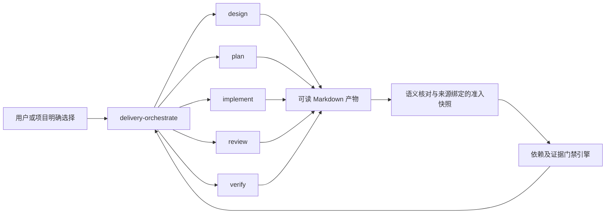

# Delivery 五能力与交付编排设计

| 文档说明 | 内容 |
| --- | --- |
| 版本 | 1，2026-10-15 |
| 目标与基线 | skills 仓库；原有文件的起点摘要见 evidence/protected-baseline.json |
| 设计来源 | 本会话逐项确认的职责、目录、质量、演进和调度原则；实施授权原文见 authorization.md |
| 成文依据 | delivery-design/契约 1；加载时的规范副本与摘要见 evidence/authoring-skills.json |
| 决策状态 | 用户已确认原则；具体实现取舍由本次明确授权下的模型决定，见 decisions.md；不声称逐字段获用户批准 |
| 实施和验收 | 由 implementation、review、verification 和 runtime 记录实际事实，本文不维护实时进度 |

方案概览：保留原有 workflow，在 delivery 命名空间建立五个完整的独立能力和一个编排器。各能力使用人和模型均可阅读的 Markdown，包含自己的内容标准、工作边界和留存要求。编排器读产物、核对语义后生成绑定来源版本的准入快照，脚本根据声明依赖和真实证据执行状态检查。实现与审查分离，变更使受影响结论待核对，历史失败和收尾保留。新体系只在用户或项目明确选择后使用。

## 1. 背景、目标与范围

旧 workflow 将设计、规划、实施、审查、验证与状态格式集中绑定。现有设计和规划 skill 已有较完整的内容规范，但直接替换并不能自动保留旧流程的机械门禁。目标是把内容能力和流程控制解耦，同时保留质量责任。

| 目标 | 机制 | 验收 |
| --- | --- | --- |
| 五项能力可独立调用 | 每项自带规范、模板或参考、报告规则，不依赖编排代码 | AC-01 |
| 人和模型都能承接 | Markdown 解释依据、行为、证据和限制，稳定标识用于引用 | AC-02 |
| 组合后不漏质量环节 | 显式依赖、独立审查、逐项验收及完整收尾检查 | AC-03 |
| 历史和在途工作可追溯 | 原始对象快照、事件留存、版本绑定与显式重接纳 | AC-04 |
| 原有机制继续可用 | 旧目录和入口不修改；新系列显式选择 | AC-05 |
| 能持续更新 | 契约版本、实际修订、兼容分类与组合回归 | AC-06 |

范围包含六个 skill、编排脚本、针对性测试、示例、安装与本地提交；不改旧引擎、不迁移历史 `.workflow`、不创建在线服务、不 push。新引擎不是自动调模型的 SDK；编排模型按 skill 协议组织工具和子 agent。

## 2. 现状分析与影响范围

原 design-tech-doc 与 plan-implementation 已分别复制为 delivery-design、delivery-plan。两个新副本保留原检查代码并补充交付约定，已有 44 项设计检查与 14 项计划检查测试；这些只是当前检查器的机械测试，不能作为六技能整体质量证明。

| 位置 | 本次变化 | 保护要求 |
| --- | --- | --- |
| delivery-design、delivery-plan | 接入统一选择、版本与编排映射规则 | 保留专业正文规范，不降低内容要求 |
| delivery-implement、delivery-review、delivery-verify | 新增完整自包含能力 | 不互相导入代码，不依赖 runtime |
| delivery-orchestrate | 新增编排协议与状态引擎 | 状态只由脚本更新，不能改写能力结论 |
| docs/delivery/本目录 | 本次设计、执行与证据 | 仅实际产物，不制造空阶段完成记录 |
| 旧 skills 与其他现有文件 | 不修改 | 按起点摘要核对；不混入本次提交 |

仓库要求每个 skill 自包含且无共享运行代码。因此共同约定在各能力中保留其必要部分，编排器维护完整接入语义和自己的脚本，兼容测试检查边界一致性。

## 3. 总体方案与技术取舍

能力可以由人直接调用，也可以由编排器调用。图中的箭头表示组织关系，不代表必须每次执行五个环节。已有有效设计、计划或代码可以选不同入口；当前目标的审查和验收要求仍须明确。

| 编号 | 决定 | 依据与代价 |
| --- | --- | --- |
| D-01 | 五能力与编排独立，旧系列保留 | 已确认；避免将新机制强加给历史任务，过渡期有相近规范 |
| D-02 | Markdown 为专业内容真源，编排侧 JSON 是版本绑定的接纳快照 | 质量优先选择；避免让独立使用承担机器格式；需审查映射的语义正确性 |
| D-03 | runtime 采用锁保护的原子事件账本和内容寻址对象 | 质量优先选择；便于中断恢复，单工作目录一个写入协调者；不追求分布式并发 |
| D-04 | 按实际文件范围绑定，支持目录中新增和删除 | 已确认版本追溯原则；范围过宽会保守失效，范围遗漏仍需语义审查发现 |
| D-05 | 独立审查与逐项证据分开，限定交付不改验证事实 | 已确认；未知或缺证据不能通过风险接受洗成通过 |
| D-06 | 新入口显式选择，质量决定 agent 分工 | 已确认；独立性是硬约束，不以模型型号或调用次数证明 |
| D-07 | 独立默认不提交，完整编排可按边界自动本地提交 | 已确认；不 push，不混入已有用户修改 |
| D-08 | 首版采用契约 1，未知版本拒绝；更新须评估语义 | 已确认；不实现自动迁移或多版本长期维护平台 |

不采用只按自然语言“完成”推进，因为不能可靠发现证据过期；也不将五个能力绑到统一运行库，因为会破坏独立使用和仓库自包含要求。首版接纳 JSON 由模型产生，但来源、摘要、依赖和证据规则由确定性脚本检查；模型判断本身仍需独立审查。

## 4. 功能详细设计

### 五项能力

| 能力 | 核心产物 | 必须保留的内容 | 权限边界 |
| --- | --- | --- | --- |
| design | design.md | 目标、现状、机制、取舍、契约、验收、决定 | 不实施、不批准自己 |
| plan | plan.md | 任务、依赖、细化、审查组、验收组、记录入口 | 不维护实时实施状态 |
| implement | implementation/序号.md | 依据边界、实际改动、自检、偏差遗留、交接 | 改授权产品与正式测试，不把自检当验收 |
| review | review/序号.md | 范围版本、规格结论、质量结论、问题证据、复审 | 不修被审产品，不冒充独立性 |
| verify | verification/序号.md | 依据对象、覆盖方法、执行证据、逐项判断、后续 | 可隔离探针，不改产品与正式测试 |

文档内容按实际风险展开，表格用于并列信息，文字说明因果和取舍。模板可合并章节，但不能丢失必要语义。正式活动留存失败、阻塞和未检查范围；用户明确只讨论或不写文件时遵从，不伪称已保存。

### 编排接纳与推进

先读取用户范围和已有记录，确认使用新体系；再选入口。设计和计划的真实确认按内容与适用条件承接，不重复审批。当前用户已授权模型按质量优先处理实现歧义，授权原文单独留存，不能扩大到其他项目。

编排器建立任务、审查、验收的联合依赖图。任务依赖可等待产物形成、审查通过或验收通过；审查和验收自动依赖其覆盖任务，循环必须拒绝。每项任务具有审查与验收归属，至少一个整体审查覆盖全交付。组内客观可接入条件与跨组门禁分别判断。

主 agent 或子 agent 承担适合自己的工作，按预期质量选择。审查者的身份和上下文必须不同于相关实现者；执行身份是可检查声明，脚本不能密码学证明“真是另一个人”，编排报告须保留真实调度来源。

### 证据与修复

命令运行保存 argv、环境说明、退出结果、标准输出、错误输出和前后产品快照。命令成功只是原始证据，还需验证者逐项判断；执行改变被验收产品时证据不能直接用于通过。人工项须有项级来源与实际确认摘录；内容检查有具体产物证据。

失败问题保留稳定身份。修复返回实施，计划缺项返回规划，机制变化返回设计，单纯证据缺口返回验证；不由审查者修产品。复审默认覆盖原问题和修复影响，影响无法界定时扩大。连续重复失败且无新证据时停止原样重试，换诊断策略并记录；需要扩大授权或违反硬约束时不能自行越过。

### 恢复与收尾

每个写操作有稳定操作 ID；同 ID 同内容重试返回原结果，内容不同则拒绝。事件账本原子更新，原始对象先保存，崩溃最多留下未引用对象；账本损坏或未知版本不能猜测恢复。

来源或产品变化后，当前结果标为需核对而非抹掉旧结果。重新读取来源、明确影响并重新接纳；仍适用的原始证据可复用，无需为版本变化机械重跑全部检查。完整收尾要求当前实施、独立审查与所有必需验收就绪。限定收尾仅接受有实际失败证据、允许豁免且经用户明确接受的项目，保留原不符合项；未知、缺证据和不可豁免约束不能借此放行。

closed 后拒绝继续写活动记录，显式 reopen 开启后续活动；历史收尾保留。关闭后产品变化须说明当前证据已不适用，不能拿旧关闭状态证明新版本。

## 5. 接口与集成设计

人机接口是各 SKILL.md 及渐进加载的内容规范；运行接口是编排器自己的 `scripts/delivery.py`。CLI 的最终字段与完整样例以 [runtime-api.md](../../../delivery-orchestrate/references/runtime-api.md) 为准，避免在设计与手册维护两份可变 Schema。

| 接口 | 作用 | 不承担 |
| --- | --- | --- |
| init / configure | 创建工作状态，接纳来源与依赖声明 | 不生成用户批准，不调用业务实施 |
| record | 接纳实施、独立审查、验证的实际报告 | 不根据文件存在自动批准语义 |
| run | 执行已声明验收命令，保留真实输出 | 不将退出码 0 转为整体验收通过 |
| status / check / next | 派生状态、检查门禁、列出可做项 | 不修改能力原文或授权 |
| close / reopen | 校验收尾并保存历史，显式继续 | 不覆盖失败和旧关闭记录 |

源文档、报告及证据路径限制在项目内；目录范围包含新增、删除及未提交文件，不能只绑定 HEAD。默认目录有排除自身工作目录与版本库内部数据的规则，避免生成报告反过来使产品证据循环失效。越界路径和无法安全解释的符号链接拒绝并解释。

运行代码仅在编排 skill 中共享。安装仍使用仓库 install-skill.sh；安装前检查新名字是否已有其他内容，不能覆盖无关目录。各新 skill 提供明确选择规则，Codex policy 也标为显式调用；其他客户端仍须遵从 skill 入口文字，不能承诺所有客户端有相同发现机制。

## 6. 验证与验收

| 验收 ID | 可判定要求 | 验证手段 |
| --- | --- | --- |
| AC-01 | 六个 skill 可校验且引用可达；五能力不导入编排代码 | 包结构检查、实际独立行为演练 |
| AC-02 | 三类新报告规范、模板、填充示例完整，事实/结论/限制可区分 | 独立内容审查及真实案例输出 |
| AC-03 | 正常流程可闭环；循环、伪独立、失败漏处理、缺验证不得放行 | 引擎单测、CLI闭环、独立负向探针 |
| AC-04 | 新删改、原证据篡改、重试冲突、关闭后变化可识别；历史保留 | 文件系统与进程测试 |
| AC-05 | 原有文件摘要一致，六项新入口可用且不替代旧入口 | 保护清单比对、安装软链检查 |
| AC-06 | 未知契约拒绝；更新或重接纳不伪造授权，现有两检查器回归通过 | 兼容案例及真实测试输出 |

检查器测试、行为演练和独立审查分别报告。有限案例通过不能承诺所有模型与任务均不会退化；新旧机制对照检查质量责任与失败处理，不要求复制旧流程的每个步骤。

## 7. 风险、假设与未决问题

1. 机器准入映射可能遗漏语义：保留来源快照及映射者，独立核对覆盖；脚本不宣称理解所有自然语言。
2. 同一文件承载多个任务时，范围绑定可能保守失效：允许有理由的重新核对，不允许直接清除错误。
3. agent 身份和人工确认来源仍依赖可信会话采集：脚本校验引用和声明，不把用户可编辑文件当不可伪造签名。
4. 引擎首版针对本机单工作目录，锁为本机进程协调；不支持远端多写者、任意历史格式自动迁移。
5. 实施中的重大选择与需查看内容持续记入 decisions.md；本次授权允许先完成，未声称用户已逐项批准这些选择。
