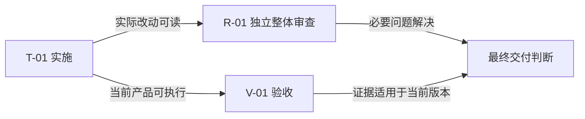

# label 前缀实现计划

计划版本 1，2026-10-15；delivery-plan 契约 1。skill 基线为仓库 646d9845f1ca79b3d9385c5cf37734c2d97bd504 加当前工作区规则，SKILL.md 指纹 f1792a10625991a26d385dc11a79858784652c12c0589fe5e77bd8cb20e8abcb；完整快照见行为样本 manifest。当前仅完成规划，不表示获得实施权限或产品验收。

本次将 label 的前缀作为调用者控制的字面文本加入结果，保留默认行为。一个实施任务同时修改函数和正式测试，一个独立审查组检查完整改动，一个验证组覆盖全部验收。项目没有独立设计，无需为本改动另建；明确设计依据内嵌下文。

## 1 计划定位与设计承接

| 对象 | 依据及范围 |
| --- | --- |
| 项目现状 | 实际读取 ../../../label.py：唯一函数返回 text.strip()；文件 SHA-256 3d48d2569b8bd769cb429ba7770789367f5ed0c7c2a35ca6e392e2ecccb1d0d4；隔离项目无版本库 |
| 需求与授权 | ../../../request.md；仅允许规划，不允许实施或运行产品测试 |
| 目标 | 增加 keyword-only prefix: str = ""；返回 prefix + text.strip() |
| 约束 | 不裁剪 prefix、不插入分隔符；旧调用结果不变；调用者保证 str；不新增依赖、I/O、UI |
| 设计阻塞 | 无；局部测试组织由实现者选择，不改变上述行为 |

| 决策 ID | 决定与理由 | 判断来源 | 确认状态及凭据 |
| --- | --- | --- | --- |
| D-01 | keyword-only 可选前缀，默认空；调用方控制排版，保持原有调用兼容 | 模型判断，本次请求转述 | 用户已确认：request.md 明确确认上述机制；仅设计确认，非实施授权 |

## 2 交付分解与覆盖关系

| 任务 ID | 交付成果 | 设计引用 | 前置依赖 | 验收与验证归属 |
| --- | --- | --- | --- | --- |
| T-01 | 修改 label.py 并新增正式回归测试 | D-01 与第 1 章 | 实施授权及同版本基线 | AC-01、AC-02、AC-03、AC-04、AC-05；V-01 |

| 验收 ID | 要求及预期 | 任务与审查 | 验证组 | 证据入口 |
| --- | --- | --- | --- | --- |
| AC-01 | label(" x ") == "x"，默认兼容 | T-01、R-01 | V-01 | 待执行，verification/ |
| AC-02 | label(" x ", prefix=" p ") == " p x"，前缀空白保留 | T-01、R-01 | V-01 | 待执行，verification/ |
| AC-03 | label("   ", prefix="p") == "p"，空正文 | T-01、R-01 | V-01 | 待执行，verification/ |
| AC-04 | label(" x ", prefix="中文") == "中文x" | T-01、R-01 | V-01 | 待执行，verification/ |
| AC-05 | label("x", "p") 引发 TypeError，prefix 为 keyword-only | T-01、R-01 | V-01 | 待执行，verification/ |

## 3 依赖、阶段与启动条件

单阶段，一次细化完整。T-01 启动条件为获得实施授权且基线未发生未评估变化。R-01 与 V-01 在实际修改形成后可分别开展；均不反向阻塞 T-01 的首次实施。不存在共享文件的并行实施者。

| 前置对象 | 后续对象 | 依赖类型 | 满足条件 |
| --- | --- | --- | --- |
| T-01 | V-01 | 验证前置 | 函数与测试形成，执行环境具备 Python 3 |

审查依赖由上方关系和第 5 章语义核查，轻量脚本不覆盖它。仅安排一个组，不新增无依据的提前审查门禁。

## 4 任务说明

### T-01 前缀函数及正式测试

| 字段 | 内容 |
| --- | --- |
| 细化状态 | 已细化 |
| 目标与产物 | 修改 label.py；拟新增 test_label.py，记录真实实现和自检 |
| 设计依据 | 第 1 章 D-01；验收 AC-01 至 AC-05 |
| 范围与约束 | 仅函数及测试；遵循第 1 章输入和副作用约束 |
| 前置与启动条件 | 获得实施授权；重新核对 label.py 基线 |
| 必读材料 | ../../../request.md、../../../label.py、本计划第 1、2、5 章 |
| 代码位置 | 既有 label.py；拟新增 test_label.py，当前不存在 |
| 实施步骤 | 见下方有序步骤 |
| 验收与验证归属 | AC-01 至 AC-05，V-01，独立整体审查 R-01 |
| 反馈触发条件 | 发现调用者依赖不同签名、类型假设变化或修改越界时反馈；不能扩大输入兼容承诺 |

1. 核对基线和授权，给函数增加 keyword-only prefix，返回字面拼接结果。
2. 在正式测试中用标准库 unittest 覆盖第 2 章五个断言，避免新依赖。
3. 获授权后执行必要自检并检查实际差异，保存 implementation/ 实施记录，附实际命令与结果。
4. 交给 R-01 与 V-01；发现失败时回到实施并保留原问题。恢复方式为撤回本次函数及新增调用的改动，不删除不属于本次的变更。

## 5 验证组织与完成判定

### R-01 独立整体实现审查

覆盖 T-01 全部改动、正式测试及产品调用兼容；审查者不得是相关实现者。直接读需求和实际代码，分别判断规格符合性、实现质量；重点检查 keyword-only、默认兼容、前缀字面语义及未引入副作用。实际改动形成后启动，阻断最终交付。原问题与修复影响范围复审；扩大契约时扩大审查。此组兼任整体审查，无遗漏其他组。

### V-01 当前版本行为验收

执行环境需有 Python 3，测试数据见第 2 章。实施时选择并记录实际测试入口；拟采用 `python3 -B -m unittest discover -p 'test_label.py' -v`，测试文件当前尚不存在，此命令未执行。逐项对照 AC-01 至 AC-05 的真实断言结果，不能仅凭退出码判覆盖完整。记录产品指纹、环境、命令、实际输出与逐项结果。

最终交付要求：产物形成、独立审查无未处理阻断、五项验收具备当前有效证据、范围内无遗漏。本计划不产生这些事实。修复影响函数时重验相关断言及默认兼容，保留原失败；无关变化不机械使全部证据失效。例外需明确授权且不能掩盖缺证据，调用方作收尾判断。

## 6 执行记录与恢复约定

| 权威入口 | 职责 |
| --- | --- |
| implementation/，尚未建立 | 实际改动、自检、偏差、未完成项 |
| review/，尚未建立 | 独立审查、稳定问题标识、修复关系 |
| verification/，尚未建立 | 逐项证据、版本、适用环境、不符合与未验证 |
| runtime/，仅未来明确接入编排时建立 | 编排推进与收尾状态，非本 skill 维护 |

不维护第二份实时状态。恢复先读实际记录、核对当前产物与证据绑定，再判断下一步；本次未实施、未运行产品测试，不预建成功日志。

## 7 检查、细化与变更

| 检查 | 结果 |
| --- | --- |
| 设计承接与范围 | 默认兼容、字面前缀、keyword-only 和无额外功能均有任务及验收归属 |
| 联合依赖 | 单任务向审查和验收出边，无回边；无循环，审查关系由语义检查补足 |
| 可交接性 | 代码路径与新增路径分开；当前一次细化完整 |
| 权限与真实状态 | 来源和确认分开；仅规划授权，未实施未验收 |
| 机械检查 | 成文后运行 check_plan.py；具体输出另存；该结果不构成批准 |

变更记录：无，首次成文。后续拆并保留 T-01 映射；契约变更先确认并评估相关验收。计划定义调整不改外部执行记录。
