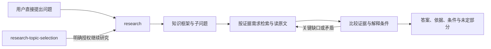

# Research 整合设计

本文件是工作流 research-unification（2026-10-16）的设计记录，承接本次对话已确认的职责、研究方法与实施范围。

## 一句话方案

将 research-router 与 clippings-research 整合为可独立使用的 research，把知识发现、检索路由和证据分析连成问题驱动的研究流程；research-topic-selection 保留为可选上游。

## 背景与目标

旧 research-router 明确只做路由，缺少问题拆分、知识探索、证据比较与迭代补查；clippings-research 已有问题研究闭环，但入口和资料定位仍带有收藏色彩。两者分别扩展为通用研究会重复维护规则。用户确认将完整能力整合到 research，研究选题仍负责价值和优先级，直接提出的问题无需经过选题。

承接当前两个包的有效规则与本次对话，不把历史验证解释为新版本验证。深度同时包括找到必要知识与可靠分析，而非固定轮数、来源数或报告长度。用户已确认默认资料研究；需要实验时说明目的与方法，得到实测请求后再进入实验。

## 做法

研究先确认问题与材料约束，在方向不清时询问一个关键问题。问题明确时先建立必要的知识框架，再按子问题选择来源；探索与定向深挖可以往返，不要求固定阶段表或报告。关键词扩展覆盖术语、别名、中英文与相关领域；引文追踪同时查原始依据和后续修正。扩展只服务原问题，不自行改变目标。

来源按主张类型使用：文档、代码、研究结果和社区线索承担不同作用。原文、独立性、日期、版本与适用条件进入判断；补查针对会改变理解或结论的缺口。重要冲突未解决时缩小结论，渠道失败不等于不存在；穷举限于明确的有界范围且验证分页、截断与结束条件。

研究默认在对话交付，长度按问题复杂度调整。个人资料是按需证据，无收藏不阻断；用户明确限定单文件、仅本地或只查网络时遵守范围。保存仅在明确请求时衔接现有写入能力，不改阅读状态或长期记忆。选题可单独读取检索参考，只运行发现和价值判断，不启动完整研究或实验。

## 备选与取舍

不保留两个同级研究入口，避免按证据来源拆分同一流程。保留现有工具与按需参考文件，不新增研究执行器或依赖。采用同仓库参考路径供选题复用检索方法；缺少研究包时，选题仍使用自身规则与环境可用工具，不伪称完成交接。旧版归档且退出安装，不保留多个自动触发的别名。

## 明确不做

不改变选题价值判断与反馈保存规则，不合并选题和研究，不修改第三方 agent-reach 或 last30days；不把某客户端的固定工具状态当作所有环境事实。不自动实验、安装研究对象、修改项目、保存研究、写长期记忆或推送仓库。不保证全网穷尽、统计质量提升或所有客户端已刷新运行中的会话。

## 验收标准

- research 可独立触发，研究问题明确时不重复选题；选题继续研究交接可复用范围与线索。
- 正文与参考覆盖知识结构、术语扩展、跨来源发现、前后追踪、补查、反证与停止条件。
- 行为案例实际执行覆盖独立研究、交接、知识发现、矛盾、材料限制与渠道失败；区分实际观察与未测场景。
- 原七份文件归档后内容摘要与基线一致；活动引用迁移，历史验证文本不改写。
- 两处客户端 research 链接指向本仓库，旧两种安装链接移除；路径、结构与 diff 检查通过。

## 决策摘要

| ID | 决策 | 来源 |
|---|---|---|
| D-01 | 合并为 research，可独立研究或接收选题交接；research-topic-selection 名称与上游职责保留 | 用户 |
| D-02 | 深度包含知识框架、术语扩展、多来源发现、原始依据及后续修正追踪 | 用户 |
| D-03 | 按问题比较证据、检查反证、针对缺口补查，按证据充分性停止 | 用户 |
| D-04 | 个人资料按需，遵守材料范围；默认资料研究，实验另有明确请求 | 用户 |
| D-05 | 主体与路由、站点、个人资料参考分开；沿用工具，不新增执行脚本 | 用户 |
| D-06 | 旧版归档保留历史，更新选题及 folo 引用，验证后切换两处安装 | 用户 |
| D-07 | 做结构与独立行为验证，明确证据范围，不把案例定义当已执行 | 用户 |

## 接口与数据形状

目标包为 research/SKILL.md、references/search-routing.md、references/sites.md、references/local-context.md 与 test-prompts.json；新验证摘要记 research/validation.md。正文遵循仓库四段式；description 承重信息前置并控制在249字符内，作为本仓库兼容约定而非跨运行时通用断言。

选题交接使用自然语言五项：问题、用途、范围及约束、已有线索、待验证判断；不要求新协议或固定 JSON。检索参考有直接消费边界，选题读取不触发完整研究。参考相对路径在任意已安装软链接入口仍可解析。

旧包迁移到 Archive/research-unification-2026-10-16/ 下对应原目录；保持字节不变。维护中的 research-topic-selection/SKILL.md、test-prompts.json 和 folo/SKILL.md 更新旧名引用，历史 validation.md 保留原语义。

## 已知限制

行为验证为 4 次实际执行、关联 6 类案例定义的观察，精确运行模型 ID 未暴露；没有旧版本对照、重复采样或统计改进结论。尚未独立执行完整有界枚举、宽泛主题澄清、收藏通知不触发及专门实验边界四类模板；上游单独消费检索参考与缺包降级仅有文本和路径审查。

交接验证使用明确源码入口；安装验证只检查磁盘链接，均不证明客户端自动发现、自动触发或运行中会话刷新。未验证真实反馈或研究成果保存。站点旧实测只作有日期的历史线索，本次不逐站重验登录、凭证或全平台搜索。原历史记录中的旧路径保留，当前档案由归档映射解释；基线七文件中的已忽略 `.DS_Store` 仅保留于本地归档。

## 实际交付

2026-10-16 已完成以下交付：

- 新建 `research/SKILL.md` 与检索、站点、个人资料三份参考，保持独立入口；新增 10 个案例定义和据实编写的 `research/validation.md`。没有新增研究执行器。
- 选题正文按需消费同仓库 `../research/references/search-routing.md`，继续研究进入 `../research/SKILL.md`；原选题价值、深度与反馈契约保持。更新选题案例与 folo 的指定活动引用。
- T2 三次实际研究及 T3 一次源码入口交接分别经独立语义审查 pass，关联 6 类案例定义；原始请求、答复、工具证据、版本和审查声明留存在本地 `.workflow/research-unification/reports/`，不把定义数量当执行次数。
- 先核对安装目标并新装 research、验证两处链接，再移除四个已核实的旧链接。`~/.claude/skills/research` 与 `~/.agents/skills/research` 均指向本仓库 `research/`。
- 两个旧包移至 `Archive/research-unification-2026-10-16/` 下对应原目录，七文件摘要与基线一致，历史验证文字保持不变；六个原跟踪文件进入归档提交。
- 完整交付检查器、三个受影响包的 `quick_validate` 与限定范围 diff 检查通过；结构、行为审查和安装各有不同证据范围。整体终审、workflow verify/close 由本地工作流另行记录，本记录不替代其证据。
