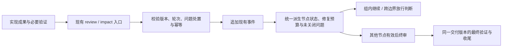

# 工作流审查收敛：正确验收与重复开销削减

| 文档说明 | 内容 |
| --- | --- |
| 版本与日期 | 1.0，2026-10-15 |
| 设计状态 | 本会话中的行为规则已由用户逐项确认；本文是整合后的设计稿，尚未经过整篇独立审查 |
| 实施与验收状态 | 尚未实施；没有本次代码测试、运行提效或质量对照结果 |
| 代码基线 | skills 仓库 `d8cb702a5aad0c722345e08aa75d743c43b328ce`；成文时 `task-workflow/` 无未提交修改 |
| 依据 | 本会话的实现审计与逐项确认；[原审查粒度设计](workflow-review-granularity.md)；现有引擎与协议 |
| 关联计划 | [工作流审查收敛实现计划](../plans/workflow-review-convergence.md) |
| 实施边界 | 本次只交付设计与计划。后续实施限于本文范围，不自动授权修改代码、启动工作流或发布 |

方案概览：本次修补节点制审查中的结论覆盖、修复计数、终审和恢复确认绑定问题，并补齐已知问题的关闭记录。节点各自保有审查结论，谱系继续继承历史和修复预算；同一轮集中修复可以产生多条复核记录，但只计一轮。终审、最终验证与收尾复用同一套交付版本绑定，版本变化优先补充差异复核。通过增量展示、集中影响判断、共享验证和定向复核减少重复工作；实际总耗时是否下降仍需运行取证，格式 4 继续保持非默认。

## 1 背景、目标与范围

用户的核心要求是：降低执行阶段审查频率和重复开销，同时保持任务完成质量。当前实现已经有审查节点、两态验收和失效检查，但部分机械规则混淆了审查记录、修复轮次和版本覆盖，反而造成重复确认与流程阻塞。

| 目标 | 要解决的具体问题 | 成功口径 |
| --- | --- | --- |
| 正确保留验收结果 | 拆分后的子节点共用谱系最新记录，彼此覆盖 | 子节点分别通过后可同时有效，后续失败不回退到旧通过记录；AC-01 |
| 正确限制修复 | 子节点首审、多条同轮记录被误计成多轮修复 | 正常拆分首审不扣预算，同轮只计一次，第三轮仍被阻止；AC-02、AC-03 |
| 终审覆盖实际交付 | 终审可以提前记录，且未绑定最终完整版本 | 其他节点当前有效后才能终审；终审、验证、收尾版本一致；AC-04、AC-05 |
| 恢复确认不能错配 | 旧确认可以配合新的提交参数放行新阶段 | 凭据携带实际确认版本，参数不能改写授权对象；AC-06 |
| 减少重复判断 | 每次新增范围外变化都重新展示全部历史并逐节点操作 | 增量阅读、集中分析、批量提交，仍逐节点确认完整快照；AC-07 |
| 已知问题不遗失 | `open_issues` 恒空，跨轮次继承依赖文字纪律 | 稳定编号、自动继承、有据关闭，阻断项未关闭不能验收；AC-08 |
| 控制实际成本 | 少了审查节点，却增加影响判断、重复复核和记账 | 用总耗时及操作量评估；保留质量门；AC-09、AC-10 |

范围包含格式 4 的现有审查入口、事件与派生状态、必要测试和协议对齐。格式不高于 3 的执行行为、独立计划语义审查、最终验证和收尾要求继续保留。局部可验证修复由主控验收，复杂或扩大影响的修复做独立定向复核，终审原有独立性要求继续适用。

不在本次范围：多智能体调度改造、自动语义依赖分析、多写者事务、独立问题管理产品、已送审节点的多前身合并，以及格式 4 默认启用。非 Git 环境的完整节点失效检测也不在本次补齐范围；效果评估限于 Git 项目，不能据此宣称非 Git 情况安全。

## 2 现状分析与影响范围

以下入口已按上述代码基线核对。行号随实施变化，函数名是后续定位依据。

| 对象 | 当前作用与缺口 | 本次变化 |
| --- | --- | --- |
| `node_review_index`、`invalidation_report` | 最新结论按谱系和阶段索引，拆分子节点互相覆盖 | 将当前结论归属细化到节点，继续复用统一状态派生 |
| `node_review_count`、`round_count`、`round_cap_problem` | 同谱系记录数减一作为修复轮数，封顶后一律拒绝审查 | 区分首审、同轮成员结果及新一轮修复，统一计数与入口校验 |
| `wait_graph`、`node_state` | 已有终审等待所有其他节点、当前验收有效性判断 | 直接复用于终审送审检查和落账复查 |
| `review_node` | 只闸本节点实现条件；记录没有完整交付绑定，问题列表固定为空 | 接收必要审查元数据、问题变更和终审绑定 |
| `_binding`、`fingerprint`、`acceptance_fingerprint` | 最终验证已有工作树与计划验收指纹 | 复用于终审、修复成果快照及恢复确认，不新造指纹算法 |
| `resolve_confirmation_*`、`confirmed_version_binding` | 凭据与调用方提交范围分别检查；后续提交检查不含未提交变化 | 校验凭据自身的版本绑定，覆盖工作树变化 |
| `cmd_impact`、`binding_matches` | 逐节点提交，完整变化集相同才复用 | 保留完整绑定，增加历史判断与增量展示、批量输入 |
| `read_events`、派生状态、投影修复 | 事件权威，单主控串行追加，计划状态是投影 | 新字段参与校验、幂等摘要、重放与展示；复用现有写入路径 |
| `SKILL.md`、协议、README | 有两轮与旧修复波次等不同口径 | 按适用格式统一，明确首次审查、修复轮次与差异确认的区别 |

代码入口：[workflow.py](../../task-workflow/scripts/workflow.py)；测试入口：[test_workflow.py](../../task-workflow/tests/test_workflow.py)；运行协议：[dispatch-protocol.md](../../task-workflow/references/dispatch-protocol.md)。

已有结构校验和测试不能证明实际审查充分或总耗时下降。本次成文没有重跑项目测试；此前审计结果不充当本次改造的验收结果。

## 3 总体方案与技术取舍

### 3.1 一套事件记录，分别表达三种事实

1. **节点结论**回答当前节点是否通过，以及结论覆盖哪个版本。
2. **谱系修复历史**回答已经用了几轮集中修复，不随拆分、改名或会话恢复清零。
3. **问题处置记录**回答发现过什么、影响哪里、凭什么关闭，不由一份新的空清单覆盖历史。

终审、恢复确认和修复成果快照共用交付绑定设施；普通节点继续按本节点实现、前提和影响判断确定有效性，不把所有普通节点都改成整树绑定。

图中箭头表示处理与数据流；不增加独立审查阶段或问题审批流程。

### 3.2 关键决策与确认依据

除用户直接提出的收敛要求外，下表方案均为模型提出、用户明确认可。确认依据来自本会话的逐项答复；不将模型自检写成用户对整篇文档的批准。

| 编号 | 决定及适用边界 | 理由 | 用户确认依据 | 设计落点 |
| --- | --- | --- | --- | --- |
| D-01 | 限制范围，优先总耗时下降，保留质量门与已有审查分流 | 避免用更多规则抵消审查收益 | “不要扩大复杂度，现在是收敛” | 第 1、7 章 |
| D-02 | 当前结论按节点隔离，历史与预算按谱系继承 | 同根不等于共用一份结论 | “可以，按这个原则” | §4.1 |
| D-03 | 前身已通过的正常拆分，子节点首审不计修复轮；未解决失败的拆分继续承接预算 | 区别新节点验收与延续修复，防换 ID 清零 | “可以，按这个边界” | §4.2 |
| D-04 | 同轮固定参与节点和修复版本，分别复核只计一轮；失败再修进入下一轮 | 避免多条复核记录重复扣预算 | 对同轮方案答复“可以” | §4.2 |
| D-05 | 其他节点当前验收有效，才允许正式终审；送审前和落账前检查 | 终审判断必须建立在已验收成果上 | “可以，按这个规则” | §4.3 |
| D-06 | 终审、最终验证、收尾匹配完整交付绑定；变化后按差异补充确认 | 防止旧结论放行新版本，控制重审范围 | “认可” | §4.3 |
| D-07 | 新阶段确认凭据绑定实际确认版本，调用参数不得覆盖 | 防止旧确认与新提交范围错配 | “认可，按这个规则” | §4.4 |
| D-08 | 每批集中判断新增差异及组合影响，批量提交，逐节点绑定完整快照 | 减少重复阅读与操作，不推定全局无关 | “认可，按这个规则” | §4.5 |
| D-09 | 问题稳定编号、自动继承、显式有据关闭；按影响范围阻断验收 | 防止跨复核、拆分和阶段的问题丢失 | 对问题闭环方案答复“可以” | §4.6 |

备选取舍：继续按记录数计轮不能满足同轮多子节点的语义；按文件分别缓存“无关”再自动合并，不能证明组合变化无影响；额外建立修复批次引擎或问题系统会扩大实施与维护成本。因此只在现有事件中补充必要归属信息，继续按完整快照校验影响判断。

## 4 功能详细设计

### 4.1 节点结论不再相互覆盖

最新审查记录按“谱系、当前节点 ID、当前审查阶段”查找，然后检查该记录是否通过、版本是否匹配，以及原有失效条件。必须先取最新记录，再判断版本；不得寻找一条更早且恰好匹配的通过记录来抵消后续失败。

拆分出的节点在自己的验收完成前保持未验收；前身的通过不自动成为子节点的通过。N3、N4 各自通过后可以同时有效。N3 后续失败只替换自己的当前结论；实际变化若影响 N4，仍由原有前提、影响判断和问题范围规则使 N4 暂停或待复核。

失效历史仍保留在谱系中，但是否否定当前结论，须核对现有记录中的“所否定结论”及关联范围，不能仅因谱系相同就使兄弟节点失效。没有自己验收记录的子节点本来就未验收，不靠继承旧通过绕过历史问题。跨节点实际影响仍分别检查，不能借结论隔离漏掉。

谱系和阶段继续从既有前身链继承。开启新阶段后，不沿用旧阶段的节点通过结论。

### 4.2 首审豁免与同轮多节点复核

| 场景 | 轮次处理 |
| --- | --- |
| 谱系首次审查 | 不计修复轮次 |
| 前身已通过，正常拆分后的子节点首次验收 | 不计修复轮次，但保留谱系已用预算 |
| 前身失败且未解决，拆分后继续处理原问题 | 进入谱系下一轮集中修复，子节点不能按免费首审处理 |
| 同一轮内，不同参与节点提交各自正式结果 | 共用一轮，只在首条正式结果落账时计一次 |
| 本轮某节点失败，针对结果再次修复后复核 | 新一轮；不能继续使用旧轮次 |
| 同操作 ID、同请求重试 | 重放原结果，不新增轮次或问题 |

前身状态沿该节点的前身链判断，不能拿兄弟节点的通过代替前身失败。正常拆分首审失败，只是发现问题；之后的修复和复核才使用下一轮预算。

一次集中修复送审前固定轮号、参与节点及其声明版本、修复成果的交付绑定。首条复核记录承载本轮信息，其他记录关联它；全部信息仍位于审查事件中，不另建可变批次台账。主控在启动修复前检查余量，引擎在首条结果入账及后续关联时校验。

同一节点在同一轮只有一次正式结果。换操作 ID 不能覆盖结果；同 ID 重试按幂等处理。同轮成员必须来自同谱系、同阶段，且对应固定版本；不允许追加新成员或用新成果冒充旧轮次。

通常收齐本轮结果后再修下一轮。中途确需修改本轮相关成果时，本轮可以提前结束：已用预算保留，未复核成员仍未验收；新成果使用下一轮上下文，并说明提前结束依据。旧轮次随后不再接受新的成员结果。第二轮第一份结果落账后，仍允许第二轮其他成员提交；封顶拦的是开启第三轮。

版本重确认本身不代表又完成了一轮问题修复；纯差异确认不以审查记录条数扣预算。若处理的是既有失败或未关闭问题，则必须归入修复轮，不能以“更新版本”为名绕过上限。这是“预算计集中修复”的统一口径；不减免实际发生的修复轮次。

### 4.3 终审顺序与完整交付绑定

最后一个节点继续兼任整体终审。主控送审前、引擎正式记录结论前，都使用当前有效性判断检查所有其他节点。曾经通过但已经失效、暂停或带有未关闭阻断项的节点，不能满足前置条件。只检查其他节点，不要求终审节点先验收，单节点工作流可正常终审。

终审送审时生成交付绑定并交给审查者。结论落账时回传该绑定，与当前绑定比较，一致才能记录；不得审完后才读取新版本并声称它已被审查。审查期间变化时先补充确认，再形成对应新版本的结果。

终审通过后，`verify` 与 `close` 都检查最新终审结论绑定当前交付版本；最终验证继续按原有规则检查执行期间版本稳定、证据有效与验收覆盖。收尾要求终审、有效验证结果和当前交付绑定一致。

| 终审后的变化 | 处理 |
| --- | --- |
| `.workflow/` 记账、任务状态等已排除内容 | 沿用现有指纹排除口径，不引入新失效 |
| 工作树或计划验收指纹变化 | 旧终审保留历史，当前版本须先完成补充确认 |
| 差异局部、影响清楚 | 引用原终审和实际差异，按既有审查分流补充复核，形成新版本终审记录 |
| 整体设计、集成关系改变或影响不清 | 扩大定向复核范围，必要时重新整体审查 |

普通节点的 `impact irrelevant` 不能直接更新终审的完整版本绑定，可以作为补充确认依据。受影响的普通节点先恢复有效，再更新终审结论。原审查的独立性要求不因更新绑定而取消。

现有指纹包含 HEAD，因此把已审工作树提交为新 commit 也会改变绑定。先沿用该保守口径：提交与交付文档整理尽量在终审前完成，不新增版本等价算法。交付绑定的精确覆盖边界见 §6.1。

交付文档在终审前回写已经发生的实现与验证事实；终审、收尾等随后产生的动态结果引用唯一执行记录。终审后通常只向 `.workflow/` 追加运行记录，避免为更新一句状态反复改变交付版本；若确需修改交付文档，仍按真实差异确认，不扩大指纹排除范围。

### 4.4 新阶段确认绑定实际确认对象

独立确认凭据必须明确谱系、当前阶段、实际确认的交付绑定、同意重新尝试的结论和依据。确认送出前取得版本，确认形成时核对版本稳定。普通通过或影响判断记录不自动等于新阶段授权。

`review --new-phase` 从凭据读取确认对象，与当前对象比较；`--confirmed-commit` 若保留，仅用于与凭据记载的提交范围核对，不能覆盖确认版本。未提交或未跟踪变化由共享交付指纹承接，不再只靠后续提交列表判断。

事件记录和报告形态使用同一元数据规则。报告保留现有路径限制与内容摘要，并在固定机器可读元数据中携带确认对象；脚本不从自然语言猜测授权。事件形态只能消费创建时已带独立确认元数据的记录，禁止修改旧事件补填。无法合法形成事件凭据时使用现有独立确认报告入口，不增加确认命令或新事件类型。

现有的一次性、阶段衔接、封顶门槛和时序要求继续检查。凭据缺少绑定或版本已变化时，取得真实补充确认；不能在开启时自动填入当前指纹。新阶段开启后可以继续修改实现；确认只认可重新尝试依据，不代替新实现的验收。

### 4.5 范围外变化按批次处理

保留原有规则：已审实现或明确前提被触及，进入待复核；范围外影响不明时暂停对应结论。不同目录、不同任务或没有声明依赖，不足以自动判无关。

对仍指向同一审查记录、节点版本和阶段的上次判断，展示其依据、原完整变化集和当前新增、修改、删除的差异。主控优先阅读增量，并检查它与既有变化的组合影响。判断最终仍针对当前完整快照，不按文件拼接历史“无关”结论。

一批变化读取后，主控一次给出多个节点的结论与各自依据；`impact` 批量提交时，每行仍绑定自己的审查记录、节点版本、阶段和完整变化集摘要。结论不能跨节点推定，未提交行不能默认无关。

同组内可继续的实现先形成稳定成果；消费某个已验收边界前处理该节点及必要上游的判断；终审、验证、收尾前处理所需全部判断。`status` 只展示，不自动派发审查。延后处理期间，对应结论仍暂停，不能提前消费。

### 4.6 问题清单形成最小闭环

审查者直接输出结构化问题条目，正文引用稳定编号；主控不再从长报告凭记忆重摘。编号在本工作流内稳定，拆分、改名、新阶段和重启均不改变。

审查记录提交本次新增、关闭或重开的问题操作；系统从历史事件推导当前清单。漏写旧问题或提交空列表不会清除历史。`open_issues` 改为派生结果，不能由调用方传一个空数组覆盖。

| 操作 | 约束与结果 |
| --- | --- |
| 新增 | 记录问题、具体依据、正确结果、影响任务或验收项、是否阻断；不得复用其他问题编号 |
| 声称已修复 | 仍未关闭；等待符合既有分流要求的验收 |
| 关闭 | 指向已有编号，并提供修复与验证、误报裁定或重复项归并的具体依据 |
| 重开 | 同一问题复现沿原编号恢复未关闭；新增问题用新编号，不重置预算 |
| 拆分或新阶段 | 保留编号、历史与未关闭状态，按当前任务归属承接 |

只设“未关闭／已关闭”两种问题状态。重复项关闭必须指向保留项；延期不是关闭。改变范围或接受风险沿用已有确认规则，不在本次增加新的审批系统。

关联任务用于机械确定当前责任节点；只关联验收项时须给出对应任务映射。无法确定归属的条目明确显示为未分配，阻止可能受影响的拆分节点通过，并阻止终审和收尾；不能把“无归属”解释为“无影响”。

跨节点问题只保留一个编号，关闭证据须覆盖完整影响范围。关闭不限定必须由最初发现它的节点完成：承担修复验收的节点可以凭必要联合验证证据提交处置；每个节点自己的有效性仍分别计算。这样终审发现上游问题后，可先修复并恢复上游，再重做终审确认，不形成“问题只能在终审关闭、终审又等待上游通过”的循环。

`pass` 不得留下影响本节点的未关闭阻断项；`fail` 应指向具体阻断问题。非阻断建议仍保留可见，终审和收尾明确列出，不冒充已解决。派发和复核输入自动带出相关未关闭项。

### 4.7 组合约束推演

| 操作前状态 → 操作 | 操作后状态与保障 |
| --- | --- |
| 前身已通过且已用一轮 → 拆分，两子节点首审 | 各自形成结论；谱系仍用一轮，不重置、不重复扣除 |
| 前身失败 → 两子节点共同第一轮修复，一过一失败 | 两条结果合计一轮；失败节点再次修复进入第二轮，通过节点按实际影响决定是否复核 |
| 第二轮首条结果已写 → 第二个成员提交 | 可加入同一固定快照的第二轮；不能另开第三轮 |
| 同轮包含终审，前置节点失败 → 准备终审 | 终审前置检查拒绝；可提前结束本轮，未审成员保持未验收 |
| 终审完成 → 新交付文档提交 → 请求收尾 | 完整绑定不匹配，拒绝；差异确认形成新绑定后取得匹配验证 |
| V1 获得恢复确认 → 工作树变为 V2 → 用新提交参数开启阶段 | 凭据绑定仍为 V1，拒绝；补充确认 V2 后才允许 |
| 旧问题两条 → 本次只关闭一条 → 拆分并新阶段 | 另一条仍存在，按任务归属阻断；操作重试不重复新增或关闭 |
| 终审发现跨节点问题 → 上游定向修复、联合验证关闭 → 再终审 | 问题历史保留，上游先恢复有效，终审可继续，无相互等待 |

## 5 接口与集成设计

继续使用 `review`、`impact`、`status`、`next`、`slice`、`verify`、`close`。新增复杂元数据通过现有命令的一个结构化输入选项传入，拟名 `--details <JSON文件>`；文件是请求载体，事件仍是权威源。具体私有函数拆分和参数最终拼写属于实现自由，不得改变下述语义。

| 接口 | 输入变化 | 输出与失败责任 |
| --- | --- | --- |
| 普通 `review` / `--recheck` | 可带问题处置；修复复核须带本轮上下文或既有轮锚点 | 返回本次轮次、谱系已用轮数、相关未关闭项；非法跳轮、同节点重复正式结果、缺关闭依据拒绝 |
| 终审 `review` | 必须回传实际送审交付绑定；差异确认引用原终审 | 前置节点当前有效且绑定一致才写入；失败返回具体节点或版本差异 |
| `review --new-phase` | 从确认凭据解析所属谱系、阶段和实际版本 | 既有恢复条件及新绑定都满足才开启；参数与凭据不一致拒绝 |
| 单节点 `impact` | 保留原预期记录、完整变化摘要、判定、依据和操作 ID | 继续按原绑定核对；增量视图只辅助阅读 |
| 批量 `impact` | 结构化 `targets`，每行含节点、预期记录、预期完整摘要、判定、依据、稳定操作 ID | 逐行绑定与返回；新写入项先全部校验，任一不合格不追加本批新事件 |
| `status` / `next` / `slice` | 派生轮次、问题与影响增量 | 同一套状态判断；展示不写判断，不把未关闭阻断项当有效验收 |
| `verify` / `close` | 复用当前交付绑定与最新终审记录 | 版本不匹配、终审不有效或阻断问题未关时拒绝正式验收；诊断命令仍可在流程外运行 |

批量请求不共用一个结论或一个节点操作身份。每行携带稳定操作 ID，复用现有幂等机制：已落账行返回原结果，未落账行核对快照后追加；重试不重复写入。单主控串行写入约束保持不变。落盘中断按现有事件恢复；不承诺新增跨进程事务，损坏事件仍按现有读取检查拒绝，不能静默丢行。

所有影响结果的新输入，包括送审绑定、轮上下文、问题处置和确认元数据，均参与对应请求摘要。请求 ID 相同而内容不同必须拒绝，不能重放一份与本次问题或版本不同的旧结果。

## 6 数据设计

### 6.1 共享交付绑定

`binding = {fingerprint, acceptance}`，分别复用现有 `fingerprint(root)` 与 `acceptance_fingerprint(plan)`。前者在 Git 项目中包含 HEAD、索引／工作树状态和未忽略的未跟踪文件内容，排除 `.workflow/`；后者绑定完整计划验收正文，排除真实任务状态和已有规则允许独立变化的证据列。不得扩大排除范围来减少失效。

这是现有设施的覆盖口径，不代表自动覆盖仓库外或 Git 忽略的交付产物。该类产物继续使用既有证据引用及内容摘要；如本次交付依赖它们，验收必须核对证据，不能声称整树指纹已经覆盖。

### 6.2 事件补充信息

| 数据 | 归属与最小内容 | 空值、继承与生命周期 |
| --- | --- | --- |
| 节点当前结论 | 谱系、节点、阶段及最新审查记录 | 没有自身记录即未验收；最新失败不回看旧通过 |
| 修复轮上下文 | 首条审查记录携带轮号、成员及节点声明版本、交付绑定；后续记录引用首条操作 ID | 非修复审查无修复上下文；不能据此清空谱系预算；上下文固定后不扩成员 |
| `round` / `rounds` | `round` 表示本次修复归属，非修复为 0；`rounds` 表示谱系本阶段已用修复轮数 | 两者可不同；由合法轮上下文推导，历史阶段继续展示总账 |
| 终审绑定 | 实际送审的 `binding`；补充确认关联原终审与差异依据 | 缺失不等于当前版本；不能事后自动补造 |
| 独立确认元数据 | 谱系、阶段、`binding`、所确认提交范围、明确允许新阶段的结论与依据；关联本阶段最后审查记录 | 凭据必须来自该次分析之后；报告和事件同口径，缺失即不可用于恢复 |
| 问题处置 | 问题 ID、操作（新增／关闭／重开）、必要问题字段或关闭依据 | 请求只携带变化；原问题内容、来源、历次处置在事件中保留 |
| 问题当前视图 | ID、说明与成立依据、正确结果、关联任务／验收项、是否阻断、状态及处置证据 | 从全部相关历史推导；新阶段不清空；未分配不当无关 |
| 影响判断 | 沿用审查记录、节点版本、阶段、完整变化集和摘要、结论与依据 | 增量从相同审查上下文的上次判断计算；跨上下文不拼接旧结论 |

数据直接放在既有事件类型中；报告、状态与计划投影读取派生结果，不维护第二份可手工清空的问题或修复台账。新增问题编号应由稳定操作身份与条目身份确定或在首次请求前保存，确保重试得到相同编号。

问题关闭证据、终审补充确认和独立确认由实际审查者负责语义判断；引擎只检查关联、必要字段、版本、一致性和门禁，不以“字段填满”证明问题真的修好。

## 7 非功能与运行保障设计

| 要求 | 保障与评估方法 | 当前证据与边界 |
| --- | --- | --- |
| 减少重复阅读 | 展示新增／修改／删除差异及上次依据，完整快照可回看 | 设计已确认，实际节省时间待测 |
| 减少操作往返 | 同一稳定批次可一次提交多节点影响判断 | 逻辑判断与逐节点记录数量未必减少，不声称消除所有平方增长 |
| 减少重审 | 主控处理明确局部修复；独立复核聚焦复杂或扩大影响部分；终审更新优先审差异 | 保留原独立性与必要检查，不把低审查次数当质量证明 |
| 控制改造成本 | 标准库、现有脚本与事件、一个统一状态派生口径 | 不因本次改造建立通用流程框架或新增依赖 |
| 恢复可靠 | 操作 ID、请求摘要、事件重放、投影修复继续适用 | 单主控串行模型；不扩大到多写者保证 |
| 真实提效 | 记录总耗时、独立审查次数、影响判断提交次数、补充复核、重复验证和返工 | 场景演练证明行为；后续真实任务取证才能判断模型上下文成本 |

效率比较至少覆盖连续独立节点、拆分后集中修复、终审后局部变化三类场景。对可完成的相同场景比较基线与修补版，旧版因缺陷阻塞的场景只报告失败与恢复成本，不伪造可比成功耗时。先用隔离测试证明预期操作量，再在受控真实任务中复用已有记录采样，不为计时另加审查轮。

仅当实际总耗时下降且没有发现因省略必要检查造成的必须修复漏检，才可报告该样本提效；小样本不能证明总体漏检率不升高。结果未取得或没有改善时继续非默认试用，分析具体成本，不自动追加规则。

## 8 兼容、迁移与上线恢复

| 对象／步骤 | 要求 | 检查与失败处置 |
| --- | --- | --- |
| 格式不高于 3 | 原执行、审批、验证、收尾与历史记录保持兼容 | 使用现有回归场景，不批量重写历史 |
| 格式 4 已有记录 | 可读取、展示真实历史；不把缺字段推定为已满足新增绑定或问题闭环 | 对缺少必要凭据的动作明确拒绝，按原报告和实际版本补充真实确认；不能自动补造旧结论 |
| 既有修复历史 | 保留原事件与已记录预算；不为本次接入静默清零或重写 | 不能从旧记录可靠恢复的部分明确报告，停止受影响操作，不猜测问题或轮次 |
| 新记录 | 在写入前校验新元数据、摘要与派生结果 | 非法请求不落账；中断沿已有幂等与投影恢复路径处理 |
| 协议切换 | 引擎和协议作为同一次受控修补交付，仍显式选择格式 4 | 用户与模型读到一致的轮次、复核与终审口径 |
| 恢复到旧实现 | 先停止受影响工作流，保留全部新事件与证据；切回匹配格式的实现后再判断能否继续 | 不能让不理解新字段的旧引擎继续写同一活动周期；历史只读展示不等于可恢复执行 |

本次不做自动历史迁移或删除。旧凭据确需补充时以新记录形成真实证据；不得改写历史关闭结果、审批记录或把本次自检追认为旧独立审查。

## 9 验证与验收

以下均为计划验收项，当前未执行。详细命令、验证组和证据入口由关联实现计划维护。

| 验收 ID | 场景与前置 | 操作 | 可观察预期 | 方法 |
| --- | --- | --- | --- | --- |
| AC-01 | 原节点通过后拆分 | 子节点分别通过；随后一节点失败或产生针对自身的失效记录，重启读取 | 子节点曾可同时有效；失败只取其最新记录，兄弟不因同谱系误失效，实际相关影响仍传播 | 隔离 CLI 链路 |
| AC-02 | 前身已通过且用过一轮／两轮 | 子节点各自首次验收；其中一项首审失败 | 首审不增加原预算；后续修复不能超过剩余轮次；改名不能逃逸 | 分支测试 |
| AC-03 | 前身失败，两个子节点同轮修复 | 一过一失败；再修失败项；第二轮成员分别提交；模拟重试、中断、版本变化 | 每轮计一次；同节点不能旧轮重审；第二轮可收齐；第三轮拒绝，问题继承 | 隔离端到端 |
| AC-04 | 其他节点未通过、已失效或有阻断问题 | 尝试正式终审；再恢复前置；另测单节点流程 | 不满足前置拒绝；恢复后允许；单节点不自锁 | CLI 门禁测试 |
| AC-05 | 终审绑定 V1 | 期间／之后改代码、交付文档或计划；更新差异确认；验证前后再改版本 | 不得用 V1 放行 V2；三方绑定一致才收尾；记账不自失效；HEAD 变化按现有口径处理 | 版本与收尾链路 |
| AC-06 | 已封顶，V1 有独立确认 | 改为 V2，含未提交改动；修改提交参数；重用确认；分别使用报告和事件形态 | 错配、缺绑定、错误阶段、重复确认均拒绝；真实当前确认可恢复但不直接验收实现 | 恢复链路 |
| AC-07 | 已有范围外 A 的判断，又出现 B | 看增量、批量判断不同节点、修改同路径内容、混入过期行、部分落账后重试 | 展示 B 及组合上下文，仍绑定 A+B；过期新写入拒绝；已写行幂等；不跨节点默认放行 | 快照与批量测试 |
| AC-08 | 两个阻断项和非阻断建议已登记 | 只关闭一个、提交空变更、拆分、新阶段、重开、联合关闭、操作重试 | 剩余问题不消失；有阻断项不能通过；关闭有据；非阻断项可见；无重复与循环等待 | 问题闭环链路 |
| AC-09 | 原有工作流与协议 | 运行现有回归，核对原门禁和各入口统一判断 | 旧格式及有效历史不被重写；新旧协议适用范围清楚；测试通过不冒充审查通过 | 必要回归与集中审查 |
| AC-10 | 三类代表场景，记录可比版本与环境 | 统计操作量；在真实任务记录总耗时、审查、影响判断、复核、重复验证和返工 | 批量确实减少操作；无重复扣轮或全面重审膨胀；实测未达标不宣称提效、不改默认 | 场景演练与受控采样 |

验证组织采用整组必要回归和少量关键端到端场景，整组改动集中审查、集中修复、定向复核。不为每条规则、每个文件分别启动独立审查，不重复执行仍有效的同版证据。

## 10 风险、假设与未决问题

| 事项与类型 | 影响与处理 | 关闭条件／当前状态 |
| --- | --- | --- |
| 实际总耗时下降、总体漏检率不升高：待实测 | 不能仅凭节点数、CLI 次数或测试结果承诺；受控采样，不额外增加审查 | AC-10 有真实版本和证据；总体质量结论仍受样本范围限制 |
| 人工／模型判断仍可能错误：已知边界 | 结构化问题、版本和字段检查不能代替审查内容；保留独立性、实际 diff 与验证核对 | 持续使用既有质量要求，不承诺绝对不漏检 |
| 指纹保守失效：已接受限制 | HEAD 变化也可能要求确认；尽量在终审前完成提交与文档整理 | 用户已认可复用现有指纹，本次不建设等价版本算法 |
| 旧格式 4 凭据缺字段：兼容风险 | 不制造旧授权；仅阻塞需要该证据的动作，保留历史并补充真实确认 | 实施时核对实际活动记录，兼容与缺凭据路径有测试 |
| 非 Git 和多写者：范围限制 | 现有检测不足或无事务保证；本次不据此扩张适用声明 | 仍不属于本次实现目标，不将这些场景计入提效成功样本 |

没有需要再次向用户确认的行为选择。实现者可以自行决定私有函数拆分、JSON 输入选项拼写、派生视图组织和测试辅助函数。若实际实现发现本稿会导致错误放行、问题丢失或流程卡死，给出具体反例，仅反馈受影响决定；不得通过增设流程或缩减质量要求自行化解。

本稿仅完成设计表达与后续规划依据。设计规则确认、代码实现、验证通过、运行提效是四种不同状态，后续更新分别记录。
