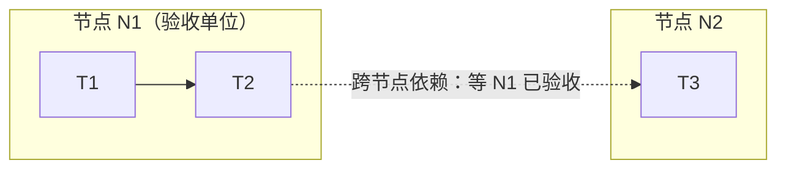

# 执行阶段审查粒度改造：审查节点与两态验收

| 项 | 值 |
|---|---|
| 类型 | 需求／模块技术设计——task-workflow 执行协议与引擎的改造 |
| 评审强度 | 重点——影响面覆盖全部后续工作流；状态语义与放行契约变化；"实际漏检率不升高"为待实测假设 |
| 状态 | 执行中（2026-10-15 用户指示「按照计划和方案开工」；第四至第九轮修正与交付范围口径已并入并重过方案门，计划门已批准） |
| 最后更新 | 2026-10-15 |
| 读者 | 方案门评审人；后续执行者与引擎维护者 |
| 维护方式 | 一次性变更设计：收尾回写后冻结，后续改造另立记录并引用；§做法 与实现有出入之处的权威口径在 §接口与数据形状 与 §决策摘要 D-23 起；未穷尽处见 §已知限制 |
| 关联来源 | 八条行为方案＝用户确认（进入本工作流前）；十点修订建议＝用户对初稿的修订意见，经"重写方案"指示并入本稿——**本稿整体（含十点）的确认点为本工作流的方案门**。兼容约束见 `docs/designs/workflow-evidence-lifecycle.md`、`docs/designs/workflow-approval-fingerprint.md`；**第四轮审阅（2026-10-15）＝对接口与计划一致性的四项修正**：节点有效性统一口径、操作 ID 重试协议、前身/合并限制、新阶段独立确认记录；另含交付范围口径对齐。**第五轮审阅（同日）＝三项闭合修正**：节点版本输入扩至任务声明字段（验收要求变化即失效重判）、操作 ID 强制传入（取消自动生成分支）、新阶段确认绑定（谱系/一次性/版本时效）。**第六轮审阅（同日）＝两项放行正确性修正**：显式声明的节点依赖纳入等待图（声明即约束，判环/派发/就绪共用）、工作树变化纳入失效检查（按文件集限定）。**第七轮审阅（同日）＝一处旁路修正**：范围外变化（提交与工作树一视同仁）共用兜底影响判断、不以未提交豁免；另补混合来源成环用例（判环须合并为同一张图）。**第八轮审阅（同日）＝一处实现契约补齐**：影响判断的提交入口（`impact` 命令）、持久化（`impact_assessed` 事件）、按内容摘要的绑定与重启复用/过期规则。**第九轮审阅（同日）＝一处提交前核对补齐**：`impact` 回传预期审查记录与变化集摘要、引擎核对一致才写入；不一致拒绝并返回新快照——并入后重过方案门 |

> **怎么读**：§背景与目标 / §备选与取舍 / §明确不做 是改动判断依据（方案门审阅五节）；§做法 是机制正文（八节：质量基线 → 节点与边界 → 状态流转 → 证据与审查判断 → 结论绑定与失效 → 修复契约与两轮上限 → 终审 → 回退与首版范围）；§验收标准 是验证计划。参考型小节（接口与数据形状、决策摘要、已知限制、实际交付）依工作流在计划阶段补齐，人审可跳过。
>
> **读者分界**：前五节给人读并受方案审批锁定；执行者与模型的契约在 §接口与数据形状，硬边界见 §明确不做。

## 一句话方案

执行阶段的审查单位从"每个任务"改为计划中预先声明的「审查节点」——任务是执行单位（派发、证据、恢复仍挂在任务上），节点是验收单位——放行采用"待执行 → 实现中 → 已实现待审查 → 已验收"的统一状态。优化目标是在交付质量要求成立的前提下，减少审查派发、上下文重复加载与重复检查的耗时；审查次数能减多少由任务的风险与依赖关系决定，某类任务合并审查后无法维持质量的，保留原有审查频率。

## 背景与目标

### 问题现状

执行阶段每个任务都要过一遍独立审查（实现者 + 审查者至少两次派发），审查次数与任务数线性增长（协议文本可证）；重复派发与重复审查在总耗时中的占比是否在"一个功能内的连续小步、同型小改动"上最高，是**待测判断**（由 §验收标准 第二层评估），本稿不预设。且逐任务审查看到的是半成品片段，上下文并不完整。"同型机械改动合并"是逃生通道，不是默认形态，没有改变这个线性关系。事实依据：现行协议与派发流程文本；本仓库近几次工作流从单任务到少量任务，每次都完整走逐任务审查与整体终审。

### 预期结果

**质量标准与必要检查不降低**——由流程约束落实：① 关键风险边界先于消费完成验收；② 逐任务留痕且每行关联验收依据或具体问题；③ 终审全量口径、整体需求覆盖逐项核对；④ 实现证据随任务记账。这四条约束落实"标准不降低"；**它们不推导"实际漏检率不升高"**。

**实际漏检率不升高**——是需要对照评估验证的假设，方法、样本与通过条件见 §验收标准；发现因分组漏掉必须解决的问题时，先修复、调整规则、重新验证，不用节省的时间抵消。

**耗时优化**——在以上条件成立的前提下，减少审查派发、上下文重复加载与重复检查的耗时；是否达成以总耗时为准，不以派发次数为准（§做法·回退与首版范围）。

### 关键约束

计划格式分档——格式 4 启用节点制，旧格式（≤3）继续原有行为，不静默改变运行中的旧工作流；引擎改动必须带隔离测试（标准库，不加依赖）；新增状态只增加就绪校验与旁路封堵，不减少任何既有验收、证据链与收尾要求。

### 承接关系（自生来源）

本方案正文在本次工作流内起草，无既有文档承载。来源状态分两档：八条行为方案为用户在本工作流之前已确认；十点修订建议为用户对初稿的修订意见，经"重写方案"指示并入本稿，仍随本稿整体送审（方案门即其确认点）。兼容约束继承自既有设计记录——`docs/designs/workflow-evidence-lifecycle.md`（状态记账与验收指纹分离、账本/事件是状态真源：任务状态行仍按投影写回，但不进指纹正文）与 `docs/designs/workflow-approval-fingerprint.md`（计划指纹只忽略真实任务状态行：不新增计划可变字段、不改指纹算法）。

## 做法

### 质量基线（先固定，不因分组降低）

每个工作流继续满足五项要求：需求和决策完整落地；行为、边界与兼容性符合约定；相关风险经过检查；验证证据真实且对应当前版本；必须解决的问题已经关闭、文档与实际交付一致。

分组不能减少原本必要的检查项，也不能通过降低问题等级、缩减验收范围、把未完成内容写成"已知限制"来通过。测试通过、报告齐全、审查者结论分别提供不同证据，**任何一种都不能单独代表交付质量成立**。

### 节点与边界

**节点是验收单位，任务是执行单位。** 节点围绕一个可以完整判断的功能、契约或风险边界组织，可含多个连续任务，也可只含一个任务；整个工作流只有一个节点同样合法——前提是不存在需要提前检查的边界，且审查者能够完整覆盖。

计划至少声明：节点 ID、归属任务、分组理由、审查职责、依赖节点、送审条件、是否兼任终审。每个任务恰有一个归属节点；终审与定向复核可以覆盖其它节点的内容——**唯一归属不等于只许检查一次**。

任务依赖图与**节点等待图**都不得有环。等待图统一为「**等待者 → 被等待者**」方向：B 依赖 A → 等待边 `B → A`；等待图 = 任务依赖导出的跨节点等待边 ∪ **显式声明的节点依赖边（`依赖节点` 字段）** ∪ ｛终审节点 → 每个其它节点（终审等待全部验收）｝——**声明即约束：声明边与任务依赖导出的边同等生效**；判环、`slice` 派发与就绪检查（`close`/`verify`）共用同一张等待图。示例图画的是执行方向，判环一律以等待图为准。例如 `T1 → T2 → T3`，不能把 T1、T3 分到 A、T2 分到 B，造成 A、B 相互等待。**终审节点的调度约束**（防等待死锁）：恰有一个终审节点；它不得是任何其它节点的上游；上述等待图必须无环——"最后一个节点"由此成为可检查的调度规则。

**节点调整纪律**：只在出现新的依赖、契约变化或修改范围扩大等具体依据时调整，并记录原因；调整产生的新节点声明前身并继承审查谱系（见·结论绑定与失效）。



从这张图该读出：组内任务可以消费彼此的"已实现"成果；跨节点依赖（含显式声明的节点依赖）只在**上游节点整体已验收**后解除——节点是放行的原子单位（图中箭头为执行方向；等待图方向相反，见下）。

**提前审查只针对明确的风险边界**，命中任一条才设置提前节点：关键契约存在新增或实质变化、下游将据此实现；错误会向多个模块扩散或造成明显返工；后续步骤将产生难以撤回的外部影响；当前验证不足以控制相关风险。提前节点必须写明"审查对象 —— 后续消费者或操作 —— 判断错误的后果"。普通内部数据结构或辅助函数，不因为被下一项任务调用就自动需要提前独立审查。安全、数据正确性、并发、迁移等高风险面保留独立检查，但检查时机落到具体行为（如权限边界改变、数据迁移执行之前），**不按任务名称含关键词恢复逐任务审查**。组内可以消费"已实现"成果；被认定为关键边界的依赖，通过**拆分节点**使其在消费之前完成验收。

### 状态流转

```
待执行 → 实现中 → 已实现、待审查 → 已验收
```

`record` 记录"已实现"与证据；`review` 记录节点审查结果；**节点通过后，成员任务才映射为现有的 `complete`**——既有的"完成＝已验收"语义不被改软。节点未通过时，即使其中部分任务没有问题，也不提前释放该节点的跨边界依赖。同节点内，允许依赖已实现成果继续推进；跨节点要求上游已经验收。

**三种判断分别计算，不得混同**：① 任务实现是否完成（证据在 `record`）；② 节点结论是否有效（前提与失效规则）；③ 是否因依赖而阻塞（上游未验收）。上游失效或结论转「待重新确认」只改变 ②③——**不把已完成的实现退回「待实现」**：已实现任务不因上游失效而重做，受影响的是结论有效性与放行。

**权威源与写入顺序**：格式 4 下，审查与实现事件（events.jsonl）是权威记录，计划里的 `状态` 是可由事件重放恢复的展示投影；写入顺序为先事件、后状态，中断于两者之间时按事件重放修复投影。投影与事件推导不一致 → 先恢复；无法恢复 → 拒绝放行（`slice`/`record`/`review`/`close` 同一入口阻断）。

`next`、`slice`、`record`、`review` 使用一致的状态判断——不允许只在展示或派发入口检查、另一个入口却能直接推进。`verify` 与 `close` 保留既有验收、证据链与收尾要求，同时**必须为新状态补充必要的就绪校验**：验证命令可以用于诊断，但正式收尾不能绕过节点验收与整体终审——不为"保持旧代码完全不变"留下旁路。引擎的可强制边界是"未验收不放行、评审记录存在且绑定当前版本"；"审查做得对不对"不属于机械校验，它在纪律与 §验收标准 的评估层——这条界线要写明，免得后人以为引擎验了内容。

### 证据与审查判断

每项任务完成后记录：实际修改、提交范围、验收方法与结果、相关失败信号、尚存疑问；**优先引用已有输出**，不为留痕重复执行测试或复制整份日志。节点送审条件：归属任务全部达到"已实现"，必要验证完成，未解决事项明确列出。

审查者读取实际改动与必要上下文，对规格符合性、实现质量及组内集成关系作出判断；实现者报告只作线索。"每个任务一行结论"保留，但每行必须**关联验收依据或具体问题**——有行数只证明覆盖记录齐全，不能证明检查充分；节点另给整体结论，防"每项单独成立、组合后不成立"。

### 结论绑定与失效

每次审查至少记录：节点版本（定义见 §接口与数据形状·前提与有效性）、已审提交范围、证据引用、结论、未关闭问题；整体终审绑定完整交付版本。**有效性分两种，不是同一种绑定规则**（复用底层事件与指纹设施，判定规则分开）：

- **节点结论有效性 = 已审范围 + 依赖前提**：记录同时保存已审提交范围与**依赖前提清单**；前提不只记上游契约锚点（产出任务的文件集、接口签名摘要、基线提交），还须纳入**影响结论成立的共享实现与配置**（共享函数、默认值等——逐条声明，不以接口签名为限）。失效触发三条，任一命中即转「**待重新确认**」：① **已审实现本身出现新提交**（已审范围之上的实现变化）**或已审范围内出现未纳入审查的工作树变化（未提交/未跟踪内容）**；② 已声明前提被触及（**提交或工作树变化**）；③ **无法判定影响的变化**——不按「未命中前提」保留结论。**工作树变化与提交一视同仁**：① 已审范围或已声明前提的文件集上出现变化（未提交/未跟踪，复用整树指纹的单树设施）→ 直接转「待重新确认」；② 文件集之外的变化（**提交或工作树差异**）→ 先全局枚举变化路径（逐项 path＋内容摘要），**在判断作出前暂停该节点放行**，再按·兜底执行 提交影响判断；**不以"尚未提交"豁免**——判断对内容生效，同一改动提交前后摘要一致即可继续复用。锚点检测能发现的是**已声明前提**上的变化；不能证明无影响时走第③条兜底——覆盖面以声明完整性与影响判断为界，**不承诺「绝对不漏检」**。**判定口径（统一）**：以【当前节点版本 × 当前审查阶段】下的**最近一条有效审查结论**为准——该结论必须为 `pass`；其后出现 `fail`、`node_invalidated` 或触及前提的新提交（失效三条）任一条即**阻止放行，不得回看更早的 `pass` 抵消**；直到其后再出现有效的复核 `pass` 才恢复为有效。状态由这一规则统一派生，各入口不得各自取「最近一次 `pass`」（§接口与数据形状 同口径）。**节点版本含节点块与归属任务的声明字段——只改任务验收要求、未改代码，也不能沿用旧结论**（定义与输入范围见 §接口与数据形状·前提与有效性）。
- **终审与最终验证有效性 = 完整交付版本**：整树指纹 + 计划指纹（沿用现有绑定设施），只服务这一层。

**下游已消费的契约变更**：上游契约改变时，凡审查记录声明依赖该契约的节点——即使已验收——结论转「待重新确认」，其跨节点下游依赖暂停（与未验收同款处理）；恢复条件＝针对新契约做**定向复核**，确认结论在新契约下仍成立（影响无法判断则升级为节点审查）；恢复后回到已验收，原结论保留为历史。变更检测由工具完成（前提清单上的**提交与工作树**差异），影响说明由主控给出，必要时由独立审查确认——不引入自动影响分析系统。**兜底执行（影响判断的提交与复用）**：工具检测到前提之外的变化（**提交或工作树差异**）时，先全局枚举待判断变化（逐项路径＋内容摘要），**在判断作出前暂停该节点放行**（与「待重新确认」同款处理）。影响判断由主控经 **`impact` 命令**提交——**提交须回传其实际评估时的预期审查记录与变化集摘要（取自 `status`）；引擎核对一致才写入**（不一致 → 拒绝并返回新快照、保持阻塞；已成功操作的同 ID 重试返回原结果、不重新绑定）——以事件 **`impact_assessed`** 随事件持久化：结论「无关」→ 绑定【被评估的节点审查记录（当前有效结论的操作 ID／谱系＋节点版本＋阶段）＋被评估变化集（逐项 path＋内容 sha256 前 16 位）】并保存依据，随后恢复有效；结论「相关」或判不出（以 `undecidable` 提交）→ 转「待重新确认」并定向复核，不默认保留。**绑定有效期内重启直接复用**（重放事件即可识别，不重复提问）；**判断对内容生效、不按路径沿用**——同路径内容再次变化即绑定过期、重新暂停；审查记录更替（新结论、新阶段、节点版本变化）同样使绑定过期。

**谱系与恢复语义**：稳定身份是**审查谱系根**——节点首次送审生成谱系 ID；拆分、改名或调整产生的新节点必须声明前身并继承谱系根与问题清单；轮次与失效历史挂在谱系根上，节点 ID 只是当前代表。中断恢复按谱系根重建当前有效结论与轮次计数。**去重身份**：重复记账以**稳定操作 ID** 识别同一次操作的重试（同一操作重试不计轮次；操作 ID 在首次执行前生成并保存、重试复用，见 §接口与数据形状·操作 ID 协议）；审查记录另附节点版本、审查阶段、依赖版本（前提版本）与证据。**不得仅凭（谱系根，已审范围，结论）相同去重**——同一范围在**新契约或新阶段**下的复核通过是与旧记录不同的新证据，必须保存。**合并限制（首版）**：不支持已送审节点合并——**一个新节点最多承接一个已送审前身**；拆分或调整可产生多个子节点，各自以同一前身作为唯一前身（共享谱系根，不构成合并）。多前身重组须先补完整多谱系语义（组合后的谱系根、问题清单合并与预算归属），不在首版范围（见 §备选与取舍·备选六）。前身声明与解析规则见 §接口与数据形状。保留前身与问题历史；修复预算沿谱系根继续（不重置、不相加）。换节点 ID、拆分节点或重启会话不能清空原问题及其修复历史。

### 修复契约与两轮上限

主控验收须**同时**满足：原问题与正确结果明确；修复不涉及复杂行为或关键契约变化；影响范围清楚且没有扩大；有充分的验证证据；主控实际核对修复 diff、原问题与结果。"文件未超出节点范围""测试由失败变通过"只是**辅助条件**——复杂状态机、权限、并发等修复即使只改一个文件，也可能需要独立定向复核；拿不准时走独立复核。两条路径都不自动重启全面审查。

每个节点最多两轮集中修复（主控验收计入，新增问题不重置轮次）。超限后停止相关推进，重新分析根因、设计或验证方法。是否换实现者、是否升档由失败原因决定（不设"第二轮固定换人升档"的硬规则）；终审原有的独立性与模型要求保留。

**封顶后的合法恢复＝开启新审查阶段，不是第三轮**：新阶段须同时满足——① 有可核的实质变化（根因、设计或验证方法至少一项有证据支撑的改变；仅补一段说明不构成）——**以独立审查的确认记录为凭**：新阶段记录绑定**谱系、前阶段号→新阶段号、确认记录、所确认的变更版本**；引擎校验四项：确认记录属于该谱系；**未被此前任何 `review_phase` 引用过（一次性——不得换个操作 ID 重复重置预算）**；所确认变更版本存在于提交图且**其后该谱系范围无未纳入确认的新变更**（旧版本确认不得放行新的相关变更）；**阶段衔接：新阶段号＝该谱系当前阶段＋1（引擎推导并写入事件），确认记录所载阶段与当前阶段一致、事件重放的阶段序列连续——不符即拒绝**。**实质变化是否成立由审查者判断，不由文本检查承担**；② 影响面重评（触及任务范围、验收或设计判断时回填计划并重新审批——**重过受影响的审批门**：方案正文变化时方案门同样失效（引擎按内容指纹拒绝放行），只改计划则重过计划门；execution 出现新判断先 `gate`）；③ 原问题清单连续追踪、编号接续。轮次在新阶段重新计两轮，总账保留（"阶段 1：两轮用尽 → 新阶段：…"）。

### 终审：最后一个节点兼任

启动条件：其它节点已验收（终审节点的调度约束见 §做法·节点与边界）、全部实现完成、交付文档已就绪。最后节点的审查者保持独立，读取**从工作流基线到当前版本的完整改动**（含首次修改）。同一次审查承担两部分职责：验收最后节点；检查整个交付是否满足目标、决策与全局约束，跨节点契约是否一致，后续修改是否削弱前面的保证，文档是否与实现一致。

已审内容可以复用已有结论，深入检查集中到新改动、集成影响与具体疑点；但**整体需求覆盖仍须逐项核对**（范围缩减检测不可豁免）。两部分都通过，最后节点才验收；随后执行最终验证与收尾。

### 回退与首版范围

回退优先作用于出现问题的**节点类型或风险类别**——细化节点、必要时恢复逐任务审查，不因一次问题让所有工作流永久增加重复步骤。**不以派发次数减少认定优化成功**：总耗时未改善即视为未达成优化目标。

**启用边界**：格式 4 首版非默认——仅限开发测试与受控试用（显式选择）；默认路径维持现有逐任务审查；**效果评估通过并获明确确认后**才切换默认为格式 4，未通过则维持 opt-in 或按节点类型/风险类别回退。

首版集中实现：节点声明（含终审调度约束）、两态调度、独立节点审查、修复分流、终审合并、结论锚点与失效恢复、事件权威源，以及必要的记账规则。暂缓：超阈值自动并行审查、复杂评分体系、自动模型升级——节点过大时先修正分组。

## 备选与取舍

- **备选一：维持逐任务审查，继续依靠"同型机械改动合并"逃生通道**。没选：合并是特例，解不了"审查次数与任务数线性相关"。
- **备选二：只改协议文本、不动引擎**。没选：没有状态与失效规则的承载，跨边界等待无机械门，未验收也拦不住收尾——会留下旁路。
- **备选三：把所有被下一任务消费的接口都设为提前审查节点**。没选：那等于把逐任务审查换个名字恢复；提前审查只针对四类明确风险边界（§做法·节点与边界）。
- **备选四：修复复核按"局部性 + 测试通过"分流**。没选：先判语义风险，局部性与证据只是辅助条件。
- **备选五：用四条流程约束直接论证"质量不降"**。没选：流程约束落实"标准不降低"，推不出"实际漏检率不升高"——后者按 §验收标准 对照评估。
- **备选六：首版开放已送审节点合并（多前身重组）**。没选：需要先补完整多谱系语义（组合后的谱系根、问题清单合并、预算归属），与"首版限制合并"的简化目标不符；确需重组时按单前身拆分/改名进行（§做法·结论绑定与失效·合并限制）。

**残余风险**（不预设为"接受方差上升"；由评估与信号检验，不成立即回退）：

| 风险 | 触发条件 | 信号 | 处置 |
|---|---|---|---|
| 组内依赖链上的错误先被下游消费 | 关键边界未被识别为提前审查触发 | 终审发现"前面漏掉的局部问题"占比上升 | 重开该节点类型的分组规则；细化节点 |
| 修复不再必经第二次独立判断 | 分流判据被执行者放宽 | 修复后仍出现同类必修问题 | 收紧分流为"拿不准即独立复核"；回到逐任务频率 |
| 粗分组导致审查变浅 | 单节点或大节点的覆盖只留行数不留依据 | 逐任务结论行缺"验收依据或具体问题" | 按 §做法·回退与首版范围 细化节点 |
| 前提声明不完整或影响判断失误 | 已声明前提之外的间接影响未被纳入 | 终审发现"后续改动削弱了前面的保证" | 扩大定向复核范围至受影响节点；必要时升级节点审查 |

## 明确不做

- 并行执行 / 工作树隔离不做——写操作仍串行派发（`并行` 字段语义不变）；
- 不减少任何既有验收、证据链与收尾要求；新增状态只加就绪校验与旁路封堵；
- 审批模式语义（gated / execution / bug 路径的门）不动；bug 路径与极小工作流同样声明节点（单节点合法，需满足 §做法·节点与边界 的条件），bug 三项强制不变；
- 不删独立计划语义审查——扩展为：分组是否合理、验收是否充分、任务依赖图与节点等待图（含终审等待边）都无环；
- 终审的独立性与模型要求保留；
- 不做"按体量自动降频"——节点划分在计划期显式声明，不由 agent 按规模自行推断；
- 不改"同型机械改动合并"的判据，只新增"同批须属同一节点"；
- 首版暂缓项：超阈值自动并行审查、复杂评分体系、自动模型升级、已送审节点合并（多前身重组——每个新节点最多一个前身）；
- 不引入新依赖/新外部工具；不动其它 skill 与用户既有修改；不推送。

## 验收标准

验证计划分两层，**方法、样本与通过条件在计划阶段预先确认**。**本次交付＝可受控试用的机制实现**：第一层（引擎与协议正确性）随实现执行；第二层（实际工作效果）与切换默认属启用条件，在受控试用阶段另行执行——不属本次已完成结论，也不据此切默认。

**第一层 · 引擎与协议正确性**（隔离测试 + `check` + 独立语义审查）：跨节点不得提前消费（未验收不放行跨边界依赖）；任务依赖图与节点等待图均无环，终审调度约束（恰一个终审节点、不得被依赖）被校验；未验收不得映射 `complete`、不得进入最终验证与收尾；结论锚点失效与恢复（无关提交不失效、契约变更触发下游待重新确认与暂停、定向复核后恢复）；事件权威源（中断于事件与投影之间按事件修复、不一致拒绝放行）；重复记账不计重复轮次、换节点 ID/拆分/重启不清空历史（谱系根）；中断恢复后各入口状态判断一致；封顶后新审查阶段的成立条件生效；已审实现自身变化触发重新确认、共享实现/配置按已声明前提触发、无法判定影响时按兜底先做影响判断；去重按操作 ID——新契约/新阶段下同范围同结论的复核通过不被去重；三态分别计算（上游失效不回退已实现任务）；等待图方向（等待者 → 被等待者）被校验；审批按受影响门失效（方案正文变化 → 方案门）；**任务验收要求变化（无代码提交、节点块不变）使旧结论不得放行；全部记账操作（含 `impact`）缺 `--operation-id` 被拒，事件落盘后、返回前中断再携原 ID 重试幂等重放（不新增事件/轮次/阶段）；新阶段确认的四项绑定校验（重复使用同一确认、旧版本确认放行新变更、阶段衔接不符均被拒）；只有节点级依赖（无任务级依赖）时不得提前放行；任务依赖导出与显式声明两条来源的等待图环均被发现，含混合来源成环（任务依赖 A→B ＋ 声明 B→A，各自无环、合并成环）；不新增提交、只修改已审接口或配置（工作树变化）再派发依赖节点，必须被阻止；范围外变化（提交与工作树）共用同一影响判定——同一改动提交前后判定一致（判断按内容摘要绑定、可复用），不以未提交豁免；缺判断暂停放行；重启（重建进程/重放事件）后相同绑定直接复用、不重复阻塞；同路径内容变化后旧判断失效、审查记录更替后绑定过期；impact 提交前核对预期审查记录与变化集摘要——观察 H1 后内容变为 H2（或审查记录已更替）再提交针对 H1 的判断必须被拒并返回新快照；同操作 ID 重试返回原结果、不重新绑定**；格式 ≤3 旧工作流行为不变。

**第二层 · 实际工作效果**（对照评估，不以审查次数为结论）：对代表性任务，在**相同实现快照**上比较新旧审查安排——一致的模型配置与问题判据，统一裁定发现是否有效；区分四类发现：前面漏掉的局部问题、整体集成问题、后续改动引入的问题、交付后暴露的问题（"终审发现更多"不直接判为质量下降）。同快照对照只覆盖"发现问题能力"；**提前审查时机、组内错误传播与返工成本另用代表性流程回放或受控执行覆盖**；漏检判定使用**独立裁定的问题集合**（不以旧流程的发现列表为"全部正确答案"），裁定人与规则预先确认。实际执行效率另用同类任务观察总耗时、审查耗时、修复耗时与派发次数——**"同一份代码审得更快"不等于整个工作流完成得更快**。

**结论口径与启用条件**：有限样本不证明永远不漏检；两层成立并取得效果证据、且经明确确认之后，才能把"减少审查开销且保持交付质量"写成已验证结论，并才把格式 4 切换为默认路径。一旦发现因分组而漏掉必须解决的问题，先修复、调整对应规则并重新验证，不用节省的时间抵消。

## 接口与数据形状

**计划段（格式 ≥4 新增）。** 段标题：二级标题「审查节点」（与「阶段」同级）；节点块标题：三级标题「N<n> 节点名」。每个节点块＝**节点 ID（块标题）＋六项必填字段＋一个可选字段**，逐字约定：

- **归属任务**：`T1, T2`（逗号分隔的真实任务 ID；每个任务恰属一个节点）
- **分组理由**：功能或契约完整性依据，含下游依赖与判断错误的返工影响；提前审查节点须含「审查对象—消费者或操作—后果」三元组
- **审查职责**：验收对象与整体结论要求（逐任务一行＋节点整体结论）
- **依赖节点**：`无` 或**逗号分隔的节点 ID 列表（多值）**——**声明的边与任务依赖导出的边一并纳入等待图（声明即约束）**：可表达"无任务级依赖、但须先验收上游再消费/放行"的顺序；声明边同样参与判环，显式互依赖形成的环会被拒绝
- **送审条件**：归属任务全部已实现＋必要验证完成＋未解决事项列明
- **兼任终审**：`是` / `否`（恰一个为 `是`；该节点不得为其它节点上游）
- **前身**（可选）：`无` / **最多一个**节点或谱系 ID——仅在由已有节点拆分、改名或调整而来时声明。校验（格式 ≥4）：① **前身数量多于一个即视为合并已送审节点，`check` 拒绝**（首版不支持合并，见 §做法·结论绑定与失效）；② 前身不得指向本计划中仍在使用的节点 ID（本次调整应替换/移除原节点）；③ **前身从历史记录解析**：解析范围＝当前计划文本 ∪ 本工作流历史记录（审查记录与事件中已生成的谱系 ID、已声明的前身链）——**不得因被替换节点已不在计划文本中而判「引用不存在」**；完全解析不到、或解析结果歧义 → ERROR；**本节点自己声明的 `前身` 值不进入它自己的解析集合**（自声明不自证，否则拼错的引用会自证成立）；④ 多个子节点可分别以同一前身作为唯一前身（拆分场景），各自继承同一谱系根；修复预算沿谱系根继续（不重置、不相加）；⑤ **未声明前身的节点，其归属任务若在历史审查记录里带有别的谱系（≠ 本节点谱系根）的审查历史 → ERROR**——改名/换 ID 不得静默清零轮次与问题清单

**值解析（严格）**：`归属任务` / `依赖节点` / `前身` 共用同一解析路径——先剥**一个**尾部括号注解（全角 `（）` 或半角 `()`），再严格解析「`无` 或逗号分隔 ID 列表」；残余不可解析、注解剥空、空列表项任一即 **ERROR**（不静默降级为空集）；`none` / `-` / `待确认` 不是 `无`。

格式 ≥4 下另校验：**节点 ID 唯一**（两块共用同一 ID → ERROR）；**每个任务恰属一个节点**（不属任何节点、或同时归属多节点 → ERROR）；等待图（等待者 → 被等待者；**任务依赖导出的跨节点边 ∪ 声明的节点依赖边**；含终审 → 每个其它节点的等待边——**终审边仅在恰有一个终审节点时加入**）**无环——两条来源的边合并为同一张图后判环：跨来源组合成环（任务依赖 A→B ＋ 声明 B→A）或单来源成环均即 ERROR**；**终审节点被依赖时「等待图成环」与「不得为上游」两条 ERROR 同时出现**（同一根因，双报便于定位）；节点块缺必填字段、依赖节点或前身引用不存在的节点 → ERROR；**放行与就绪判定的「上游」取沿等待图可达的传递闭包（多跳）**——链式图上任一可达节点未验收都会拦住下游；批次派发（合并 `slice`）成员须同属一个节点。格式 ≤3 计划不解析此段、不新增校验。

**CLI（格式 ≥4 生效；格式 ≤3 行为不变）：**

- `record <slug> <T> --commits A..B --evidence "<验收怎么跑/结果/失败信号自查>"`——记「已实现」（**必须携带 `--operation-id <id>`**）；格式 4 不再使用 `--verdict`。**`record` 记既成事实，不做派发门**——派发门在 `slice`（对未验收的跨节点上游拒绝派发）、就绪检查在 `close`/`verify`（对未验收节点拒绝放行）；上游未验收时仍可记实现，只是跨节点下游不放行。
- `review <slug> <节点> --verdict pass|fail --commits A..B --lines "<T1: 结论＋依据；…>" --evidence "<引用>" [--premises "<类型: 路径; …>"]`——记节点判定（**必须携带 `--operation-id <id>`**）；`pass` 后成员任务映射 `complete`。**缩略形态不可用**：`--recheck` 只叠加在完整 review 参数上（缺 `--verdict`/`--commits`/`--lines`/`--evidence` 任一即拒绝）。
- `review --recheck <原操作ID> --operation-id <id>`：定向复核——`--recheck` 的值是**所关联原审查记录的操作 ID（原记录关联）**，本次复核自身的重试身份由 `--operation-id` 携带（两者不同）；记为新操作、不去重。**`--recheck-mode`** 只认 `主控核对` / `定向复核`（默认 `定向复核`——未显式声明时按独立复核记），只在带 `--recheck` 时有效（普通 review 带它会被拒），随事件保存。
- `review --new-phase --basis "<实质变化>"`：封顶后开启新审查阶段（**必须携带 `--operation-id <id>`**）；`--confirmation <记录引用>` 关联独立确认的报告或审查记录，`--confirmed-commit <A..B>` 为所确认的变更版本。**`--confirmation` 两形态与白名单**：① 记录形态——本工作流一条 `node_review`/`impact_assessed` 记录的操作 ID，须属该谱系、所载阶段与当前阶段一致，**且事件序晚于该谱系当前阶段最后一条 `node_review`**（本阶段自己的审查记录不构成「独立确认」）；② 报告形态——`.workflow/<slug>/reports/` 内**真实存在**的报告（仓内相对路径 / `reports/x.md` / 名字 `x.md` 归一化到同一身份），归一化后在该目录之外（`..` 逃逸、绝对路径、兄弟目录、仓外路径、同层文件）一律拒绝；引擎不读内容，是否属该谱系由审查者判断。**引擎按六项机械校验**：① 属该谱系；② 一次性（未被此前任何 `review_phase` 引用过；报告按路径＋摘要，同路径内容变了＝新凭据）；③ 版本时效——`A..B` 存在、A 为 B 祖先、B 在 HEAD 历史里，**且该谱系的已审文件集非空**（判据是文件集不是提交范围：`base..HEAD` 存在但无文件改动同样被拒——空文件集会让「其后无未纳入确认的新变更」整体空转），其后该谱系范围无未纳入确认的新变更；④ 阶段衔接（新阶段号＝当前阶段＋1，事件重放的序列连续）；⑤ **已封顶门槛**（轮次必须已用尽）；⑥ **确认时序**（见上）。
- `impact <slug> <节点> --verdict irrelevant|related|undecidable --basis "<依据>" --expect-review <审查记录操作ID> --expect-changes <变化集摘要> --operation-id <id>`——**提交影响判断**：`--expect-review/--expect-changes` 回传 `status` 展示的预期值；引擎**先核对**——预期审查记录仍为该节点当前有效结论、当前待判断变化集摘要与 `--expect-changes` 一致，**一致才写入判断**；不一致 → **拒绝本次提交、保持阻塞并返回新快照**（不得把判断绑定到主控未评估的内容）；「无关」→ 绑定并保存依据、恢复有效；「相关」与 `undecidable（判不出）」→ 转「待重新确认」；相同绑定重启后直接复用；**同操作 ID 重试返回原结果、不重新快照/绑定**。**`impact` 与 record/review/slice 同一道计划门**（审批失效即拒绝，不因"只写事件、不改投影"而例外）。
- `next`/`slice`/`status`：显示未验收节点、待重新确认（**含原因、被评估的审查记录 ID 与待判断变化的 path＋内容摘要——即 `impact` 所需的预期值**），与「审查债务」清单（已实现但未完成节点审查的任务、尚未开启审查的节点）；`slice` 对未验收的跨节点上游（**传递闭包**）拒绝派发；`close`/`verify` 对未验收节点或未处理待重新确认拒绝放行。**展示层同源**：格式 ≥4 下 `status`/`next` 的任务状态一律经事件派生读（`DONE ＝ 已实现 ∧ 节点已验收`），不读计划状态行的字面值——手改 `complete` 既不会被当作完成跳过，也不会被派发。

**操作 ID 协议（格式 ≥4）**：`record`、`review`、`--recheck`、`--new-phase`、`impact` **必须**携带 `--operation-id`——**未提供即拒绝**；首版**不提供**引擎自动生成分支（自动生成会在"事件已写、未及返回"时丢失 ID，重试必然新开一条，与去重承诺矛盾）。调用方在**首次执行前生成并保存**该 ID，**重试必须复用**。语义：相同 ID＋相同请求 → **幂等重放**：返回原结果、恢复投影、不新增事件/轮次/阶段；相同 ID＋不同请求 → 拒绝；真正的新复核使用新操作 ID、另行关联原审查记录（`--recheck`）。**请求身份按各操作的判据计算**（`record`：任务集合＋提交范围＋证据；`review`：节点＋结论＋已审范围＋逐任务行＋证据＋复核关联；`impact`：节点＋判定＋依据＋预期值）——**`--premises` 不进 review 的请求身份**：同一操作 ID 重试即使换了前提清单也判「同请求」、重放原结果（前提只随原记录保存，不因重试改写）。**结果 receipt 随事件持久化（或可由事件确定性重建）**——中断后重建再重试，仍据此返回原结果。

**事件（events.jsonl，格式 4 新增类型）**：`implemented`（任务实现完成＋证据）、`node_review`（操作 ID、节点版本、审查阶段、**前提清单（`premises`，非"前提版本"）**、逐任务行、结论、未关闭问题（**首版恒空占位——没有提交入口**）、**`全局约束摘要`（必填）**、**已审提交锚（记录时解析成完整 sha 的 base/head）**）、`node_invalidated`、`projection_repair`、`review_phase`（开启新审查阶段：谱系、前阶段号→新阶段号、basis、独立确认记录引用与所确认的变更版本）、`impact_assessed`（影响判断：操作 ID、绑定＝被评估的节点审查记录身份＋变化集摘要、结论、依据）。事件为权威、计划状态为投影；先事件后状态。**投影与事件推导不一致 → 先恢复（有实现证据的偏差按事件双向修复），无法恢复 → 拒绝放行：`slice`/`record`/`review`/`close`/`impact` 同一入口阻断；`verify` 不在投影修复入口内**——它另有未验收就绪门（`require_node_acceptance`），只按事件派生判定，不修投影、不给诊断豁免。

**前提与有效性**：前提条目＝{类型：契约锚点/共享实现/配置；引用：文件或路径集；摘要：sha256 前 16 位；基线提交}，**由调用方逐条声明（非自动采集）**，目录引用递归展开成文件列表。**节点版本**＝【节点块 ＋ 各归属任务块】的声明字段规范化文本的 sha256 前 16 位（**剔除 `状态` 等运行字段**；字段按键排序取原文——**顺序不影响版本，分隔符与注解等取值排版差异会换版本**）——节点声明或任务要求/验收定义变化即版本变化；**重新批准计划只证明同意新要求、不证明旧实现满足新要求**，旧结论属于旧版本、按公式转「待重新确认」（定向复核恢复），无需新增触发类型。**已审提交锚**：审查记录固化 `--commits` 解析后的完整 sha；**读路径优先用锚**，仅旧记录缺锚时按分量回退重新解析——`HEAD` 是会移动的引用，读取时重新解析会让「已审范围上的新提交」与「范围外变化提交前后一致」整体失效。**全局约束摘要**：计划的 `## 全局约束` 一节正文的规范化摘要随记录保存，该节改写（不依赖提交、不改节点/任务声明）即使相关结论转「待重新确认」，由 `--recheck` 重记摘要恢复；**「判得出无关则记录依据保留」的快捷路径首版不区分**（保守一律转）。不属该节的计划级声明（其它小节、头部字段）由方案/计划内容指纹承接（重过门），引擎不自动使结论转「待重新确认」——需要机械触发的载体应在 `--premises` 里声明为 `配置` 前提。不修改计划/方案审批指纹算法（版本摘要为独立摘要）。**失效记录与轮次挂在谱系根上**：已记录的 `node_invalidated` 按**谱系根**过滤（改名/拆分后的新节点仍承接旧观察）。节点结论有效 ⇔ 在【当前节点版本 × 当前审查阶段】下取**最近一条有效审查结论**：该结论必须为 `pass`，且其后未被 `node_invalidated`、已审范围之上无触及前提的新提交（失效三条）——三项同时成立才有效；**且不存在「未判定影响的范围外变化」**（每个此类变化须有绑定有效的 `impact_assessed` 判定：判「无关」→ 解除暂停；判「相关」/「判不出」→ 按「待重新确认」与定向复核路径恢复，该条机械暂停不再单独拦阻；缺判定或绑定过期即暂停放行）。**后续的 `fail` 与失效记录一律阻止放行，不得回看更早的 `pass` 抵消**；直到其后再出现有效的复核 `pass`（`--recheck`）才恢复，原结论保留为历史。状态由这一规则统一派生（各入口不得各自取「最近一次 `pass`」）；不满足时转「待重新确认」，其跨节点依赖暂停。

**三态**：任务实现是否完成（`implemented` 事件）/ 节点结论是否有效（前提与失效）/ 是否因依赖而阻塞（上游未验收）——分别计算；上游失效只影响后两者。

## 实际交付

### 交付物清单

- **引擎**：`task-workflow/scripts/workflow.py`。格式 ≥4 的全部新分支挂 `is_v4`；格式 ≤3 路径逐字不变（新旧引擎对拍见下）。修复波（提交 `920637a`）新增 `_review_anchor`（已审提交锚优先）、`wait_closure`（跨节点上游传递闭包）、`lineage_task_scope`（未声明前身守卫）、`confirmation_order_problem`（确认时序）、`global_constraints_digest`（全局约束摘要），并收紧 `resolve_confirmation_report`（限 `.workflow/<slug>/reports/`）、`_reviewed_paths`（改 `-z` 口径，换行文件名两侧同源）、`cmd_impact`（补计划门）、`Plan.states()`/`next_v4`（展示改经派生状态）。
- **测试**：`task-workflow/tests/test_workflow.py`——**176 例全绿**（165 例既有 + 修复波 11 例）；格式 4 专项覆盖 `review_nodes_*`、`two_state_*`、`three_*`、`four_*`、`five_*`、`six_*`。
- **协议与文档**：`SKILL.md`、`README.md`、`references/plan-format.md`、`references/dispatch-protocol.md`、`references/plan-review.md`（本次回写同步）。
- **计划段**：`## 审查节点`（`### N<n> <名称>`＝节点 ID＋六项必填字段＋可选「前身」；值解析严格，注解只剥一个尾部括号；`依赖节点` 多值）。
- **CLI**：`record … --commits --evidence --operation-id`；`review … --verdict|--recheck|--new-phase`（`--lines`/`--evidence`/`--premises`/`--recheck-mode`/`--basis`/`--confirmation`/`--confirmed-commit`）；`impact … --verdict --basis --expect-review --expect-changes --operation-id`（含节点位置参数共 7 个入参）；`next`/`slice`/`status` 增未验收节点、待重新确认（含原因与 `impact` 预期值）、审查债务、阶段总账；`slice` 批次须同节点；`close`/`verify` 未验收就绪门。
- **事件**（`events.jsonl` 权威、计划状态为投影、先事件后状态）：`implemented`、`node_review`（含必填 `全局约束摘要` 与已审提交锚）、`node_invalidated`、`projection_repair`、`review_phase`、`impact_assessed`。
- **判据与身份**：`VALID_STATUS_V4={pending,implemented,complete}`；节点状态词 `valid/invalid/recheck/paused`（`node_state` 单一实现，各入口共用）；节点版本＝{节点块＋归属任务声明字段}摘要（sha256 前 16 位）；谱系根 `<节点ID>-<sha8>`；操作 ID 幂等协议（首次生成、重试复用、receipt 随事件持久化）；展示层经事件派生。
- **门与封堵**：跨节点派发门（`slice`，上游取等待图传递闭包）、收尾门（`close`/`verify`）、投影修复（`slice`/`record`/`review`/`close`/`impact` 五入口）、两轮修复上限与封顶恢复（`review --new-phase` 六项机械校验）。

### 与计划的偏离及原因

1. **T4–T7 的逐任务独立审查按用户指示取消**，改为工作流末尾统一审查（一次覆盖 T4–T7 与全分支 diff）——原因：用户在执行中调整执行模型；T1–T3 已按逐任务审查完成，T4 起适用（账本 2026-10-15 17:16 起各条已记）。§验收标准 第一层的「独立语义审查」由此统一轮承担。
2. `review --new-phase` 增加**已封顶门槛**与**确认时序**（即六项机械校验的第⑤⑥项）——T6 裁定②＋修复波 I3：「封顶后的合法恢复」直义，防分段开阶段或拿本阶段记录循环重置预算。
3. `impact` 与 record/review/slice/close 同列**投影修复入口**（第五入口）；`verify` 明确不在其内（另走未验收就绪门）。
4. `依赖节点` 按**多值**实现（裁定 R3）；`--recheck-mode`、`--confirmation` 两形态白名单为 T6 新增承载。
5. **修复波九项**（统一终审 A/B 裁定；代码提交 `920637a`）：C1 已审提交锚优先读取＋`-z` 口径；I1 换节点 ID 未声明前身 → `check` 拒绝；I2 跨节点上游改传递闭包；I3 封顶确认加时序绑定＋报告形态限 `.workflow/<slug>/reports/`；I4 新阶段第三项要求该谱系至少一条非空已审范围；M1 展示层改经事件派生；M4 失效历史按谱系根过滤；M5 `impact` 补计划门；F1 新增 `全局约束摘要`。
6. 其余「实现事实 vs 文档口径」差异按**准确落点**回写：**§接口与数据形状**（严格值解析、节点 ID 唯一、任务唯一归属、自声明不自证、终审边细则、状态集合、双向修复、谱系形状、`open_issues` 恒空、`--premises` 不进 review 请求身份）；**`references/plan-format.md`**（值解析与结构校验清单、前身与谱系形状、状态集合收窄、双向修复、记账命令与 `--lines` 书写要求、操作 ID 协议）；**`references/dispatch-protocol.md`**（`fail` 退出码、`--lines` 纪律、轮次语义、前提与失效、影响判断、定向复核、封顶恢复）；**`SKILL.md`**（格式 ≥4 的 E 轮 bullet 与 Exit Criteria）；**`README.md`**（机制分级表与决定八按上述口径同步；其已知限制列表是设计文档 §已知限制的子集，属正常）；**§已知限制**（终审启动条件为调度纪律、账本残留等）。

### 遗留项

- 第一层验证逐条有承载；原缺项（`verify` 无投影修复入口）按「五入口＋`verify` 另门」口径改文档闭合。
- 第二层评估与「切默认为格式 4」属启用条件，本次未执行（§验收标准 口径不变）。
- `test-prompts.json` 未同步（D-20）。
- 遗留限制见 §已知限制；本次回写的协议文档修正见提交「本次回写提交」（提交信息 `回写（统一终审）：五份协议文档修正与设计文档对齐`——该提交自身的 sha 不在本文内自引用）。

## 已知限制

- 锚点检测只覆盖**已声明前提**，非语义完备；前提之外的间接影响依赖兜底的影响判断，判断质量进入链路（配信号与回退，见 §备选与取舍）。
- 评估未执行前格式 4 保持非默认；漏检率与总耗时的效果数据空缺。
- 首版禁止已送审节点合并（保守选择：每个新节点最多一个前身），节点重组能力受限。
- 操作 ID 为调用方职责：格式 4 记账操作强制传入 `--operation-id`（未提供即拒绝）；引擎只保证同 ID 幂等重放与冲突拒绝，不提供自动生成与找回。
- 节点版本摘要在节点块与归属任务声明字段上计算：声明类改动（含验收要求）会使相关节点转「待重新确认」，由定向复核收敛——这是"不得回看旧 pass"的对称代价。
- 两态与节点机制仅在格式 ≥4 生效：旧计划不受益、也不受影响。
- 事件权威依赖单控制器串行写入（沿用现状），未引入多写者事务。
- 账本写入侧预存残留（T2 裁定 R6，不修）：`ledger_append` 用 `str.splitlines()` 读回账本再写，含 U+2028/U+2029 的行会被物理拆行；非本工作流引入，修会改动格式 ≤3 行为，仅呈现层残留。
- 非 git 环境：格式 ≥4 的失效检测（已审范围、已声明前提、范围外变化）整体不生效——不暂停、不写失效，按「无可检测变化」处理（容忍边界）。检测排除 `.workflow/` 自身状态，与整树指纹同口径。
- 节点版本取字段取值原文：分隔符、注解等排版差异也会换版本（**字段顺序不影响**，按键排序摘要）；声明类改动即转「待重新确认」，由定向复核收敛。
- 计划级声明的变化：`## 全局约束` 一节已由 `全局约束摘要` 机械承接（该节改写即转「待重新确认」）；**其余**计划级声明（其它小节、头部字段）由方案/计划内容指纹承接（重过门），引擎不自动使结论转「待重新确认」——需要机械触发的载体应在 `--premises` 里声明为 `配置` 前提。
- 终审「启动条件：其它节点已验收」为**调度纪律**：`review` 入口不机械校验该条件，机械承载在 `close`/`verify` 汇总门（按事件派生判定）。
- 未关闭问题（`open_issues`）首版恒空占位：审查记录没有提交未关闭问题的入口。
- 换行文件名失真（原 T5 残留）：`_reviewed_paths` 已随修复波改为 `-z` 口径，两侧集合同源，该项**已收口**（此处保留仅为对历史清单的交代）。
- 封顶恢复的确认凭据只做机械面（属谱系／一次性／版本时效／阶段衔接／已封顶／时序）：**报告形态不读内容、可被伪造**（新写一份报告即可绕过时序绑定，属可见欺诈面）；机械面只提高单次成本，**不构成上限**。
- 已审**文件集**为空（全部审查记录的已审范围都没有文件改动，例如一律 `HEAD..HEAD`）且已封顶的谱系：`--new-phase` 第三项显式拒绝后，**阶段内没有可判定的交付范围**，也没有阶段内恢复路径——须人工裁定后另开工作流。
- 「判得出无关则记录依据保留」的快捷路径首版不区分：`## 全局约束` 只改措辞也会使已验收节点转「待重新确认」，需一次 `--recheck` 收敛（与节点版本变化的代价对称）。
- 旧格式 4 事件若缺 `全局约束摘要` 字段：读校验整体拒绝、**无回退**（不做缺省补算）——格式 4 未发布、无历史记录需迁移，字段在受控试用前即收口（F1 的 `node_review` 必填约束）。

## 决策摘要

| ID | 决策 | 来源 | 理由 |
|----|------|------|------|
| D-01 | 审查单位：节点为验收单位、任务为执行单位（派发/证据/恢复挂任务，放行挂节点） | 用户 | 八条方案第 1 条 + 十点第 2 条；修执行粒度不改交付单元 |
| D-02 | 提前审查只设四类触发（关键契约新增/实质变化且下游据此实现；错误扩散或明显返工；难撤回的外部影响；当前验证不足以控制风险），须写「审查对象—消费者或操作—后果」三元组；不按任务名称含关键词恢复逐任务审查 | 用户 | 十点第 3 条；防"所有接口都成节点"退回逐任务审查 |
| D-03 | 状态语义：`record` 记「已实现」，节点 `review` 通过后成员任务才映射 `complete`（＝已验收）；跨节点依赖等待上游已验收 | 用户 | 十点第 5 条；`complete` 既有语义不被改软 |
| D-04 | 事件（events.jsonl）为权威记录、计划状态为可重放投影；先事件后状态；不一致先恢复、无法恢复拒绝放行（slice/record/review/close 同一入口） | 用户 | 审阅确认；与 workflow-evidence-lifecycle 既有结论一致 |
| D-05 | 终审调度约束：恰一个终审节点、不得为其它节点上游、等待图无环（含终审等待边） | 用户 | 审阅确认；防终审等待死锁 |
| D-06 | 封顶恢复语义：两轮上限；超限后开启「新审查阶段」须满足：① 实质变化**以独立确认记录为凭**（记录绑定谱系、阶段衔接、确认引用与所确认变更版本；校验：属该谱系、一次性（不得换 ID 重复使用）、版本存在且其后无未纳入确认的新变更、阶段衔接正确；实质是否成立由审查者判断）＋② 影响面重评（重过受影响审批门）＋③ 原问题连续编号；轮次新阶段重计、总账保留 | 用户 | 用户确认（"第三条可以"）；防"补一段说明"绕过封顶；第四轮审阅补"独立确认记录校验"；**第⑤已封顶门槛、第⑥确认时序与报告形态限缩见 D-25** |
| D-07 | 失效检测三条触发：已审实现自身新提交**或已审范围内的工作树变化（未提交/未跟踪）**；已声明前提被触及（**提交或工作树变化**，含共享实现与配置）；无法判定影响的变化按兜底先做影响判断、必要时定向复核；**范围外变化（提交与工作树差异一视同仁，先全局枚举变化路径再定向判断）——确认无关则记录依据后放行，相关或判不出则转待重新确认，不以未提交豁免**；不承诺"绝对不漏检" | 用户 | 第三轮审阅第 1 条；防"自身实现被改仍视为已验收" |
| D-08 | 去重身份与重试协议：重复记账按稳定操作 ID——**首次执行前生成并保存、重试必须复用；全部记账操作（record/review/--recheck/--new-phase/impact）强制携带 `--operation-id`，未提供即拒绝（首版无自动生成分支）**；相同 ID＋相同请求→幂等重放（返回原结果、恢复投影、不重复计数），相同 ID＋不同请求→拒绝；`--recheck <原操作ID>` 只承担原记录关联、本次复核用新操作 ID；审查记录附节点版本、审查阶段、依赖版本与证据；同范围在新契约/新阶段下的复核通过是新证据，必须保存 | 用户 | 第三轮审阅第 2 条；第四轮补重试协议；第五轮改为强制传入、取消自动生成分支；第八轮纳 `impact` 入该协议；`--recheck-mode`（默认「定向复核」）与「`--premises` 不进 review 请求身份」见 §接口与数据形状 |
| D-09 | 三态分离：任务实现完成 / 节点结论有效 / 依赖阻塞分别计算；上游失效不回退已实现任务 | 用户 | 第三轮审阅（接口设计区分） |
| D-10 | 等待图方向统一「等待者 → 被等待者」（B 依赖 A → 边 B→A）；终审等待边同向 | 用户 | 第三轮审阅补充点；方向不明会误判成环 |
| D-11 | 谱系与合并限制：稳定身份为审查谱系根；**每个新节点最多承接一个已送审前身**（拆分/调整可产生多个子节点共享同一前身）；多前身即合并、首版拒绝（不做多谱系语义）；前身**从历史记录解析**（当前计划文本∪审查记录与事件中的谱系 ID/前身链），合法拆分不得误判为"引用不存在"；修复预算沿谱系根继续 | 用户 | 第三轮审阅补充点；第四轮审阅第 3 条收紧为"单前身、真限制合并" |
| D-12 | 封顶恢复的审批范围：重过受影响的审批门——方案正文变化时方案门同样失效，只改计划则重过计划门 | 用户 | 第三轮审阅补充点；沿用既有内容指纹机制 |
| D-13 | 格式 4 首版非默认（开发测试与受控试用 opt-in）；效果评估通过并获明确确认后才切默认 | 用户 | 十点第 10 条 + 审阅第 5 条；不静默改变运行中的旧工作流 |
| D-14 | 评估口径：同快照对照（发现问题能力）＋流程回放/受控执行（审查时机/错误传播/返工成本）＋独立裁定的问题集合＋四类发现区分；以总耗时为准 | 用户 | 十点第 9 条 + 审阅第 5 条；"审得更快"不等于工作流更快 |
| D-15 | 内部命名：节点 ID 用 `N1..`；事件类型 `implemented`/`node_review`/`node_invalidated`/`projection_repair`/`review_phase`/`impact_assessed`；操作 ID 形如 `rv-<谱系>-<seq>`（可经 CLI `--operation-id` 传入，重试复用，见 D-08）；前提摘要取 sha256 前 16 位 | 用户 | 落实 D-01…D-12 的承载格式；节点 ID 与操作 ID 会出现在格式 4 计划正文与 CLI 输入，其形状于 2026-10-15 计划门经用户确认（「按照计划和方案开工」） |
| D-16 | 修复分流与主控核对边界：语义风险优先（五项须同时满足），局部性与测试翻转仅辅助；拿不准走独立定向复核；主控核对限"修复提交范围＋原问题＋验证证据" | 用户 | 十点第 8 条 + 八条第 4 条；受益方自判宽松度是已证实的失败模式 |
| D-17 | 计划格式 4 新增 `## 审查节点` 段（节点 ID、归属任务、分组理由、审查职责、依赖节点、送审条件、兼任终审七项）；语义审查扩展：分组合理性、验收充分性、等待图（含终审边）无环 | 用户 | 十点第 2 条 + 第 10 条；字段名由用户点名 |
| D-18 | 节点有效性统一口径：在【当前节点版本 × 当前审查阶段】下取最近一条有效审查结论，必须为 `pass`；其后 `fail`/失效记录一律阻止放行、不得回看更早 `pass`；有效复核 `pass` 后恢复；**节点版本＝节点块＋归属任务声明字段的摘要（剔除状态等运行字段）——任务验收要求变化同样使旧结论失放行资格**；状态由同一规则派生，各入口不得各自取「最近一次 pass」 | 用户 | 第四轮第 1 条；第五轮扩版本输入（重新批准计划不能代替新要求下的复核） |
| D-19 | 交付范围口径：本次交付＝**可受控试用的机制实现**（第一层正确性随实现验证）；实际工作效果评估与切默认属启用条件、受控试用后另行执行，不属本次已完成结论 | 用户 | 第四轮审阅交付范围项；避免把未执行的评估写成已成立 |
| D-20 | 行为提示（`task-workflow/test-prompts.json`）本次不同步：默认路径（格式 ≤3）行为未变、既有提示仍准确；格式 4 受控试用前另行评估是否补分支说明 | 用户 | 第四轮语义审查发现（2026-10-15 计划门经用户确认「按照计划和方案开工」）；与"不扩大本轮范围"一致 |
| D-21 | 等待图构成与共用：等待图＝任务依赖导出的跨节点边 ∪ **显式声明的节点依赖边** ∪ 终审边——**声明即约束**；判环、`slice` 派发与就绪检查（`close`/`verify`）共用同一张图；只检查引用存在不够 | 用户 | 第六轮审阅第 1 条；声明与公式脱节会提前放行、显式互依赖会逃过判环 |
| D-22 | 影响判断的提交契约：`impact` 命令＋`impact_assessed` 事件（随事件持久化）；绑定＝被评估审查记录身份（操作 ID／谱系＋节点版本＋阶段）＋变化集内容摘要（逐项 path＋sha256 前 16 位）；保存结论与依据；**提交前核对预期审查记录与变化集摘要（不一致拒绝并返回新快照、保持阻塞）；同操作 ID 重试返回原结果、不重新绑定**；缺判断或绑定过期→暂停放行；相同绑定重启复用（重放事件识别）；判断对内容生效、同路径新内容不沿用 | 用户 | 第八轮审阅；防重启反复阻塞与按路径复用旧判断；第九轮补提交前核对 |
| D-23 | **已审提交锚**：审查记录固化 `--commits` 解析后的完整 sha；读路径**优先用锚**，仅旧记录缺锚时按分量回退重新解析——`HEAD` 是会移动的引用，读取时重新解析会让「已审范围上的新提交」与「范围外变化提交前后一致」整体失效 | 统一终审 A（C1）＋控制器裁定（已按此修实现） | 写入的锚被读取顺序抵消，实测命中 D-07 核心保证（已审范围内再提交不可见、`verify` 与跨节点派发放行未审内容）；一行读取次序问题，`-z` 口径一并收口 |
| D-24 | **跨节点上游＝沿等待图可达的传递闭包（多跳）**：`slice` 派发门、就绪判定、失效暂停下游同一口径；终审节点本就等待全体 | 统一终审 A（I2）＋控制器裁定（已按此修实现） | 一跳读法使「上游未验收不复用」在链式图上不成立（N1←N2←N3 实测放行）；闭包与终审全量等待边语义一致 |
| D-25 | **封顶恢复的机械校验六项**：① 属该谱系（记录白名单 `node_review`/`impact_assessed`；报告形态须在 `.workflow/<slug>/reports/` 内）② 一次性 ③ 版本时效（`A..B` 存在且**该谱系至少一条非空已审范围**、其后无未纳入确认的新变更）④ 阶段衔接 ⑤ **已封顶门槛** ⑥ **确认记录须晚于该谱系当前阶段最后一条 `node_review`**（本阶段自己的审查记录不构成「独立确认」） | 统一终审 A（I3/I4）＋B（D1）＋T6 裁定②＋控制器裁定（已按此修实现） | 原四项挡不住循环重置（每次「用满两轮＋引本阶段记录」即可开新阶段，实测连续三次 rc=0）；空已审范围使第三项空转（实测放行 B 之后的新变更）；封顶门槛补上「封顶才是恢复前提」 |
| D-26 | **`## 全局约束` 摘要机制（F1）**：`node_review` 必填 `全局约束摘要`（该节正文规范化摘要）；该节改写（不依赖提交、不改节点/任务声明）即转「待重新确认」，`--recheck` 通过即重记新摘要恢复；**「判得出无关则记录依据保留」的快捷路径首版不区分**（保守一律转） | 统一终审 B（F1/D3）＋计划 T5 做法⑥＋控制器裁定（已按此修实现） | 原文档承诺强于机制（实测改全局约束、重过计划门后 N1 仍 `valid`）；计划级声明需要机械承接坐标；纯措辞改动需一次复核，代价与节点版本变化对称（记入 §已知限制） |
| D-27 | **投影修复入口＝`slice`/`record`/`review`/`close`/`impact` 五入口；`verify` 不在投影修复入口内**——它另走未验收就绪门（`require_node_acceptance`），只按事件派生判定，不修投影、不给诊断豁免 | 统一终审 B（F2/D2）＋T4 裁定（文档已按此回写） | 实测 `impact` 同为投影修复入口而文档漏列、`verify` 被误列入而实现不做修复；`verify` 无旁路风险（门用事件派生），故改文档而不再加门 |
| D-28 | **展示层经派生状态**：格式 ≥4 下 `status`/`next` 的任务状态一律经事件派生读（`DONE ＝ 已实现 ∧ 节点已验收`），不读计划状态行字面值 | 统一终审 A（M1）＋控制器裁定（已按此修实现） | 手改 `complete` 时展示层与权威入口不同源（显示 `DONE`、`next` 把任务移出 ready 与 awaiting_review）；无放行风险但会被读成已完成 |
| D-29 | **改名/换节点 ID 必须声明前身**：未声明前身的节点，其归属任务若带有别的谱系的审查历史 → `check` ERROR | 统一终审 A（I1）＋控制器裁定（已按此修实现） | D-11「换节点 ID 不得清空修复历史」原为明文保证但机械未查（实测改名后轮次清零、总账另开）；守住「机械可查就必须查」的口径，合法拆分（已声明前身）不受影响 |
| D-30 | **失效历史按谱系根过滤（M4）**：已记录的 `node_invalidated` 过滤条件是「谱系 ＋ 晚于最近结论」，不再按节点 ID | 统一终审 A（M4）＋控制器裁定（已按此修实现） | 失效历史与轮次挂在谱系根上；只比节点 ID 会让改名/拆分后的新节点看不见已记录的失效 |
| D-31 | **`impact` 受计划门约束（M5）**：与 record/review/slice 同一道 `require_plan_approval`，审批失效即拒绝 | 统一终审 A（M5）＋控制器裁定（已按此修实现） | 入口协议一致性——`impact` 虽只写事件、不改投影，判断仍会绑到计划内容上，不应成为唯一无门入口 |
