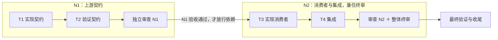

# 执行阶段审查改造：按完整节点验收

> **阅读改写稿 · 2026-10-15。** 本稿用于评审方案的表达方式，尚未替代[原方案](/Users/cm/workspace/github/skills/docs/designs/workflow-review-granularity.md)，也未改变正在执行的工作流。原稿记录为执行中，尚未登记实际交付结果；本次没有重新核验实现进度或效果数据。

## 1. 方案概览

把围绕同一功能或契约的连续任务组成一个审查节点，完成后一起验收。任务仍逐项执行并留下证据；依赖该节点的后续工作，必须等节点整体验收通过后才能开始。

这项改造要减少重复派发审查者、重复加载上下文和检查半成品的时间。**质量要求保持不变；是否真的更快、是否增加漏检，需要通过试用证明。** 首版提供可受控试用的机制，格式 4 保持显式启用，默认流程不切换。

| 环节 | 现有流程 | 拟采用的流程 |
|---|---|---|
| 执行与留证 | 每项任务分别执行、报告 | 保持逐任务执行与证据记录 |
| 独立审查 | 通常每个任务都派发一次审查 | 围绕完整功能、契约或风险边界，按节点审查 |
| 依赖放行 | 依赖已有完成状态 | 组内可消费已实现成果；跨节点必须等上游已验收 |
| 修复验收 | 修复容易再次进入完整审查 | 局部且可验证的修复由主控核对；复杂修复独立定向复核 |
| 整体终审 | 在任务审查之外另做终审 | 最后一个节点的独立审查兼任整体终审 |
| 收尾 | 最终验证、证据检查、文档回写 | 全部保留，并检查节点验收是否仍然有效 |

本方案减少的是重复检查的次数，验收范围和证据要求不缩减。节点划分在计划中声明，不能由执行者为了提速临时跳过审查。

## 2. 用一个完整例子说明

假设一个功能需要四项任务：T1 定义并实现上游契约，T2 完成该契约的验证，T3 实现消费者，T4 完成集成。



图中箭头表示执行顺序。T1、T2 同属一个节点，可以连续推进；T3 依赖上游契约，必须等 N1 整体验收通过。这里提前审查的理由是“后续消费者将依赖新契约”，不是因为任何函数被调用都要设一个审查节点。

一次正常执行分为五步：

1. T1 完成实现并记录修改、提交范围和验证证据；T2 随后继续。此时 T1 是“已实现”，不是“已验收”。
2. T1、T2 都实现完毕且满足送审条件，独立审查者检查实际改动，并给每项任务和整个 N1 作出结论。
3. N1 通过后，两个任务一起成为已验收，T3 的跨节点依赖解除。N1 未通过时，不先释放其中“看起来没问题”的部分。
4. N2 完成后，同一位独立审查者既验收 N2，也对从工作流基线到当前版本的完整交付作整体终审。
5. 全部节点验收有效、整体终审通过后，再做最终验证与收尾。

如果 N1 发现问题，先在 N1 内修复，消费者继续等待。如果 N1 通过后又改变了契约，已经依赖它的审查结论也要重新确认；已写完的实现不因此自动退回“未实现”。

一个工作流也可以只有一个节点：所有任务实现后统一审查，并兼任终审。前提是不存在需要提前检查的边界，而且审查者能够完整覆盖。

## 3. 执行时必须遵守的规则

### 3.1 先划边界，再开始执行

每项任务恰好归属于一个节点。计划写清节点包含什么、为什么这样分、审查什么、等待谁、什么时候送审，以及是否承担终审。终审或定向复核可以再次检查其他节点，任务唯一归属不限制必要的检查范围。

出现以下任一情况，才设置提前审查边界：

- 关键契约新增或实质变化，下游将据此实现。
- 错误会扩散到多个模块，或造成明显返工。
- 下一步会产生难以撤回的外部影响。
- 现有验证不足以控制相关风险。

提前节点须说明“审查对象、后续消费者或操作、判断错误的后果”。权限、数据、并发、迁移等风险落到具体行为上检查，不能只因任务名称带有这些词，就恢复逐任务审查。

计划中任务依赖与节点等待关系都必须无环，且恰好一个节点承担终审。终审节点等待其他节点验收，不能又被其他节点依赖。执行中只有出现新的依赖、契约变化或影响范围扩大等具体依据，才能调整节点。

### 3.2 实现完成与验收通过分别记录

任务的推进过程是：

```text
待执行 → 实现中 → 已实现、待审查 → 已验收
```

实现者每完成一项任务，记录实际修改、提交范围、验收方法与结果、失败信号自查和未解决事项。已有测试输出优先引用，不为记账重复测试或复制整份日志。

节点只有在成员任务全部已实现、必要验证已完成、未解决事项列明后才能送审。审查者读取实际改动与必要上下文，报告只作为线索。结果必须同时包含：

- 每项任务一行结论，关联验收依据或具体问题。
- 节点整体结论，判断规格、实现质量与组内集成是否成立。

节点通过后，成员任务才映射为既有的 `complete`。测试全绿、报告齐全、审查者一句“通过”，任何一种都不能单独代替完整交付判断。

### 3.3 修复采用两种验收方式

主控直接验收一项修复，需要同时满足五个条件：原问题与正确结果明确；修复不涉及复杂行为或关键契约变化；影响范围清楚且未扩大；验证证据充分；主控实际核对修复差异、原问题与结果。

复杂状态机、权限、并发等修复，即使只改一个文件，也可能需要独立定向复核。只凭“文件没超范围”或“测试由红变绿”不能决定走主控验收；拿不准就独立复核。

两种路径都围绕受影响内容验收，不自动重新启动全量审查。主控核对限于修复提交范围、原问题和验证证据。

### 3.4 每个审查阶段最多两轮集中修复

主控验收也计入修复轮次，新发现问题不重置计数。两轮后仍不通过，停止相关推进，重新分析根因、设计或验证方法。是否更换实现者或模型配置由失败原因决定，不设置固定“第二轮升级”的规则。

真正的重新分析可以开启新审查阶段，但必须具备：

1. 根因、设计或验证方法至少一项发生有证据的实质变化，并得到独立审查确认。
2. 重新评估影响范围；改变方案或计划时，重过受影响的审批门。
3. 原问题编号、修复历史连续保留。

新阶段可以重新计两轮，总历史不清零。改节点名字、拆分节点、重启会话、重复提交同一份确认，都不能用来刷新修复预算。具体身份和校验规则见附录 A。

### 3.5 已验收不代表结论永久有效

每次审查都要说明：审了哪个版本、哪些提交、依据哪些证据，以及依赖哪些契约、共享实现和配置。

| 后续变化 | 对原结论的处理 |
|---|---|
| 已审实现本身又变化 | 转为待重新确认 |
| 声明依赖的契约、共享实现或配置变化 | 相关结论转为待重新确认，暂停其跨节点依赖 |
| 节点声明或任务验收要求变化 | 旧版本结论不能证明新要求，需重新确认 |
| 变化出现在已审范围和声明前提之外 | 先暂停放行，再由主控提交有依据的影响判断 |
| 范围外变化被确认无关 | 将判断绑定到具体审查记录和变化内容后，允许继续 |
| 范围外变化相关或无法判定 | 定向复核；影响不清时扩大为节点审查 |

未提交和未跟踪的工作树变化与新提交同样处理。不能因为还没提交，就让消费者读取未经审查的新内容。

“实现完成”“审查结论有效”“依赖是否阻塞”分别计算。上游变化会影响后两项，不直接要求所有已实现任务重做。复核通过后恢复验收，原结论作为历史保留；后来的失败或失效记录不能被更早的通过结论抵消。

### 3.6 最后一次节点审查兼任整体终审

其他节点已验收、全部实现完成、交付文档就绪后，最后节点才进入兼任终审的审查。审查者保持既有独立性与模型要求，读取从工作流基线到当前版本的完整改动。

同一次审查分别回答两个问题：最后节点是否合格；整个交付是否满足目标、全部决策和全局约束。还要检查跨节点契约是否一致、后续修改是否削弱已有保证、文档是否符合实际。

已有有效结论可以复用，深入检查集中于新改动、集成影响和具体疑点；**整体需求覆盖仍要逐项核对**。两部分都通过后，继续最终验证和收尾。

## 4. 质量底线与实际代价

本轮继续要求：需求与决策完整落地；行为、边界及兼容性符合约定；相关风险经过检查；验证证据真实并对应当前版本；必须解决的问题关闭，文档与交付一致。

分组不能通过降低问题等级、缩小验收范围，或把未完成内容改称“已知限制”来取得通过。独立计划语义审查保留，并增加对分组合理性、验收充分性和两类依赖图的检查。

| 风险或代价 | 如何识别 | 如何处理 |
|---|---|---|
| 组内错误先被后续任务消费 | 终审发现前面漏掉的局部问题增多，返工扩散 | 调整对应节点类型的分组，必要时恢复更早审查 |
| 主控把复杂修复当成局部修复 | 修复后仍出现同类必修问题 | 收紧分流，拿不准即独立复核；必要时恢复逐任务频率 |
| 节点过大导致审查变浅 | 逐任务只有结论，没有验收依据或具体问题 | 细化节点，恢复可完整判断的范围 |
| 前提声明遗漏或影响判断出错 | 后续改动削弱了原先保证 | 扩大定向复核范围，必要时升级节点审查 |
| 声明类变化使已通过结论失效 | 只改验收要求，也会暂停放行 | 针对新要求复核；接受必要的重新确认成本 |

引擎可以强制检查“未验收不放行、记录存在、版本绑定有效”，不能机械证明审查者判断正确。前提锚点也只能覆盖已声明依赖，无法承诺绝对不漏检。这部分质量必须由审查纪律和试用评估共同检验。

## 5. 本次交付、验证与启用条件

### 5.1 本次交付什么

交付可受控试用的节点机制：节点声明、实现与验收分离、独立节点审查、修复分流、终审合并、结论失效与恢复、事件记录及必要的就绪检查。

计划格式 4 及以上采用节点制；格式不高于 3 的旧计划维持原行为，不新增节点解析与校验。首版仍串行派发写操作，不做工作树隔离、多写者事务、自动并行审查、复杂评分体系、自动模型升级或已送审节点的多前身合并。

审批模式 `gated / execution / bug` 的含义不变。启用节点制的 bug 和极小工作流同样声明节点，可以只有一个；bug 原有三项强制要求保留。“同型机械改动合并”判据不改，只增加同一批任务须属同一节点的限制。

不引入新依赖或外部工具，不修改其他 skill 或用户既有修改，不推送。本轮不调整 `task-workflow/test-prompts.json`：原稿决定默认路径未变，格式 4 受控试用前再评估是否补充分支说明。

### 5.2 第一层：证明机制实现正确

通过标准库隔离测试、`check` 和独立语义审查，验证以下类别。附录 C 给出具体情形，避免把一长串测试要求塞进方案概览。

| 类别 | 必须守住的结果 |
|---|---|
| 分组与依赖 | 跨节点不提前消费；任务图与统一节点等待图无环；终审不会死锁 |
| 状态与收尾 | 未验收不能标记完成；正式最终验证与收尾不能绕过节点和终审 |
| 变化与复核 | 实现、前提、任务要求变化能够失效；无关变化经有效判断可继续 |
| 重试与恢复 | 中断恢复状态一致；同一次操作重试不增加事件、轮次或阶段 |
| 历史与修复预算 | 改名、拆分、重启不清历史；新阶段必须有有效且未复用的独立确认 |
| 兼容性 | 格式不高于 3 的旧工作流行为保持不变 |

验证命令仍可用于诊断，但诊断成功不等于已满足正式最终验证与收尾的就绪条件。

### 5.3 第二层：证明实际工作效果值得启用

这层在受控试用阶段另行执行，不属于本次机制实现已经完成的结论。评估方法、代表性样本、模型配置、问题判据与通过条件应预先确认。

| 要回答的问题 | 方法 | 解释边界 |
|---|---|---|
| 发现问题的能力是否下降 | 同一实现快照上对照新旧审查安排，统一模型配置与判据 | 使用独立裁定的问题集合，不能把旧流程发现的列表当作全部正确答案 |
| 延后审查是否放大损失 | 代表性流程回放或受控执行 | 覆盖提前审查时机、组内错误传播与返工成本，不能只审一份静态代码 |
| 整体任务是否更快 | 同类任务观察总耗时、审查耗时、修复耗时与派发次数 | 审查次数少、同一份代码审得快，都不能单独证明整体更快 |

发现的问题区分为：前面漏掉的局部问题、整体集成问题、后续修改引入的问题、交付后暴露的问题。“终审发现更多”本身不直接等于质量下降。

只有两层验证成立、取得实际效果证据并获得明确确认后，才切换为默认格式 4，并在证据范围内报告“减少审查开销且保持交付质量”。有限样本不能证明永远不漏检。发现因分组漏掉必须解决的问题，先修复、调整规则并重新验证，不能用节省的时间抵消。

失败时优先针对出现问题的节点类型或风险类别回退：细化分组，必要时恢复逐任务审查；不因一次问题给所有工作流永久增加重复步骤。总耗时未改善，就不能宣称达成提速目标。

## 6. 为什么选择这条路线

| 备选 | 未采用的原因 |
|---|---|
| 维持逐任务审查，只用同型任务合并 | 合并仍是特例，无法普遍减少围绕同一功能的重复审查 |
| 只修改说明，不修改引擎 | 新验收状态与失效规则没有强制承载，未验收仍可能进入后续阶段 |
| 所有被下一任务使用的接口都提前审查 | 会把逐任务审查换个名字恢复；边界应由具体风险决定 |
| 只凭局部改动与测试通过，让主控验收 | 文件数与测试翻转不足以说明语义风险低 |
| 用流程约束直接证明质量不降 | 只能证明标准没有减少，实际漏检与返工仍需评估 |
| 首版支持已送审节点合并 | 多谱系合并涉及问题清单与修复预算归属，超出首版范围 |

## 附录 A：状态、版本与恢复契约

### A1. 计划格式与等待图

格式 4 新增与“阶段”同级的二级段 `审查节点`，三级标题使用 `N<n> 节点名`。节点 ID 来自标题，其余字段如下。

| 字段 | 要求 |
|---|---|
| 归属任务 | 必填，逗号分隔真实任务 ID；每个任务恰属一个节点 |
| 分组理由 | 必填，说明功能或契约完整性、下游依赖与判断错误的返工影响；提前节点增加对象、消费者、后果 |
| 审查职责 | 必填，包含逐任务结论与节点整体结论的验收对象 |
| 依赖节点 | 必填，`无` 或真实节点 ID；声明即形成等待约束 |
| 送审条件 | 必填，全部成员已实现、必要验证完成、未解决事项列明 |
| 兼任终审 | 必填，`是 / 否`，恰一个为“是” |
| 前身 | 可选，`无` 或最多一个历史节点／谱系 ID，适用于拆分、改名、调整 |

等待图统一采用 **等待者 → 被等待者**。例如 B 依赖 A，就有 `B → A`。它由三类边合并而成：任务依赖导出的跨节点边、显式声明的节点依赖边、终审节点到每个其他节点的等待边。

必须先合并，再判环；不能分别判每类边无环就认为整体无环。`check`、`slice`、最终验证与收尾的就绪判断共用这张图。终审节点不得为其他节点上游。任务依赖图也须独立满足无环要求。

缺必填字段、无效依赖、无法解析或歧义的前身、多前身、等待环均报错。批次 `slice` 的成员须同属一个节点。格式不高于 3 不解析该段、不新增这些校验。

### A2. 三种状态分别计算

| 判断 | 依据 | 影响 |
|---|---|---|
| 任务是否已实现 | `implemented` 事件及证据 | 允许同节点内依赖已实现成果继续 |
| 节点结论是否有效 | 节点版本、审查阶段、审查结果及前提变化 | 决定是否具备验收资格 |
| 是否受依赖阻塞 | 上游节点是否保持有效验收 | 决定是否允许跨节点推进 |

状态判断应由同一规则派生，`next / slice / record / review` 不能各自取不同口径。`verify / close` 保留原有证据与验收要求，并增加节点就绪检查。正式收尾不能绕过未验收、未处理的重新确认或未通过的整体终审。

### A3. 结论绑定的对象

每次节点审查记录节点版本、审查阶段、已审提交范围、证据引用、逐任务结论、整体结果、未关闭问题及依赖前提。前提既包括上游契约，也包括会影响结论成立的共享实现和配置。

| 对象 | 定义 |
|---|---|
| 节点版本 | 节点块及所有归属任务块的声明字段规范化文本，计算 SHA-256 前 16 位；剔除 `状态` 等运行字段 |
| 前提条目 | 类型为契约锚点／共享实现／配置，包含文件或路径集、内容摘要及基线提交 |
| 契约锚点 | 包含产出任务文件集、接口签名摘要、基线提交；不能只记录签名而忽略共享行为 |
| 节点结论绑定 | 已审实现范围与依赖前提，不要求所有无关变化都触发重新审查 |
| 整体终审与最终验证绑定 | 完整工作树指纹与计划指纹，沿用既有设施 |

节点版本摘要是新增的独立摘要，不修改计划／方案审批指纹算法。重新批准计划只表示接受新要求，不能证明旧实现满足新验收条件。

### A4. 有效性、失效与定向恢复

在当前节点版本、当前审查阶段下，取最近一条适用的审查结论。它必须为 `pass`，之后没有新的失败或失效，并且没有尚未完成有效影响判断的范围外变化，才能放行。后来的 `fail` 或 `node_invalidated` 不能被更早的 `pass` 抵消。

以下三类变化触发处理：

1. 已审实现本身出现新提交，或已审范围出现未纳入审查的工作树变化，包括未提交、未跟踪内容：转待重新确认。
2. 声明前提被提交或工作树变化触及：转待重新确认。
3. 范围外变化无法直接确定影响：全局枚举变化路径与内容摘要，暂停该节点放行，进入 A5 的影响判断。

全局约束变化同样要评估影响；无法确定时，相关结论先转待重新确认，确认无关则留依据。声明依赖某契约的节点，即使已经验收，也会在该契约变更后重新确认，其跨节点下游依赖暂停。

工具负责检测声明范围的变化，主控给影响说明，必要时由独立审查确认。针对新前提定向复核通过后恢复验收；无法确定影响范围时升级为节点审查。历史结论保留。

### A5. 范围外变化的影响判断

影响判断绑定两项内容：被评估的节点审查记录身份，以及被评估的变化集。前者包括审查操作 ID、谱系、节点版本和阶段；后者逐项记录路径及内容 SHA-256 前 16 位。

| 步骤 | 行为 |
|---|---|
| 发现变化 | 工具暂停节点放行，展示当前审查记录与变化集快照 |
| 作出判断 | 主控评估具体内容，经 `impact` 提交结论与依据，同时回传实际评估时的预期审查 ID、变化集摘要 |
| 提交核对 | 预期值与当前值一致才写入；已改变则拒绝、保持阻塞，并返回新快照 |
| 判无关 | 持久化绑定与依据，解除该项暂停 |
| 判相关或无法判断 | 转待重新确认，进入定向复核；不能默认沿用旧结论 |
| 相关变化已完成定向复核 | 按新的有效结论恢复；已处理的变化不再因原影响判断的暂停重复阻塞 |
| 中断后恢复 | 重放事件后，相同绑定直接复用，不重复提问或阻塞 |
| 绑定过期 | 同路径内容变化、审查记录更替、节点版本或阶段变化后，旧判断失效 |

判断按内容生效，不按路径名称生效。同一改动提交前后内容摘要一致，可继续复用。若主控观察 H1 后内容已变成 H2，针对 H1 的判断不能被绑定到 H2。

已成功操作携原操作 ID 重试时，返回原结果，不对新内容重新快照或重新绑定；统一重试规则见附录 B。

### A6. 谱系、拆分与修复预算

节点首次送审时生成审查谱系 ID。谱系根是稳定身份，节点 ID 是当前代表；修复轮次、问题清单和失效历史挂在谱系根上。

拆分、改名或调整时，新节点声明唯一前身。前身不得指向当前计划中仍在使用的节点 ID，因为本次调整应替换或移除旧节点。解析同时查当前计划、历史审查记录、事件中的谱系 ID 及前身链；不能因为旧节点已从计划移除就认定不存在。完全解析不到或有歧义时拒绝。

多个子节点可以分别承接同一个前身，并共享谱系根；修复预算继续沿根计算，不重置、不相加。首版每个新节点最多一个前身，多前身重组拒绝。该限制保留历史与预算的连续性，暂不处理多谱系合并。

### A7. 封顶后新阶段的确认

新阶段记录绑定谱系、前阶段号到新阶段号、实质变化依据、独立确认记录、所确认的变更版本。引擎检查：

1. 确认记录属于该谱系。
2. 确认记录未被此前任何 `review_phase` 使用；更换操作 ID 也不能再次使用同一确认。
3. 所确认版本存在于提交图，且此后该谱系范围没有未纳入确认的新变化。
4. 确认记录的阶段与当前阶段一致；新阶段号由引擎按当前阶段＋1 推导，重放序列连续。

以上任一失败均拒绝。是否存在实质设计变化由独立审查者判断，不由“说明文字非空”证明。

影响范围重新评估后，方案正文变化须重过方案门，只有计划变化则重过计划门；`execution` 出现新的用户判断时先 `gate`。原问题编号继续追踪，新阶段重新计两轮，总历史保留。

### A8. 持久化与投影恢复

格式 4 以 `events.jsonl` 为权威记录，计划中的状态是可重放投影。写入顺序为先事件、后状态；中断后按事件恢复投影。投影不一致先修复，无法恢复则在相关推进入口拒绝放行。

| 事件 | 记录内容 |
|---|---|
| `implemented` | 任务实现完成及其证据 |
| `node_review` | 操作 ID、节点版本、审查阶段、前提版本、逐任务行、结果、未关闭问题 |
| `node_invalidated` | 节点结论失效 |
| `projection_repair` | 状态投影恢复 |
| `review_phase` | 谱系、前后阶段、实质变化依据、独立确认引用、所确认变更版本 |
| `impact_assessed` | 操作 ID、审查记录身份与变化集绑定、判断结论及依据 |

该机制沿用单控制器串行写入，不引入多写者事务。中断恢复按谱系根重建有效结论与轮次，各入口必须得到一致状态。

## 附录 B：CLI 与重试协议

以下是原方案约定的格式 4 接口，不表示当前脚本已经实现这些入口。格式不高于 3 的行为保持不变。

### B1. 记实现、记审查与复核

记录任务实现：

```text
record <slug> <T> --commits A..B --evidence "<验收方法、结果、失败信号>" --operation-id <id>
```

记录节点审查：

```text
review <slug> <节点> --verdict pass|fail --commits A..B --lines "<逐任务结论与依据>" --evidence "<证据引用>" --operation-id <id>
```

格式 4 的 `record` 不再接收 `--verdict`，只记已实现。节点 `review` 通过后，成员任务才映射为 `complete`。

在 `review` 调用中用 `--recheck <原操作ID>` 关联被复核记录，并使用新的 `--operation-id` 标识本次复核。原记录关联与本次重试身份是两件事；同范围在新契约或新阶段下得到同样结论，也属于需要保存的新证据。

封顶后开启新阶段时，在 `review` 调用中使用：

```text
--new-phase --basis "<实质变化>" --confirmation <独立确认记录引用> --confirmed-commit <A..B> --operation-id <id>
```

独立确认记录、版本与阶段须通过 A7 的全部校验，不能只靠填入一段理由开启新阶段。

### B2. 提交范围外变化的影响判断

```text
impact <slug> <节点> --verdict irrelevant|related|undecidable --basis "<依据>" --expect-review <审查记录操作ID> --expect-changes <变化集摘要> --operation-id <id>
```

`--expect-review` 与 `--expect-changes` 来自实际评估时的 `status` 快照。引擎核对当前审查记录和待判断变化集；不一致时拒绝写入、保持阻塞并返回新快照。

`irrelevant` 保存有效绑定与依据后解除该项暂停。`related` 与 `undecidable` 进入重新确认和定向复核路径，不能据此放行。

### B3. 查询与执行入口

`next / slice / status` 展示未验收节点、待重新确认的原因，以及审查债务：已实现但未完成节点审查的任务、尚未开启审查的节点。影响判断所需的审查记录 ID、变化路径与内容摘要也必须可见。

`slice` 拒绝存在未验收跨节点依赖的派发；`close / verify` 的正式放行拒绝未验收节点和未处理的重新确认。

### B4. 所有记账操作共用的重试语义

`record`、`review`、定向复核、新阶段、`impact` 都必须携带 `--operation-id`。调用方在首次执行前生成并保存，重试复用。原稿约定的 ID 形状为 `rv-<谱系>-<seq>`；首版不提供引擎自动生成与找回。

| 请求 | 结果 |
|---|---|
| 未提供操作 ID | 拒绝 |
| 相同 ID、相同请求 | 返回原结果，必要时恢复投影；不新增事件、轮次或阶段 |
| 相同 ID、不同请求 | 拒绝冲突 |
| 真正的新审查或复核 | 使用新 ID，另行关联旧记录 |

结果 receipt 随事件持久化，或能由事件确定性重建。事件已经落盘但尚未返回时中断，重启后仍能用原 ID 重放。幂等判断不能只看“谱系、提交范围、结论”是否相同。

对于 `impact`，已经成功的原操作重试返回原结果，不能重新绑定当前的新快照；新内容必须经过新的评估与操作。

## 附录 C：机制正确性的验收情形

这些情形服务第 5.2 节的实现验收。与运行效果评估分开，避免“机制测试通过”被解释成“提速与漏检率已有结论”。

### C1. 分组、状态与依赖

| 情形 | 预期结果 |
|---|---|
| 上游节点未验收，下游依赖任务请求派发 | 拒绝；同节点内依赖已实现成果仍可继续 |
| 节点只有部分成员通过检查 | 不提前释放该节点的跨边界依赖 |
| 任务已实现但节点未通过 | 不映射 `complete`；正式最终验证与收尾不得绕过 |
| 任务图、节点等待图出现环 | 拒绝，包括终审等待边造成的环 |
| 只有节点级依赖，没有任务级依赖 | 声明仍约束派发，不能提前放行 |
| 两类来源各自无环，合并后成环 | 检测并拒绝，例如任务导出 B 等 A、显式声明 A 等 B |
| 没有终审节点、多个终审节点或其他节点依赖终审节点 | 拒绝 |
| 批次任务跨越多个节点 | 拒绝该批次派发 |
| 上游契约失效 | 下游结论重新确认并暂停跨节点放行；已实现状态不退回 |

### C2. 内容变化与影响判断

| 情形 | 预期结果 |
|---|---|
| 已审实现自身出现新提交 | 结论重新确认 |
| 不新增提交，只改已审接口或配置 | 工作树变化同样阻止放行，包括适用范围内未跟踪内容 |
| 已声明的共享实现或配置变化 | 触发相关结论失效；不能只检查接口签名 |
| 节点块不变、代码不变，只改任务验收要求 | 节点版本变化，旧结论不得放行 |
| 新要求下重新批准计划 | 不能代替针对新要求的复核 |
| 通过之后记录失败或失效 | 不回看更早的 `pass` 放行；后续有效复核通过才能恢复 |
| 范围外变化尚未提交影响判断 | 暂停放行，不按“没命中前提”视为安全 |
| 范围外变化被有效判断为无关 | 记录依据后继续，无需因此重做节点审查 |
| 同一范围外改动由未提交变为已提交，内容摘要不变 | 影响判断语义一致，可复用绑定 |
| 判断为相关或 `undecidable` | 进入重新确认与定向复核 |
| 相同有效绑定下重启进程 | 重放后直接复用判断，不重复阻塞 |
| 同路径内容变化、审查记录更替、版本或阶段变化 | 旧影响判断绑定过期 |
| 评估 H1 后内容变为 H2，或审查记录已替换，再提交 H1 判断 | 核对预期值失败，拒绝并返回新快照，不把判断绑定到新内容 |

### C3. 恢复、修复预算与兼容

| 情形 | 预期结果 |
|---|---|
| 中断发生在事件写入与状态投影之间 | 从事件修复投影；无法恢复则各推进入口拒绝 |
| 事件已写入、结果尚未返回，中断后携原 ID 重试 | 返回原结果，不新增事件、轮次或阶段；覆盖 `impact` |
| 同操作 ID 携不同请求 | 拒绝 |
| 任一记账操作缺操作 ID | 拒绝 |
| 新契约或新阶段下，对同一提交范围再次复核通过 | 保存新证据，不按范围与结论相同去重 |
| 改名、拆分或重启 | 谱系、问题与轮次连续，修复预算不重置、不相加 |
| 旧前身已从当前计划移除，但历史中可唯一解析 | 合法承接；不能误判不存在 |
| 前身仍在使用、无法解析、存在歧义或声明多个前身 | 拒绝 |
| 同一谱系修复达到两轮上限 | 停止相关推进，不能直接进入第三轮 |
| 用同一确认记录再次开阶段，或换操作 ID 重复使用 | 拒绝，一次性约束仍有效 |
| 使用不属于该谱系、已过期版本或阶段不匹配的确认 | 拒绝；确认之后出现未纳入的相关变化也不得放行 |
| 新阶段实质变化经独立确认、绑定合法、受影响审批已完成 | 开启连续的新阶段，保留旧问题与历史 |
| 方案正文变化或仅计划变化 | 分别使受影响的方案门或计划门重新生效，不能只重过无关门 |
| 中断恢复后查询、派发、记账与收尾 | 采用一致的状态判断 |
| 格式不高于 3 的旧计划 | 继续旧行为，不新增节点解析和限制 |

## 附录 D：决策索引

ID 与来源归属沿用原稿。原稿将下列决定标为用户确认；本稿不产生新的审批记录。具体机制已在正文和附录展开，索引用于追溯选择与理由。

### D1. 审查单位、质量与启用

| ID | 决定 | 理由与本文落点 |
|---|---|---|
| D-01 | 节点验收，任务执行与留证 | 减少重复审查且保留任务交付单元；第 1–3 节 |
| D-02 | 提前审查限四类风险触发，并说明对象、消费者、后果 | 避免所有接口都成为节点；3.1 |
| D-03 | `record` 记已实现，节点通过后才 `complete` | 保持完成等于已验收；3.2、B1 |
| D-04 | 事件为权威，计划状态为投影 | 中断可恢复，无法恢复不放行；A8 |
| D-05 | 恰一个终审节点、不得被依赖、等待图无环 | 防止终审死锁；A1 |
| D-09 | 实现、结论有效性、依赖阻塞分离 | 上游变化不自动推翻已实现事实；A2 |
| D-13 | 格式 4 首版显式启用，效果通过且明确确认后才切默认 | 不改变运行中的旧流程；第 5 节 |
| D-14 | 同快照对照＋流程回放／受控执行＋独立问题裁定 | 分别验证发现能力、传播代价与整体耗时；5.3 |
| D-16 | 修复按语义风险分流，主控验收须五项同时成立 | 局部改动不等于低风险；3.3 |
| D-17 | 计划新增审查节点段，扩展独立语义审查 | 分组、验收与等待关系需预先检查；3.1、A1 |
| D-19 | 本次交付是可受控试用的机制 | 实际效果不能提前宣称成立；5.1–5.3 |
| D-20 | 本轮不同步行为提示文件 | 默认路径未变，受控试用前再评估格式 4 分支说明；5.1 |

### D2. 有效性、重试与修复历史

| ID | 决定 | 理由与本文落点 |
|---|---|---|
| D-06 | 两轮封顶，新阶段须独立确认实质变化、重评影响、保留问题 | 防止以补说明绕过封顶；3.4、A7 |
| D-07 | 实现、前提及无法判定影响的变化都进入有效性检查 | 未提交内容也可能破坏已审保证；3.5、A4–A5 |
| D-08 | 首次执行前保存操作 ID，所有记账操作强制携带，重试复用 | 防止中断后重复事件与计数；B4 |
| D-10 | 等待图采用等待者指向被等待者 | 避免方向不一致造成误判；A1 |
| D-11 | 谱系为稳定身份，每个新节点最多一个前身 | 拆分不清预算，首版不做多谱系合并；A6 |
| D-12 | 恢复时重过受影响的审批门 | 方案变化不能只重过计划门；A7 |
| D-15 | 沿用约定的节点 ID、事件类型、操作 ID 形状与 16 位摘要 | 统一计划、CLI 与事件的承载；A1、A3、A8、B4 |
| D-18 | 当前版本、当前阶段的最近结论必须通过；任务声明也参与版本 | 旧通过不能抵消新失败或新验收要求；A3–A4 |
| D-21 | 任务导出、显式节点依赖与终审边合为一张等待图 | 声明即约束，跨来源的环也能发现；A1 |
| D-22 | `impact` 持久化内容绑定，提交核对快照，重试返回原结果 | 防止旧判断套用新内容，支持重启复用；A5、B2、B4 |

## 来源与交付记录

直接来源为[原方案](/Users/cm/workspace/github/skills/docs/designs/workflow-review-granularity.md)。原稿的八条初始行为决定及后续修订，在本稿按最终机制归并，不把历轮审阅过程放在阅读入口。完整修改来由仍可回溯原稿。

兼容依据继承[证据生命周期方案](/Users/cm/workspace/github/skills/docs/designs/workflow-evidence-lifecycle.md)与[审批指纹方案](/Users/cm/workspace/github/skills/docs/designs/workflow-approval-fingerprint.md)：状态记账与验收指纹分离，真实任务状态行为投影；不通过扩大审批指纹的忽略范围来容纳新机制。本次未重新审计这两份上游设计。

原稿尚未登记实际交付清单与效果数据。本稿未补写完成结论；实施后应据实登记交付、验证、偏离及限制。源稿列明的限制——依赖声明与影响判断的覆盖、调用方保存操作 ID、单前身与单写者、声明变化导致复核、旧格式不受益——均保留在对应机制处。

原稿快照 SHA-256：`453cd1ab02016ea3d408ecb27401bf5a92fe866d39f50397677d3d0c07d76321`。
