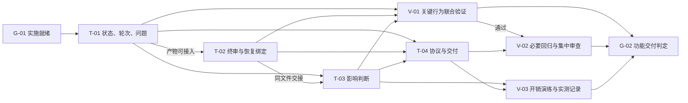

# 工作流审查收敛实现计划

## 1 计划定位与设计承接

| 项目 | 内容 |
| --- | --- |
| 版本、日期与状态 | 1.0，2026-10-15；已确认讨论的成文计划，尚未整体独立评审；实施未开始、验证未执行 |
| 实现目标 | 修复节点结论归属、修复预算、终审与恢复绑定、问题闭环；减少范围外判断和复核的重复开销 |
| 设计基线 | [工作流审查收敛设计 1.0](../designs/workflow-review-convergence.md)，以第 4—6 章的行为、接口和数据约束为实现依据，第 9 章为验收权威定义 |
| 代码基线 | `/Users/cm/workspace/github/skills`，提交 `d8cb702a5aad0c722345e08aa75d743c43b328ce`；成文时目标 `task-workflow/` 无未提交修改 |
| 工作区情况 | 其他 skill 及资料存在用户已有修改；本计划不包含这些内容，实施前重新核对目标文件变化 |
| 范围 | `task-workflow` 的既有引擎、隔离测试、相关协议和行为用例；本次两份设计与计划在实施后如实回写状态 |
| 排除项 | 多智能体调度、自动语义依赖分析、独立问题系统、多写者事务、批量历史迁移、多前身合并、默认启用格式 4 |
| 设计阻塞 | 无需重新确认的已知行为选择；若实现发现具体错误放行、问题遗失或死锁反例，只反馈受影响决定 |
| 当前授权 | 仅生成设计和计划文档；尚未授权依据本计划修改工作流代码或开始执行 |
| 执行记录入口 | 初始状态见第 6 章；后续直接实施时在该章维护实际证据，接入既有执行系统后改为引用其唯一权威记录，不双写实时进度 |

### 全局约束

| ID | 约束 |
| --- | --- |
| C-01 | 已确认规则以设计正文为权威；本计划不通过改任务、改测试或改文档降低验收要求 |
| C-02 | 格式不高于 3 的执行、审批、验证及历史收尾保持兼容；不改写旧事件制造新授权 |
| C-03 | 复用现有标准库脚本、事件、交付绑定、投影修复及单主控串行写入模型 |
| C-04 | 同组任务产物可接入即可继续；不为每个任务启动完整独立审查或重跑全量测试 |
| C-05 | 保留独立计划语义审查；本组实现集中审查、集中修复、定向复核；终审继续承担整体质量检查 |
| C-06 | 设计确认、已实现、验收通过、实际提效分别记录；没有运行证据不能宣称效率目标已达成 |

### 外部引用

以下决策均引用同一设计文档的第 3 章，不在计划内建立第二份决策正文。验收编号沿用设计第 9 章，后文仅登记实现归属与验证安排。

| ID | 来源 |
| --- | --- |
| D-01 | [设计 §3.2](../designs/workflow-review-convergence.md#32-关键决策与确认依据)：收敛范围与质量、效率要求 |
| D-02 | [设计 §3.2](../designs/workflow-review-convergence.md#32-关键决策与确认依据)：节点结论与谱系历史分离 |
| D-03 | [设计 §3.2](../designs/workflow-review-convergence.md#32-关键决策与确认依据)：拆分首审与继承预算 |
| D-04 | [设计 §3.2](../designs/workflow-review-convergence.md#32-关键决策与确认依据)：同轮多节点复核 |
| D-05 | [设计 §3.2](../designs/workflow-review-convergence.md#32-关键决策与确认依据)：终审前置检查 |
| D-06 | [设计 §3.2](../designs/workflow-review-convergence.md#32-关键决策与确认依据)：完整交付版本与差异确认 |
| D-07 | [设计 §3.2](../designs/workflow-review-convergence.md#32-关键决策与确认依据)：恢复确认绑定 |
| D-08 | [设计 §3.2](../designs/workflow-review-convergence.md#32-关键决策与确认依据)：范围外变化集中处理 |
| D-09 | [设计 §3.2](../designs/workflow-review-convergence.md#32-关键决策与确认依据)：问题闭环 |

## 2 交付分解与覆盖关系

整个改造按一个实现组组织，四项任务一次细化完整。任务用于交接产物，不各自成为独立审查节点。

| 任务 ID | 交付成果 | 设计引用 | 主要前置 | 验收与验证归属 |
| --- | --- | --- | --- | --- |
| T-01 | 节点结论、同轮修复与问题清单的统一派生及必要请求契约 | §4.1、§4.2、§4.6、§5—6；D-02、D-03、D-04、D-09 | G-01 | AC-01、AC-02、AC-03、AC-08；V-01、V-02 |
| T-02 | 终审前置检查、送审绑定及新阶段确认绑定 | §4.3、§4.4、§5—6；D-05、D-06、D-07 | T-01 可接入 | AC-04、AC-05、AC-06；V-01、V-02 |
| T-03 | 影响判断增量展示、批量提交与逐行幂等恢复 | §4.5、§5—7；D-08 | T-01 可接入；T-02 同文件交接 | AC-07、AC-10；V-01、V-02、V-03 |
| T-04 | 运行协议对齐、有限行为用例、集成检查与交付说明 | §7—10；D-01；引用其他决策 | T-01、T-02、T-03 的接口和行为已实现 | AC-09、AC-10；V-02、V-03 |

| 验收 ID | 设计要求索引，完整预期见设计第 9 章 | 关联任务 | 验证归属 |
| --- | --- | --- | --- |
| AC-01 | 拆分结论互不覆盖、最新失败不回看旧通过 | T-01 | V-01 |
| AC-02 | 正常拆分首审不扣预算，历史预算不清零 | T-01 | V-01 |
| AC-03 | 同轮多结果只计一轮、第二轮可收齐、第三轮拒绝 | T-01、T-02 | V-01 |
| AC-04 | 正式终审等待其他节点当前有效，单节点不自锁 | T-02 | V-01 |
| AC-05 | 终审、验证、收尾覆盖同一完整交付版本 | T-02 | V-01 |
| AC-06 | 独立确认不能错配新提交或未提交版本 | T-02 | V-01 |
| AC-07 | 增量阅读但完整绑定；批量行不互相授权，重试不重复 | T-03 | V-01、V-03 |
| AC-08 | 问题不因空输入、拆分、阶段或重试丢失；有据关闭 | T-01、T-02 | V-01 |
| AC-09 | 旧格式及有效历史兼容，全部入口和协议同口径 | T-01、T-02、T-03、T-04 | V-02 |
| AC-10 | 减少重复操作、复核和验证，效果声明受真实证据限制 | T-03、T-04 | V-03 |

## 3 依赖、阶段与启动条件

### 实施门禁与细化范围

| ID | 条件 | 对实施的作用 | 当前状态 |
| --- | --- | --- | --- |
| G-01 | 获得实施授权，按既有要求完成独立计划语义审查，重新核对目标代码基线 | 首项代码任务启动条件；本次成文自检不替代该审查 | 未执行，等待后续实施 |
| G-02 | 四项交付完成，必要验证有效，集中独立审查的阻断项关闭，当前版本满足终审与收尾要求 | 本次功能修补完成判定；效率实测结论另行如实记录 | 未执行 |

全部任务已细化。T-01 至 T-03 都修改同一个引擎文件，由一个执行责任方依次交接，避免为了并行产生合并与复核成本。阶段不额外增加等待条件：T-02 无需等待 T-01 独立验收，只需其契约和产物达到下面的可接入条件。

| 前置对象 | 后续对象 | 依赖类型 | 满足条件 |
| --- | --- | --- | --- |
| G-01 | T-01 | 设计确认 | 实施授权及独立计划语义审查有实际凭据，目标基线无未处理冲突 |
| T-01 | T-02 | 产物可接入 | 节点结论、修复轮、问题派生与结构化输入可被复用，接口及已知限制明确 |
| T-01 | T-03 | 产物可接入 | 节点上下文和完整快照结构稳定，旧行为仍可读取 |
| T-02 | T-03 | 资源交接 | 引擎同文件修改结束，版本绑定与公共输入处理已交接 |
| T-01 | T-04 | 产物可接入 | 状态、轮次与问题契约有实际实现和用例入口 |
| T-02 | T-04 | 产物可接入 | 终审与恢复的实际参数、错误与兼容边界明确 |
| T-03 | T-04 | 产物可接入 | 增量输出与批量影响请求的实际格式明确 |
| T-01 | V-01 | 验证前置 | 相关代码及隔离用例已形成 |
| T-02 | V-01 | 验证前置 | 版本与门禁场景已形成 |
| T-03 | V-01 | 验证前置 | 影响判断场景已形成 |
| V-01 | V-02 | 验证通过 | 关键行为断言已通过，已知失败有明确修复结果 |
| T-04 | V-02 | 验证前置 | 协议与行为用例按实际接口对齐 |
| T-03 | V-03 | 验证前置 | 批量与增量行为可演练 |
| T-04 | V-03 | 验证前置 | 提效口径、记录项与适用限制明确 |
| V-01 | G-02 | 验证通过 | 关键链路证据对最终代码仍有效 |
| V-02 | G-02 | 验证通过 | 必要回归与集中审查通过，阻断问题已关闭 |
| V-03 | G-02 | 验证通过 | 场景操作量及实测状态有真实记录，没有将待实测写成提效完成 |



箭头表示产物或验证前置，具体条件以表格为准。V-01 可在任务期间做必要定位检查，但统一证据在关联实现集成后形成；不作为组内所有任务之间的额外屏障。

## 4 任务说明

### T-01 统一节点结论、修复轮次与问题派生

| 字段 | 内容 |
| --- | --- |
| 细化状态 | 已细化 |
| 目标与产物 | 在现有引擎形成节点独立结论、同轮预算与问题闭环；提供后续任务可复用的派生和输入校验 |
| 设计依据 | 设计 §4.1、§4.2、§4.6、§5—6；D-02、D-03、D-04、D-09 |
| 范围与约束 | C-01 至 C-06；只扩充现有事件，不单独维护问题或修复批次系统 |
| 前置与启动条件 | G-01 满足；重新读取目标文件和实际工作区差异 |
| 必读材料 | 设计上述章节；`workflow.py` 的 `node_review_index`、`invalidation_report`、`node_state`、`round_count`、`round_cap_problem`、`read_events`、`review_node`；已有拆分、两轮封顶与幂等用例 |
| 代码位置 | 已有：`task-workflow/scripts/workflow.py`、`task-workflow/tests/test_workflow.py`；不预设新增业务模块 |
| 验收与验证归属 | AC-01、AC-02、AC-03、AC-08，V-01；兼容由 V-02 联合提供证据 |
| 反馈触发条件 | 原问题无法可靠归属或旧历史无法解释时，报告具体记录；若必须改变两轮上限、首审边界、问题关闭权或历史真实性，暂停受影响部分 |

实施步骤：

1. 补强现有拆分用例：要求两个子节点同时有效，并能继续到最终验证与收尾；保留一个最新失败不能被旧通过抵消的断言。
2. 调整索引与消费者，按当前节点取最新记录后判断版本；失效记录核对所否定结论与关联范围，避免同谱系兄弟误失效。统一所有派生、派发、展示与就绪入口，避免另造旁路。
3. 实现设计定义的轮上下文与预算推导，区分非修复记录、本轮成员结果、新一轮及幂等重放；封顶检查允许第二轮剩余成员，阻止第三轮。
4. 接入问题增量操作与派生视图：新增、关闭、重开；保留未提及项；通过关联任务承接拆分问题。将问题门禁接入现有状态判断，不单独再维护一份清单。
5. 新字段进入请求摘要、事件读写校验和恢复路径；补齐空输入不清单、跨阶段继承、同轮失败再修、部分结果中断、未分配问题和联合关闭场景。
6. 向 T-02、T-03 交接可调用的上下文与派生入口、请求载体格式和未完成的非阻断说明；以可接入状态交接，不冒充验收通过。

### T-02 补齐终审与恢复的版本契约

| 字段 | 内容 |
| --- | --- |
| 细化状态 | 已细化 |
| 目标与产物 | 正式终审等待其他节点当前有效；终审与新阶段确认绑定实际审阅对象；验证和收尾拒绝错版本 |
| 设计依据 | 设计 §4.3、§4.4、§4.7、§5—6、§8；D-05、D-06、D-07 |
| 范围与约束 | C-01 至 C-06；直接复用 `_binding`，不新增版本等价算法或审批阶段 |
| 前置与启动条件 | T-01 产物可接入，节点与问题状态判据稳定；不要求 T-01 已单独验收 |
| 必读材料 | `wait_graph`、`wait_closure`、`node_state`、`require_node_acceptance`、`_binding`、`review_node`、`review_new_phase`、`resolve_confirmation_*`、`confirmed_version_binding`、`cmd_verify`、`cmd_close` |
| 代码位置 | 已有引擎和测试文件；确认报告格式在 T-04 同步到协议 |
| 验收与验证归属 | AC-03、AC-04、AC-05、AC-06、AC-08，V-01；兼容与整体由 V-02 |
| 反馈触发条件 | 出现终审自锁、问题关闭与前置验收相互等待、需要伪造旧绑定或改变原指纹排除范围时，报告最小反例，不以放宽门禁处理 |

实施步骤：

1. 在终审送审协议和正式记录入口复用“其他节点当前有效”检查，返回具体阻塞原因；覆盖单节点与跨节点问题修复后恢复。
2. 使终审请求回传实际送审绑定，落账时核对；最终验证、收尾和展示使用同一有效性判据，普通影响判断不能替换终审绑定。
3. 支持引用原终审的差异确认并记录新绑定；保留实际审查方式、差异证据及问题处置，不重新启动无关的全面审查。
4. 使恢复确认凭据自身携带实际版本和明确授权元数据，事件与报告同口径；校验阶段、一次性、时序与当前绑定，提交参数只作一致性核对。
5. 保留历史读取，拒绝把缺失字段自动补成当前授权；针对未提交改动、仅 HEAD 变化、计划变化和记录期间变化增加少量有区别的失败场景。
6. 向 T-03 交接已修改的同文件、结构化请求和共享绑定；记录终审后版本变化的最小恢复操作，交 T-04 成文化。

### T-03 合并范围外变化的阅读与提交开销

| 字段 | 内容 |
| --- | --- |
| 细化状态 | 已细化 |
| 目标与产物 | 状态展示新增差异及历史上下文；现有影响判断入口支持多节点结构化提交与逐行恢复 |
| 设计依据 | 设计 §4.5、§5—7；D-08 |
| 范围与约束 | C-01 至 C-06；保持逐节点完整快照绑定，不按路径白名单或文件判断的并集默认放行 |
| 前置与启动条件 | T-01 可接入，T-02 完成同文件交接；有稳定的记录身份、版本与请求处理契约 |
| 必读材料 | `invalidation_report`、`impact_binding`、`binding_matches`、`pending_lines`、`cmd_impact`、操作 ID 与事件追加；已有 stale snapshot、内容摘要、重启复用用例 |
| 代码位置 | 已有引擎和测试文件；复用现有 `impact_assessed`，不新增批量事件类型 |
| 验收与验证归属 | AC-07、AC-10，V-01、V-03；回归由 V-02 |
| 反馈触发条件 | 若需要跨节点复用无关结论、忽略组合影响、把不同节点快照当相同，或新增多写者事务才能实现，先反馈设计冲突 |

实施步骤：

1. 在相同审查上下文内比较上次判断与当前完整变化集，生成新增、修改、删除的增量，保留上次依据及完整上下文的入口。
2. 扩展现有影响请求载体接收多行；逐行保留目标、完整预期快照、结论、依据和稳定操作 ID。单节点旧调用继续可用。
3. 提交前先识别幂等重放行，再校验全部待追加行；任一过期或非法，不写本批新事件。复用既有追加与恢复，不引入新的事务系统。
4. 加入一行过期、多行不同结论、同路径变化、部分写入后重试及审查上下文更替的用例，证明未提交行和其他节点不会被默认放行。
5. 交付批量示例与增量示例给 T-04；执行三类成本演练需要的操作计数由 V-03 统一收集，不为每个节点重复跑评估。

### T-04 对齐运行协议并组织整组交付

| 字段 | 内容 |
| --- | --- |
| 细化状态 | 已细化 |
| 目标与产物 | 让主控与模型按同一规则使用新实现，交付实际接口说明、兼容边界和验证记录 |
| 设计依据 | 设计第 7—10 章及各功能契约；D-01 与其他已确认决策 |
| 范围与约束 | C-01 至 C-06；文本按实际接口归一，不为文档新增流程、批准或额外审查节点 |
| 前置与启动条件 | T-01、T-02、T-03 的接口和可观察行为已实现，可在联合验证尚未完成时开始对齐 |
| 必读材料 | 当前 `task-workflow/SKILL.md`、`README.md`、`references/dispatch-protocol.md`、`plan-format.md`、`verification.md`、`plan-review.md`，已有 `test-prompts.json`；本设计与实际 CLI 输出 |
| 代码位置 | 已有上述协议和用例文件；仅在涉及新规则时修改。原审查粒度设计保留历史，本次设计作为后续修补权威入口 |
| 验收与验证归属 | AC-09、AC-10，V-02、V-03；依赖 V-01 的真实功能证据 |
| 反馈触发条件 | 协议适配要求新增设计审批解析器、改变技能发现或重建旧工作流时，报告越界项；不能以修改设计掩盖实现偏差 |

实施步骤：

1. 对齐格式 4 的轮次、修复分流、同轮多节点、问题关闭、终审差异确认和阶段恢复说明；旧格式说明明确适用范围，消除一波／两轮等冲突口径。
2. 说明稳定批次后集中处理影响判断、实际消费边界前必须处理完；提供实际参数与一份多节点示例，避免模型对每次编辑立即派发判断。
3. 仅补充与本次新行为关联的既有行为用例；不启动额外 skill 评分或泛化优化项目。
4. 汇总 V-01、V-03 和 V-02 的回归证据，在正式终审前回写本设计及计划中已经发生的实现、验证事实和偏差；未实测提效明确待实测，格式 4 保持非默认。随后产生的整体审查与收尾状态引用唯一执行记录，避免回写文档自身造成反复失效。
5. 将四项实现和已对齐文档提交给一次整组独立审查，集中处理阻断问题。局部修复由主控验收，复杂或扩大影响的修复定向独立复核，保持两轮边界；终审后修改交付文档仍按真实差异重新绑定。
6. 按最终实际版本核对整组证据有效性，补足真实缺口后判定 G-02；不因任务数补跑相同检查，不把成文检查或局部通过替代整体交付验收。

## 5 验证组织与完成判定

### V-01 关键契约联合验证

| 字段 | 内容 |
| --- | --- |
| 覆盖关系 | T-01、T-02、T-03；AC-01 至 AC-08；测试场景按设计第 9 章组织，避免重复维护另一份预期 |
| 前置条件 | Python 3 标准库、Git、隔离临时仓库；相关实现与用例已经形成；不对真实活动工作流做破坏性演练 |
| 验证方法 | 在既有 `task-workflow/tests/test_workflow.py` 中补强现有场景，新增用例使用可筛选的 `review_convergence` 名称；集成后执行相应筛选或整文件测试 |
| 通过标准 | 节点结论、轮次、版本、问题、批量快照的成功及拒绝路径均符合设计；至少一个拆分链路走到真实隔离 `verify`、`close` |
| 门禁作用 | V-02 前置与最终交付条件；组内产物交接不等待每个任务独立跑完它 |
| 证据要求 | 命令、退出状态、版本、场景断言与失败修复记录；关键重试／恢复断言有可定位测试 |

重点用组合链路证明性质：失败前身拆分、同轮一过一败、第二轮收齐、问题继承、其他节点有效后终审、交付版本一致后验证与收尾。另用少量反例覆盖缺失绑定、旧确认配新参数、批量过期行与空问题输入。

### V-02 必要回归与集中整体审查

| 字段 | 内容 |
| --- | --- |
| 覆盖关系 | T-01 至 T-04；AC-09，及 AC-01 至 AC-08 的集成有效性 |
| 前置条件 | V-01 通过，协议和实际接口已对齐，最终待审 diff 与版本明确 |
| 验证方法 | 标准库完整测试；有限行为用例检查；一次集中独立审查，覆盖实际 diff、设计、协议与验收矩阵 |
| 通过标准 | 原测试无未解释回归；旧格式和有效历史保持；阻断项关闭；各入口共享同一判断；没有通过降低级别、改测试或回写设计掩盖偏差 |
| 门禁作用 | G-02 必需条件；独立审查结果不能由自动测试或成文自检替代 |
| 证据要求 | 完整测试输出及版本、审查记录、问题编号与关闭依据、必要定向复核结果 |

已核实的完整回归入口：

```bash
python3 -B -m unittest discover -s task-workflow/tests -p 'test_*.py' -v
```

新增用例命名后可使用以下筛选入口；执行前确认名称已实际落位：

```bash
python3 -B -m unittest discover -s task-workflow/tests -p 'test_*.py' -k review_convergence -v
```

集中修复后先跑受影响检查。只有最终代码或未解决风险影响已有完整结果时，补做必要回归；不按每条审查意见重复运行全套。

### V-03 操作开销演练与实测状态核对

| 字段 | 内容 |
| --- | --- |
| 覆盖关系 | T-03、T-04；AC-07、AC-10 |
| 前置条件 | 新批量、增量与复核路径可用；原基线、修补版及环境可识别 |
| 验证方法 | 演练连续独立节点、失败前身拆分集中修复、终审后局部变化三类场景；复用已有测试设施记录操作量；真实任务后续沿现有记录采样 |
| 通过标准 | 批量减少提交往返，同轮不重复扣预算，局部变化不自动重启全面审查；总耗时与质量效果没有证据时明确待实测 |
| 门禁作用 | 操作量与声明真实性是 G-02 条件；真实模型总耗时改善是推广或宣称提效的条件，不能阻塞已正确完成的功能修补而诱发额外评审循环 |
| 证据要求 | 场景、代码版本、输入、操作次数及耗时口径；真实任务记录独立审查、影响判断、补充复核、重复验证和返工 |

比较保持同一场景与目标。旧版因缺陷无法走完的场景如实记录阻塞，不编造可比成功时间。测试进程耗时不能冒充模型完整工作流耗时；不为收集指标重复派发同一审查。

### 验证与证据索引

| 任务 | 验收要求 | 验证组 | 实际证据入口 |
| --- | --- | --- | --- |
| T-01 | AC-01、AC-02、AC-03、AC-08、AC-09 | V-01、V-02 | 待执行；第 6 章或后续接入的唯一执行记录 |
| T-02 | AC-03、AC-04、AC-05、AC-06、AC-08、AC-09 | V-01、V-02 | 待执行；同上 |
| T-03 | AC-07、AC-09、AC-10 | V-01、V-02、V-03 | 待执行；同上 |
| T-04 | AC-09、AC-10 | V-02、V-03 | 待执行；同上 |

同版本、同适用条件的有效证据共享引用。后续修改只使受影响证据失效；版本绑定等整体契约变化需要核对关联链路。无法判断影响时标为待核实，不能直接写通过。

## 6 执行记录与恢复约定

本节只记录本次计划的实际初始状态；不是已启动的工作流。后续若接入执行系统，以该系统为权威，本节只保留入口和摘要，不维护第二份实时清单。

| 任务 | 实施状态 | 验证状态 | 已形成产物／剩余工作 | 工作条件 |
| --- | --- | --- | --- | --- |
| T-01 | 未开始 | 未执行 | 已有设计与任务卡；尚无本次实现 | 等待 G-01 |
| T-02 | 未开始 | 未执行 | 已有设计与任务卡；尚无本次实现 | 等待 T-01 可接入 |
| T-03 | 未开始 | 未执行 | 已有设计与任务卡；尚无本次实现 | 等待前置产物与同文件交接 |
| T-04 | 未开始 | 未执行 | 已有设计与任务卡；尚无协议改动 | 等待实际接口形成 |

| 记录对象 | 最少记录内容 | 权威位置与恢复要求 |
| --- | --- | --- |
| 任务与前置产物 | 实施状态、实际路径、可接入依据、限制与剩余工作 | 本节或接入后的执行记录；已实现不写成已验收 |
| 验证与审查 | 覆盖验收项、方法、输入、版本、环境、结果、证据路径 | 与本节相同的唯一记录位置；换人不重复跑仍有效检查 |
| 问题与阻塞 | 编号、事实依据、影响对象、需要的决定、解除条件 | 实施期间的真实审查记录；不得通过删条目清零 |
| 偏差 | 原设计、实际差异、原因、影响任务／验证、处置和确认 | 第 7 章变更记录与必要设计更新；禁止先偏离再改文档掩盖 |
| 恢复入口 | 当前 commit／差异、最后可接入产物、下一任务、必读材料、未验证事项 | 恢复先核对实际文件与证据版本，再按第 3 章条件继续 |

当前没有代码实施、项目测试或独立审查的成功证据。两份文档的成文检查仅证明有限结构及自检覆盖，不填入 V-01、V-02、V-03 的通过记录。

## 7 计划检查、细化与变更

### 成文检查

| 检查层次 | 当前结论与依据 | 未覆盖范围 |
| --- | --- | --- |
| 设计承接自检 | 逐项核对本会话已确认规则与设计正文，再核对四任务、十项验收和三验证组的覆盖 | 不是独立计划语义审查，也不是整篇用户批准 |
| 任务与依赖自检 | 当前任务已细化，产物可接入与验证通过分别声明；同文件交接显式；任务不等待依赖自身的验证组 | 实际产物尚未形成，启动前须核对真实状态 |
| 机械检查 | 两个 skill 的只读检查器均通过：设计必选章节、决策引用与结构无错误；计划识别 4 张已细化任务卡、17 条依赖，无悬空 ID 或依赖循环 | 检查器不证明技术可行、证据真实、设计已批准或代码已实现；本地链接另行核对 |
| 执行前检查 | G-01 尚未执行，授权、代码新鲜度和独立计划语义审查留待实际实施入口 | 不在本次文档生成中启动实现或新增审查 agent |

### 变更记录

| 变化 | 原因 | 影响任务／依赖／验收 | 关键决策与确认 | 证据处置 |
| --- | --- | --- | --- | --- |
| 无实施中变更；本次首次成文 | 承接已确认讨论 | 当前稳定 ID 作为后续调整基线 | 设计决策引用外部权威记录；本计划尚未整体独立评审 | 无本次代码证据可复用或失效 |

后续局部命名、私有函数组织、测试辅助函数和等价结构化参数拼写由实现者处理。任务拆并保持旧新 ID 映射并联动依赖与验收。改变节点结论归属、预算、问题关闭、版本覆盖、独立性或兼容边界时，只暂停受影响任务及必要下游，带具体反例反馈；不扩大为重新讨论全部方案。

本次交付完成后，分别记录功能修补验收状态与效率实测状态。若实际总耗时没有改善，应定位具体重复成本并反馈，不以增加流程、更多文档或更多审查轮作为默认解决办法。
