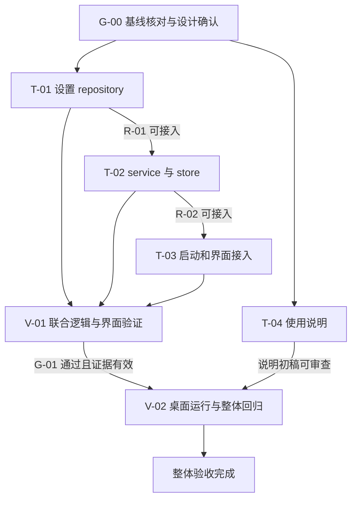
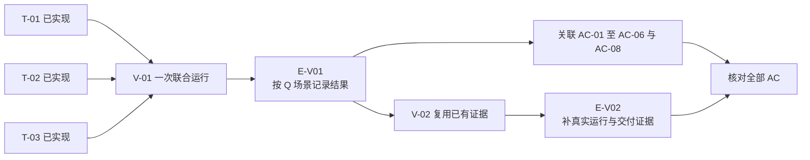
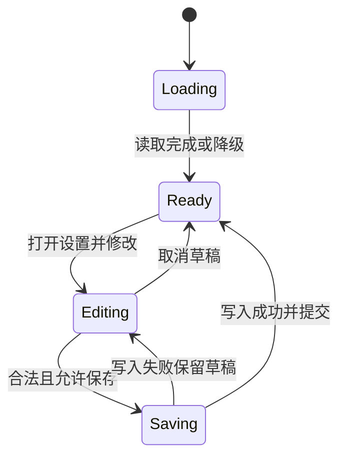
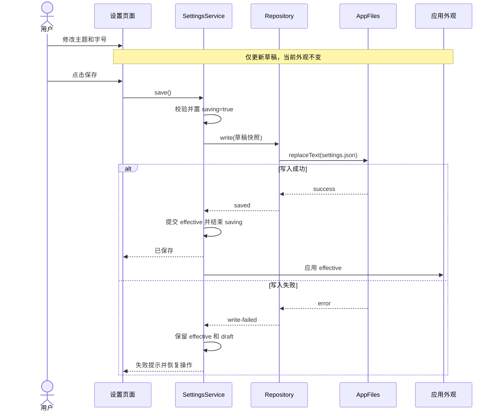

# 本机应用设置保存与重启恢复实现计划示例

为一个现有本机笔记应用增加“设置保存与重启恢复”：用户调整主题和字号，点击保存后生效；下次启动恢复已保存设置；读取或保存失败时给出明确反馈。

本示例按[实现计划规范](https://chatgpt.com/space/page_a9c37ff60540819185f786d9eeb00fc8)填写，采用一个阶段、四项任务、两组验证。T-01、T-02、T-03 可以在前置产物达到可接入条件后连续推进，最后共同验证；说明文档可以并行编写。

这里的 MemoDesk、代码路径、脚本和技术基线均为示例设定，供审阅计划的写法与粒度。尚未指定或检查真实项目，所有实施和验证状态均为未开始、未执行。真实采用前必须完成 G-00 的基线核对与设计确认。

# 1 计划定位与设计承接

## 目标和边界

| 项目 | 本次安排 |
| --- | --- |
| 计划版本 | 1.0，2026-10-15 |
| 项目 | MemoDesk，本机单窗口笔记应用 |
| 交付目标 | 主题与字号可显式保存，保存成功后生效，完全退出再启动后恢复 |
| 包含范围 | 本地设置读写、设置状态、页面接入、启动恢复、异常反馈、联合验证、使用说明 |
| 不包含 | 云同步、账号体系、多进程同时写设置、设置导入导出、设置格式迁移、其他操作系统适配 |
| 目标运行环境 | macOS；本示例仅对该平台安排真实运行验收 |
| 阶段策略 | 小改动一次细化完整，不再按“前端、后端、测试”拆阶段 |

## 基线和材料入口

| 来源 ID | 材料或入口 | 负责的内容 |
| --- | --- | --- |
| B-00 | 本章“示例代码基线” | 示例现状、可复用能力和运行脚本 |
| S-01 | 本文附录 A1 | 字段、默认值和读取规则 |
| S-02 | 本文附录 A2 | 保存、状态与交互契约 |
| S-03 | 本文附录 A3 | 启动接线与成功、失败时序 |
| S-04 | 本文附录 A4 | 关键决策、判断来源与确认状态 |
| AC-01 至 AC-08 | 第 2 章验收覆盖表 | 验收要求的唯一正文 |
| E-00 | 第 6 章执行记录 | 实际进度、产物、证据和恢复入口 |

附录 A 是为了让示例自包含而附上的设计摘录，属于设计材料。真实项目应替换成正式技术方案的精确引用，不在实现计划内维护另一套设计。

## 示例代码基线

以下路径均相对“示例项目根目录”，不是当前 skills 仓库中的文件。示例基线标识为 B-00；真实采用时应替换为实际仓库、提交及必要的工作区差异记录。

| 现有入口 | 示例现状及必须保留的能力 |
| --- | --- |
| `src/app/bootstrap.ts` | 初始化应用依赖并挂载 Vue 根组件 |
| `src/App.vue` | 负责主界面和启动状态 |
| `src/settings/settings.store.ts` | 内存保存当前主题和字号，退出丢失 |
| `src/settings/SettingsPanel.vue` | 显示主题和字号；目前改动直接作用于内存 |
| `src/editor/applyAppearance.ts` | 将设置应用到编辑器及应用主题 |
| `src/platform/appFiles.ts` | 应用私有目录内的文本读取与原子替换接口，具体契约见 A1 |
| `src/notes/`、`tests/notes.spec.ts` | 笔记读写与既有回归测试 |
| `package.json` | 已有 `typecheck`、`test`、`build:desktop` 脚本；test 使用 Vitest |
| 桌面启动器 | 已有 `--data-dir` 参数，可使用独立测试目录；正常启动默认用户私有目录 |

真实基线如果没有原子替换、独立测试目录或单实例能力，不能当作普通路径调整跳过；这些变化涉及 D-03、D-04 或 D-05，按第 7 章处理。

## 全局约束和启动门槛

| ID | 约束 |
| --- | --- |
| C-01 | 沿用现有桌面运行时、Vue 和测试工具，不引入云服务或新持久化依赖 |
| C-02 | 设置只写应用私有目录的 `settings.json`；不修改笔记文件格式和目录 |
| C-03 | 保留当前主题、字号应用能力；新的行为差异仅为“点击保存成功后生效” |
| C-04 | 验证使用独立数据目录，不清理或覆盖真实用户数据 |
| C-05 | 判断来源与确认状态分开记录；示例设定不算真实项目批准 |
| G-00 | 真实执行前核对 B-00 与实际代码、工具及授权，确认 D-01 至 D-05，写入可复现基线；不符项先评估影响 |

本例没有服务端发布、线上迁移或数据库变更，因此不增加相关任务。设置文件格式仍须明确，已经在 A1 中定义。

# 2 交付分解与覆盖关系

## 任务总表

| ID | 交付成果 | 设计依据 | 前置条件 | 验证归属 |
| --- | --- | --- | --- | --- |
| T-01 | 可读取、校验和原子保存设置的 repository | S-01，D-03、D-04 | G-00 | V-01；真实文件适配由 V-02 补充 |
| T-02 | 已保存值、草稿与保存状态分离的 service 和 store | S-02，D-01、D-02、D-03 | T-01 达到 R-01 | V-01 |
| T-03 | 启动恢复、设置页面与外观接入，以及共享集成测试 | S-02、S-03，D-01、D-02、D-05 | T-02 达到 R-02；T-01 产物可用 | V-01；真实桌面行为由 V-02 补充 |
| T-04 | 设置使用说明和异常处置说明 | S-01、S-02 | G-00；可并行 | V-02 文档一致性检查 |

T-01 与 T-02 分开是因为存储契约和状态契约各有清晰的可交付边界。T-03 同时负责接线与联合用例，避免把“写完三个模块”误当成“整条链路已经工作”。不再设置一个只有“运行测试”动作的实施任务。

## 验收覆盖表

| ID | 必须满足的结果 | 任务或约束 | 验证与证据归属 |
| --- | --- | --- | --- |
| AC-01 | 无设置文件时使用 light、14；正常启动不自动创建文件；编辑器可用 | T-01、T-02、T-03 | V-01 的 Q-01 验逻辑；V-02 的 M-01 验真实启动与文件目录 |
| AC-02 | 保存 dark、18 后显示成功并应用；完全退出再启动仍为 dark、18 | T-01、T-02、T-03 | V-01 的 Q-02 验保存提交顺序；V-02 的 M-02 验真实退出恢复 |
| AC-03 | JSON 损坏或版本 1 字段非法时回退默认值并提示；启动不改原文件；显式保存合法值后可恢复 | T-01、T-02、T-03 | V-01 的 Q-03；V-02 的 M-03 补真实损坏文件 |
| AC-04 | 保存失败时不提示成功，已生效值及旧文件不变，草稿保留，可再次尝试 | T-01、T-02、T-03 | V-01 的 Q-04；V-02 的 M-04 补真实写入故障 |
| AC-05 | 保存中控件禁用；重复提交不产生第二次写入；保存结束后状态正确恢复 | T-02、T-03 | V-01 的 Q-05 |
| AC-06 | 草稿没有变化时禁止保存；非法输入不会写文件；关闭未保存面板再打开，显示已保存值 | T-02、T-03；存储层校验由 T-01 兜底 | V-01 的 Q-06 |
| AC-07 | 可构建并启动桌面产物；既有笔记新增、编辑和重启恢复正常；说明文档与最终界面一致 | T-03、T-04，C-01、C-02 | V-02 的 M-05、M-06 |
| AC-08 | 读取失败时可用默认值进入应用并提示；未知格式版本禁止覆盖保存；保存中异常退出不会产生半截 JSON | T-01、T-02、T-03，D-03、D-04、D-05 | V-01 的 Q-07、Q-08 验错误分支；V-02 的 M-07 核对真实文件替换契约与异常退出 |

本表的证据归属是计划。实际结果只写第 6 章；没有证据的条目不能标记通过。

# 3 依赖、阶段与启动条件

## 唯一阶段 P-01

| 项目 | 安排 |
| --- | --- |
| 成果 | 桌面应用能够可靠保存和恢复设置，使用说明完整 |
| 包含任务 | T-01 至 T-04 |
| 细化状态 | 本例一次展开全部任务；真实执行前通过 G-00 核对 |
| 阶段内推进 | T-01 → T-02 → T-03；T-04 可并行 |
| 检查点 | V-01 完成关联逻辑与界面验证后进入 V-02 的真实运行验收 |
| 完成条件 | 全部任务产物形成，AC-01 至 AC-08 均有有效证据，适用阻塞关闭 |



## 可接入条件与门禁

| ID | 需要具备的内容 | 达到后允许什么 | 不要求什么 |
| --- | --- | --- | --- |
| R-01 | T-01 已实现 A1 的 read/write；类型与默认值可导入；不存在未实现占位；错误结果可区分；执行记录列出产物与限制 | T-02 接入真实 repository，异常测试可使用受控平台替身 | 不要求 V-01 提前通过，也不要求单独跑一次全套测试 |
| R-02 | T-02 已实现 initialize/save、状态字段与订阅；返回值符合 A2；并发保护已接线；无接口未决 | T-03 接入 service/store，并编写共享集成测试 | 不要求在界面接入前证明整条用户链路 |
| G-01 | V-01 必需场景通过，证据对应待验收版本；发现的失败已修复或有明确不影响范围的依据 | 开始 V-02 中成本较高的真实故障和桌面回归 | 不阻止 T-04 写说明，也不阻止提前准备 V-02 数据与命令 |

R-01、R-02 的判断依据是实际产物与契约检查，必要时补最小导入或编译诊断；它们不等于正式验收通过。若发现接口不兼容或缺失实现，条件不成立，不能为了“联合验证”跳过。

联合依赖图中没有 V-01 → T-02 或 V-01 → T-03 的边，避免“必须先联合验证，才能完成联合验证所需代码”的循环。

# 4 任务说明

## T-01 实现设置 repository

| 字段 | 内容 |
| --- | --- |
| 目标 | 把平台文件能力封装成明确的设置读取和保存结果 |
| 设计引用 | A1 的字段和文件契约；A4 的 D-03、D-04；C-01、C-02、C-04 |
| 必读材料 | `src/platform/appFiles.ts` 的 readText/replaceText；现有 `settings.store.ts` 的默认值；A1、AC-01/03/04/08 |
| 新增位置 | `src/settings/settings.types.ts`、`src/settings/settings.repository.ts` |
| 修改边界 | 本任务不改页面，不更改平台 replaceText 的原子性承诺，不修改笔记存储 |
| 启动条件 | G-00 |
| 交付物 | Settings 类型、统一默认值、结果类型、repository 工厂与实际实现 |
| 验收归属 | AC-01、AC-02、AC-03、AC-04、AC-08；统一进入 V-01，真实平台补证据见 V-02 |
| 反馈触发 | 现有平台无法区分文件不存在和读取失败，或不能保证替换失败保留旧文件；停止相关实现并反馈 D-03/D-04 的冲突 |

实施步骤：

1. 在 types 中定义 A1 的 Settings、LoadResult、SaveResult；默认值只有一个定义入口。

2. 创建 repository 工厂，注入 appFiles，以便生产使用真实平台、V-01 使用受控替身。

3. 按 A1 对缺文件、合法文件、损坏文件、未知版本、读取异常分类；读取路径不创建或改写文件。

4. 保存前校验完整字段，序列化版本 1 JSON，通过 replaceText 写入 `settings.json`；将异常映射为明确失败结果。

5. 暴露类型和实现，检查无占位分支，将实际文件位置与已知限制写入 E-00；达到 R-01 后允许 T-02 接入。

6. 把需验证的分支交给 T-03 的共享用例 Q-01 至 Q-08，不为本任务额外安排重复全量验证。

本任务“已实现”的条件是 repository 契约已落地且可接入；“验收完成”还需要其关联的有效验证证据。

## T-02 实现设置状态与保存服务

| 字段 | 内容 |
| --- | --- |
| 目标 | 明确区分已生效设置、用户草稿和保存过程，保证失败可恢复 |
| 设计引用 | A2；D-01、D-02、D-03；C-03 |
| 必读材料 | T-01 实际交付与限制；`settings.store.ts` 现有消费者；A2 状态表；AC-02/04/05/06/08 |
| 修改位置 | `src/settings/settings.store.ts` |
| 新增位置 | `src/settings/settings.service.ts` |
| 启动条件 | R-01；具体 repository 产物从 E-00 读取 |
| 交付物 | initialize、beginEdit、save、discardDraft；有效值、草稿及过程状态 |
| 修改边界 | 不改变字段和默认值，不在 store 内绕过 repository 直接写文件 |
| 验收归属 | V-01；AC-01 至 AC-06、AC-08 中相关状态行为 |
| 反馈触发 | 其他入口也能改设置、存在多窗口写入，或旧业务依赖未保存草稿立即生效；反馈 D-01/D-02/D-05，不临时增加第二套写入路径 |

实施步骤：

1. 将当前设置拆成 effective 和 draft，初始化、只读、错误、保存中等状态按 A2 定义；computed 派生 dirty，不再维护第二个易失配标记。

2. initialize 只通过 repository 读取一次；按结果设置 effective、提示与只读状态。

3. beginEdit 从 effective 复制草稿；discardDraft 丢弃草稿，清除上次保存错误，不修改已生效设置。

4. save 先同步检查只读、校验、dirty 和 saving；进入异步写入前立即设置 saving，锁住第二次提交。

5. 保存成功才更新 effective 并将 draft 对齐；保存失败保留两者原值及草稿，返回可展示的错误；所有结束路径恢复 saving。

6. 为界面提供稳定的状态和动作入口；检查没有保留直接应用草稿的旧调用，记录 R-02 的实际接入依据。

“已有 service 方法”不等于任务完成；必须形成 A2 中可观察的完整状态转换。无需先运行 V-01 才允许 T-03 接入。

## T-03 接入启动和设置页面并完成共享用例

| 字段 | 内容 |
| --- | --- |
| 目标 | 将 repository、service 和界面连成可使用的保存与恢复链路 |
| 设计引用 | A2、A3；D-01 至 D-05；AC-01 至 AC-08 |
| 必读材料 | T-01/T-02 交付记录；bootstrap、App、SettingsPanel、applyAppearance；第 5 章 Q-01 至 Q-08 |
| 修改位置 | `src/app/bootstrap.ts`、`src/App.vue`、`src/settings/SettingsPanel.vue`、必要的 `src/editor/applyAppearance.ts` 接入点 |
| 新增位置 | `tests/settings.integration.spec.ts`、`tests/fixtures/settingsPlatform.ts` |
| 启动条件 | R-02；R-01 的产物仍与引用版本一致 |
| 交付物 | 启动加载、草稿编辑、保存反馈、外观应用、故障注入测试夹具与共享用例 |
| 修改边界 | 沿用既有外观应用能力；不改笔记内容与格式；测试夹具只进入测试构建 |
| 验收归属 | V-01 全部逻辑场景；V-02 补真实桌面链路和回归 |
| 反馈触发 | 启动顺序会造成既有业务依赖失效，或保存中无法阻止旧入口修改草稿；记录具体调用证据，暂停相应接线并反馈 |

实施步骤：

1. 在 bootstrap 创建真实 appFiles → repository → service 依赖；让 App 首次进入编辑器前等待 initialize，显示加载状态。

2. 将 applyAppearance 的输入绑定到 effective；initialize 得到结果后应用一次，保存成功后再更新，草稿变动不触发。

3. 页面打开时调用 beginEdit，输入只修改 draft；按 A2 控制保存按钮、控件、关闭按钮和提示。

4. 接入成功、失败、读取降级和未知版本提示；保证失败不会进入成功分支，关闭后重新打开不会残留未保存草稿。

5. 夹具提供可计数的读写、延迟完成、读取失败、提交前写入失败，以及可观察的磁盘内容；实际 repository/service 不替换为空实现。

6. 编写 Q-01 至 Q-08：以 service 驱动状态断言，涉及交互的场景挂载实际 SettingsPanel 和必要应用组件；用例名包含 Q 编号。

7. 合并调用链后统一执行 V-01；若失败，记录场景、版本及受影响任务，修复后只重跑受影响用例和必要回归。

本任务包括编写共享测试，因为这套测试直接审查本任务形成的完整调用链，不再为前三项任务各维护一份相同的端到端检查。

## T-04 编写使用与异常说明

| 字段 | 内容 |
| --- | --- |
| 目标 | 用户知道设置何时生效、保存失败如何处理，以及未知版本为什么不能覆盖 |
| 设计引用 | A1、A2；AC-07 |
| 必读材料 | A1 读取规则、A2 页面状态与提示；V-02 开始前核对 T-03 实际界面 |
| 新增位置 | `docs/settings.md` |
| 启动条件 | G-00；不依赖 V-01 通过 |
| 交付物 | 简短的使用步骤、重启恢复说明、常见错误与重试说明 |
| 修改边界 | 不承诺云同步、不承诺自动迁移、不指导直接删除用户笔记目录 |
| 验收归属 | V-02 的 M-06 |
| 反馈触发 | 实际界面或异常行为与设计不一致；反馈差异，不能仅改说明把缺陷写成既定行为 |

实施步骤：

1. 写清“修改草稿 → 保存成功 → 当前应用生效 → 重启恢复”的顺序。

2. 说明失败时草稿保留、原设置不变，可修复环境后重试；损坏文件读取降级，合法显式保存后可以恢复。

3. 说明未知格式版本保持只读，应使用支持该格式的应用版本；不指导自动覆盖。

4. T-03 产物形成后核对按钮、提示及实际入口；随 V-02 检查说明与界面一致性。

# 5 验证组织与完成判定

## V-01 关联逻辑和界面联合验证

| 字段 | 安排 |
| --- | --- |
| 覆盖 | T-01、T-02、T-03；AC-01 至 AC-06、AC-08 的逻辑与交互部分 |
| 前置条件 | 三项产物已实现并接线；Q 用例及夹具已形成；测试依赖已就绪 |
| 方法 | 先运行 `npm run typecheck`，再运行 `npm run test -- --run tests/settings.integration.spec.ts` |
| 环境 | 示例项目锁文件对应依赖；真实 repository/service 与挂载组件，替换平台读写以控制故障与延迟 |
| 通过标准 | 类型检查通过；Q-01 至 Q-08 的全部断言通过；没有被跳过的必需场景 |
| 门禁 | G-01：进入 V-02 的真实运行验收前必须通过 |
| 证据 | 实际代码版本、依赖锁文件标识、命令、退出码、用例报告和必要失败日志；登记在 E-00 |

命令是基于 B-00 的具体示例。真实项目应在 G-00 核实脚本参数和测试运行器，不把无法运行的示例命令保留为执行指令。

| 用例 | 准备和动作 | 必须断言 |
| --- | --- | --- |
| Q-01 | 缺少 settings.json，initialize | effective=light/14；没有写调用；编辑器从加载转为可用 |
| Q-02 | 初始 light/14，草稿 dark/18，控制写入暂不完成，然后成功 | 写入完成前 effective 不变；完成后 effective 和文件均为 dark/18；成功提示仅出现一次 |
| Q-03 | 分别提供损坏 JSON、字段缺失、非法主题、非法字号；初始化后显式保存合法草稿 | 各分支均回退默认值并提示；初始化不改源内容；显式保存可写入合法版本 1 |
| Q-04 | 已有 light/14，草稿 dark/18，提交前写入故障；解除故障后重试 | 首次失败旧文件与 effective 不变，草稿仍为 dark/18，显示失败；重试成功后正确提交 |
| Q-05 | 延迟第一次保存，在未完成时再次点击并直接调用 save | 控件及关闭按钮禁用；service 返回 busy；平台写入计数只有一次；结束后可继续编辑 |
| Q-06 | 草稿不变、非法输入、编辑后取消并重新打开 | 无变化与非法值均不写文件；输入校验可见；重新打开等于 effective，无遗留错误 |
| Q-07 | readText 抛读取异常，之后恢复可写；再显式保存合法草稿 | 默认值可进入应用，读取提示可见，不自动写入；后续合法保存可成功 |
| Q-08 | 输入 schemaVersion=2 的 JSON，再尝试从 UI 与 service 保存 | 显示未知版本提示，设置只读，服务返回 readonly；原文件未被覆盖 |

## V-02 桌面运行和整体验收

| 字段 | 安排 |
| --- | --- |
| 覆盖 | 真实平台桥接、完全退出与恢复、旧功能回归、可交付产物及文档 |
| 前置条件 | G-01；T-04 初稿可审查；准备独立 TEST_DATA_DIR；实际平台与构建命令已在 G-00 核实 |
| 方法 | 运行既有 `npm run test -- --run tests/notes.spec.ts`；执行 `npm run build:desktop`；启动生成的桌面产物，以 `--data-dir TEST_DATA_DIR` 指定测试目录 |
| 通过标准 | 下列 M-01 至 M-07 满足预期；AC-01 至 AC-08 的组合证据完整、有效；无必要人工验收待办 |
| 证据 | 构建日志、产物路径和版本、系统版本、目录配置、操作记录、文件前后内容、关键提示截图及测试报告 |
| 复用范围 | 复用 V-01 的故障分支、状态和并发逻辑证据，不逐条重新手工执行全部 Q 用例 |

TEST_DATA_DIR 是执行时记录的真实路径，未指定前不能运行对目录的修改操作。每个 M 场景使用独立子目录，或明确恢复自己的初始条件，避免上一场景污染下一场景。

| 检查 | 操作 | 必须结果 |
| --- | --- | --- |
| M-01 | 用空测试目录启动桌面产物 | 默认 light/14；编辑器可用；不产生 settings.json |
| M-02 | 在 M-01 实例保存 dark/18，确认提示后完全退出进程，再以同目录启动 | 文件符合 A1；主题与字号恢复；不能用页面刷新代替进程重启 |
| M-03 | 退出应用，在专用目录写入损坏 JSON 后重启 | 默认值可用、提示可见，未保存前文件字节不变 |
| M-04 | 在专用目录制造真实写入失败，例如让 settings.json 路径被不可替换的非空目录占用；确认故障实际发生，随后恢复可写环境再试 | 无成功提示，草稿保留、effective 不变；恢复环境后保存成功；真实故障方法和结果写入记录 |
| M-05 | 运行既有笔记测试；在桌面产物中新建并修改一条笔记，退出再打开 | 测试通过，笔记内容与格式保持，设置变更不影响笔记恢复 |
| M-06 | 对照 docs/settings.md 操作设置页并核对产物 | 步骤、按钮、错误处理与界面一致；构建产物可启动 |
| M-07 | 核对真实 replaceText 实现及既有测试的原子替换保证；使用测试目录，在保存过程中终止进程并重启 | settings.json 只能是旧完整值或新完整值，不能是半截 JSON；无法稳定命中替换窗口时记录证据边界，不能仅凭一次未复现宣称充分验证 |

M-07 的完成需要“平台实现或既有有效测试对原子替换的证据”和“本次桌面接入检查”共同支撑。若底层保证无法证实，AC-08 保持待验证，并反馈 D-04；不要临时降低承诺。

## 联合结果的归属与复用



| 后续情况 | 处理方式 |
| --- | --- |
| 仅修改使用说明措辞 | 复用 V-01；重新核对受影响说明 |
| 修改保存失败处理 | Q-04 必须重跑，按影响补 Q-02/Q-05；必要时重做 M-04 |
| 修改平台文件替换实现 | 重新评估全部持久化场景与 M-07，不复用已不适用的原子性证据 |
| 只修改字体或主题应用接线 | 补运行外观和重启场景；保留未受影响的读取分类证据 |
| Q-05 失败 | AC-05 失败；记录定位到 T-02 或 T-03 的证据，不把无关的读取场景自动判失败 |

每项任务完成要求其产物已形成，并且该任务负责的验收部分有有效证据。全计划完成要求四项任务完成、八项验收要求全部满足、待验收版本与证据版本可对应，且没有适用阻塞。

# 6 执行记录与恢复约定

E-00 是本示例的进度权威记录。以下为未执行的初始化状态，没有虚构通过结果。

## 当前进度

| 任务 | 实施状态 | 验证状态 | 当前产物 | 当前工作条件 |
| --- | --- | --- | --- | --- |
| T-01 | 未开始 | 未执行 | 无 | 真实采用前需 G-00 |
| T-02 | 未开始 | 未执行 | 无 | 等待 G-00、R-01 |
| T-03 | 未开始 | 未执行 | 无 | 等待 G-00、R-02 |
| T-04 | 未开始 | 未执行 | 无 | G-00 后可与 T-01 并行 |

## 验证和前置产物记录

| 记录 | 当前状态 | 执行时必须补齐 |
| --- | --- | --- |
| R-01 | 未检查 | repository 实际位置、代码版本、接口检查依据、已知限制 |
| R-02 | 未检查 | service/store 实际位置、契约接入依据、已知限制 |
| E-V01 | 未执行 | 类型检查结果、Q 场景逐项结果、真实命令、版本、环境、报告位置 |
| E-V02 | 未执行 | M 场景逐项结果、实际目录、桌面产物标识、平台原子性证据、日志和截图 |

实际运行产生证据后，在本表登记准确位置；不得预先填一条看似存在的日志链接。工作区有未提交改动时，记录提交加补丁或产物摘要，不能只记录 HEAD 就当成完整验证版本。

## 阻塞与恢复

| ID | 问题和依据 | 影响范围 | 解除条件 |
| --- | --- | --- | --- |
| B-01 | 尚未指定真实项目；B-00 是示例基线 | 真实代码实施和运行 | 确定仓库，完成 G-00，确认或修订 A4 决策 |
| B-02 | 尚无真实验证证据 | 所有完成结论 | 实施后按 V-01/V-02 产生有效证据；它不阻止已满足条件的组内开发 |

恢复工作的读取顺序为：本章当前状态 → 第 1 章实际基线 → 下一任务卡 → 其精确设计引用 → 前置实际产物与限制。

| 恢复时的情况 | 下一步 |
| --- | --- |
| 仍是当前初始化状态 | 先处理 G-00，不直接对当前 skills 仓库套用示例路径 |
| T-01 已实现、R-01 满足、V-01 未执行 | 可以启动 T-02；保留 T-01 待联合验证 |
| T-02 已实现、R-02 满足、V-01 未执行 | 可以启动 T-03 |
| V-01 通过，真实运行尚未验证 | 核对证据版本后进入 V-02，不重复整组 V-01 |
| 代码版本与记录不一致 | 先分析变化及证据适用性，再决定补验范围 |

# 7 计划检查、细化与变更

## 检查清单

| 检查类型 | 检查内容 | 本例处理方式 |
| --- | --- | --- |
| 结构 | 任务、验收、验证、设计 ID 可定位 | T、AC、V、S、D、R、G 分开编号；引用都落到具体表或小节 |
| 结构 | 联合依赖图无环 | G-00 → T-01 → T-02 → T-03 → V-01 → V-02；T-04 为并行支路 |
| 语义 | 不只写模块，还写最终接线 | T-03 覆盖 bootstrap、App、页面与外观应用 |
| 语义 | 不把能读写文件当成设置体验正确 | Q 用例覆盖提交顺序、草稿保留、重复提交与取消 |
| 语义 | 不用平台替身证明真实文件系统 | V-02 补桌面运行、真实故障与底层原子性证据 |
| 语义 | 不把示例来源写成人工批准 | D-01 至 D-05 来源和确认状态分别记录 |
| 执行前 | B-00 是否与真实项目相符 | G-00 必须完成；不符处按影响调整 |
| 交付前 | 所有 AC 组合证据有效，说明与产物一致 | 核对 E-V01、E-V02 与交付版本后才能宣布完成 |

## 允许调整和必须反馈的边界

| 发现或变化 | 可直接处理的范围 | 必须反馈的部分 |
| --- | --- | --- |
| 文件实际叫 preferences 而非 settings | 更新路径和引用，保持行为和契约 | 无关键行为变化时不新增确认 |
| 私有辅助函数需要重构 | 在原模块职责内调整 | 不得借机更换存储技术或扩展范围 |
| 任务过大需拆分 | 保留原成果、依赖、验收和 ID 映射后调整 | 若影响关键交付范围或门禁，则说明影响 |
| 想改成选中立即保存 | 不能作为普通实现优化 | 改变 D-01 和 AC-02/04/06，需确认 |
| 希望失败时仍先应用新主题 | 不能先改后报 | 改变 D-02 的失败保证，需确认 |
| 实际支持多窗口、多进程写设置 | 不能沿用单写入者假设 | 反馈 D-05，补并发方案及验收 |
| 原子替换能力不存在 | 可继续不依赖该能力的说明审阅等工作 | 暂停相关持久化实现，反馈 D-04 与受影响任务、验证 |
| 测试环境无法制造某故障 | 查明原因，寻找等价可观察方法 | 不能删除该验收项或伪填通过 |

## 变更记录

| 变化 | 原因 | 影响范围 | 关键决策及确认 | 证据处置 |
| --- | --- | --- | --- | --- |
| 无实际执行变更 | 当前为示例初稿 | 无 | 无 | 无既有执行证据 |

发生关键问题时，反馈应包含原约束、实际观察、冲突原因、建议选项、影响的任务和验收、当前停止的范围。普通失败修复按已有设计继续；确需改设计时，只在确认后更新决策和计划。

# 附录 A 示例设计摘录

## A1 字段和持久化契约

```json
{
  "schemaVersion": 1,
  "theme": "light",
  "fontSize": 14
}
```

| 字段或行为 | 约束 |
| --- | --- |
| schemaVersion | 必须为数字 1 |
| theme | 只能为 light 或 dark；默认 light |
| fontSize | 只能为数字 14、16、18；默认 14 |
| 未知额外字段 | 版本 1 读取时忽略；保存时只输出本表三个字段 |
| 文件位置 | 平台 appFiles 所限定的应用私有目录下 settings.json |
| 正常读取 | 返回合法 Settings，初始化不回写 |
| 文件缺失 | 返回默认值，不提示错误，不创建文件 |
| JSON 损坏或版本 1 字段不合法 | 返回默认值与 invalid 提示，不改原文件；后续显式合法保存可替换 |
| JSON 可解析且 schemaVersion 非 1 或缺失 | 返回默认值与 unsupported 提示；本次应用会话内设置只读 |
| 读取异常 | 返回默认值与 unreadable 提示；不自动写入；允许用户之后显式保存并重试 |
| 保存前校验 | 输入不合法返回 invalid，不调用平台写入 |
| 原子替换失败 | 返回 write-failed，保留旧目标文件 |
| 异常退出 | 原子替换使目标文件为旧完整值或新完整值；不承诺断电耐久性，也不把尚未显示成功的保存承诺为已完成 |

平台接口约定：readText(name) 返回文本或 null，null 仅表示不存在，其他 I/O 问题抛错；replaceText(name,text) 在应用私有目录内完成同目录临时文件及原子替换，成功返回后新文件完整可读，提交前失败不破坏旧文件。该底层能力在 B-00 中设为已有，真实采用时必须核对。

repository.read 返回 settings、warning（none/invalid/unreadable/unsupported）和 readonly；只有 unsupported 为 readonly=true。repository.write 校验后返回 saved、invalid 或 write-failed，不把异常交给界面猜测。

## A2 状态和交互契约

| 状态或动作 | 明确行为 |
| --- | --- |
| effective | 当前已生效的完整设置，仅由初始化和保存成功更新 |
| draft | 设置页编辑副本，不直接作用于应用外观 |
| initialize | 读取 repository，形成 effective、加载提示与 readonly；初始化结束前主编辑器显示加载状态 |
| beginEdit | 从 effective 复制 draft，清空上次保存错误 |
| discardDraft | 不在 saving 时允许；恢复为 effective 并关闭面板 |
| save 检查顺序 | saving 则 busy；readonly 则 readonly；字段非法则 invalid；未变化则 unchanged；否则提交 |
| save 开始 | 立即置 saving=true，取得本次草稿快照，再进行异步写入 |
| save 成功 | 更新 effective 与 draft，清除读取和保存错误，显示“已保存” |
| save 失败 | effective 不变，draft 保留，显示“保存失败，请重试”；不显示“已保存” |
| saving 中 | 输入、保存、取消及面板关闭入口禁用；进程强制终止不在 UI 控制范围内 |
| 可保存条件 | 已加载、非只读、非 saving、草稿合法且发生变化 |
| 外观应用 | 只消费 effective，初始化及成功保存后更新 |



上图表示主交互路径。readonly 是读取未知版本后附加的保存限制，页面可查看但不可进入 Saving；busy、invalid、unchanged 等结果均不触发写入。

## A3 接线和保存时序

启动接线为 bootstrap 构造 appFiles、repository、service；App 等待 initialize 后进入编辑器；applyAppearance 订阅 effective；SettingsPanel 只调用 service 和编辑 draft。



## A4 关键决策来源与确认状态

所有决策均是本示例的模型设定。确认状态为“示例前提，真实采用待确认”；没有模拟用户签字或伪造确认记录。G-00 负责在真实项目中取得必要确认并替换这些状态。

| ID | 决策及关键性 | 判断来源与依据 | 确认状态 | 关联 |
| --- | --- | --- | --- | --- |
| D-01 | 显式保存成功后生效；决定用户操作和取消语义 | 模型判断；为使草稿、应用和持久化关系清晰而提出的示例选择 | 示例前提，真实采用待确认；确认人及凭据尚无 | S-02、S-03；T-02/T-03；AC-02/06 |
| D-02 | 保存失败不应用新值，保留草稿；决定失败保证 | 模型判断；避免应用表现与磁盘已保存值不一致的设计推断 | 示例前提，真实采用待确认；确认人及凭据尚无 | S-02；T-02/T-03；AC-04/05 |
| D-03 | 读取降级到默认值；未知版本只读；决定恢复和覆盖行为 | 模型判断；可用性与未知格式保护的示例取舍，非实际用户要求 | 示例前提，真实采用待确认；确认人及凭据尚无 | S-01、S-02；T-01 至 T-03；AC-01/03/08 |
| D-04 | 复用原子替换，失败保留旧文件；决定数据完整性承诺 | 模型判断加 B-00 能力假设；尚无真实平台代码证据 | 示例前提，真实采用待确认；须先核实平台能力 | S-01；T-01；AC-04/08；M-07 |
| D-05 | 只覆盖单实例单写入者及 macOS；决定并发和平台范围 | 模型设定的项目边界；单实例是待核实的基线条件 | 示例前提，真实采用待确认；须核实实际写入入口 | S-03；T-01 至 T-03；AC-05/07/08 |

采用到真实项目时，如果用户确认某条模型建议，保留“模型判断”的来源，另把确认状态更新为已确认，并记录确认依据；不能把来源改成“用户提出”。
