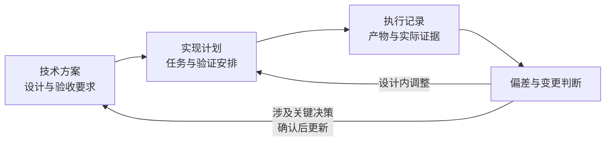

# 实现计划规范

实现计划把技术方案转成可以执行、检查和恢复的工作安排。人应能据此理解实施路径、任务边界与完成依据；AI 应能在获得明确引用的材料后开始工作，发现问题时知道反馈什么、阻塞哪里、哪些工作仍可继续。

本规范适用于现有项目的功能改造，也适用于本机应用。采用“全局完整规划、分阶段细化”；小改动可以只设一个阶段，一次写完整。

| 项目 | 内容 |
| --- | --- |
| 版本 | 1.0 |
| 日期 | 2026-10-15 |
| 适用对象 | 编写、审阅和执行实现计划的人与 AI |
| 规范来源 | 本次讨论中已确认的规划、任务、依赖、验证和变更规则 |
| 使用方式 | 七章的信息覆盖均为必备；可合并章节或表格，但不得遗漏语义要求 |

# 总体约定

## 三类材料的职责

| 材料 | 必须回答 | 作为权威来源的内容 |
| --- | --- | --- |
| 技术方案 | 为什么这样设计，系统应怎样工作 | 目标、范围、行为、结构、契约、关键决策与验收要求 |
| 实现计划 | 如何把设计变成可交付成果 | 任务、顺序与依赖、启动条件、实施步骤、验证安排 |
| 执行记录 | 实际做到哪里，凭什么判断，如何继续 | 产物、实施状态、验证结果、证据、偏差、阻塞与恢复入口 |

三类材料是逻辑分工，不强制拆成三个文件。小改动可放在一个文档内；同一项可变事实只维护一个权威记录，其他位置引用或生成视图。实现计划不能通过修改任务描述，悄悄改变技术方案的设计和验收要求。

## 全局规划与阶段细化

全局规划必须覆盖已知的全部交付范围、任务成果、主要依赖、验收归属和必要的收尾工作。后续阶段可以暂不展开具体代码位置和操作步骤，但不能把范围遗漏或关键设计未决藏在“以后细化”中。

阶段启动前，应根据实际代码和前置产物补齐可执行细节。阶段划分用于管理细化与检查范围，不自动构成串行屏障；是否可以开始，由明确的依赖和门禁决定。

任务是“交付边界清晰、能够审查并追溯验收结果的工作单元”。任务可以跨技术层，也可以共享验证；不以固定时长、文件数、代码行数或独立测试次数作为拆分标准。

## 图表和表达规则

| 信息类型 | 优先表达 | 最低质量要求 |
| --- | --- | --- |
| 范围、字段、覆盖、状态、条件、对比 | 表格 | 一行对应一个可识别对象；字段含义一致 |
| 依赖和启动门禁 | 有向依赖图配条件表 | 箭头说明依赖产物或验证结果；不能只靠排列表示顺序 |
| 操作分支和反馈路径 | 流程图 | 标出分支条件、失败去向与结束条件 |
| 跨组件交互和等待关系 | 时序图 | 标明调用、返回、异常及关键先后关系 |
| 生命周期 | 状态图或状态转换表 | 给出转换条件，区分实施与验证 |
| 具体执行动作 | 有序步骤 | 动作、对象和预期产物清楚，避免用图隐藏必要细节 |

能用图表更清楚表达的内容使用图表，不为满足数量而重复绘图。已有设计图可精确引用，不在计划里维护第二份。简单单任务依赖可用条件表代替图；出现分支、并行或验证门禁时，应给依赖图。图表中的 ID、名称和状态必须与正文一致。图负责说明关系，表格或文字负责说明可执行条件。

“无”“不适用”“待确认”必须区分：不适用写明理由；未知项写清影响和处理条件。不得用“按需处理”“自行完善”“参考前文”等模糊表述代替必须确定的工作。

## 章节总览

| 章节 | 必备成果 | 建议图表 | 达标判据 |
| --- | --- | --- | --- |
| 1 计划定位与设计承接 | 基线、目标、边界、约束、阻塞 | 基线表、来源表 | 能明确本计划承接什么、交付什么 |
| 2 交付分解与覆盖关系 | 完整任务清单及双向覆盖 | 任务总表、覆盖矩阵 | 没有遗漏、无依据扩张或重复归属 |
| 3 依赖、阶段与启动条件 | 产物依赖、门禁、细化范围 | 依赖图、条件表、阶段表 | 能判定任务是否可启动，且无循环 |
| 4 任务说明 | 可交接的任务定义 | 任务卡、步骤、必要流程图 | 新执行者不依赖聊天历史即可执行 |
| 5 验证组织与完成判定 | 验证组、整体验收、证据规则 | 验证矩阵、联合验证流程 | 每项要求有可判断的完成依据 |
| 6 执行记录与恢复约定 | 状态、证据、偏差与恢复规则 | 进度表、证据表、阻塞表 | 能准确恢复进度，不把实现等同通过 |
| 7 计划检查、细化与变更 | 结构和语义检查、变更边界 | 检查表、变更表 | 调整可追溯，关键决策不会被绕过 |

# 1 计划定位与设计承接

## 必备内容

| 内容 | 具体标准 |
| --- | --- |
| 实现目标 | 用可观察的交付结果描述，不只写“实现方案” |
| 范围与排除项 | 明确涉及的能力、场景及不处理的相邻需求 |
| 设计基线 | 设计名称、版本或可识别快照、相关章节及验收入口 |
| 代码基线 | 仓库或项目入口、提交或其他可复现状态；有未提交改动时注明范围 |
| 全局约束 | 受保护行为、接口契约、依赖限制、执行权限与统一工作规则 |
| 设计阻塞 | 未决事项、影响的任务或契约、解决条件；无则明确写“无” |
| 计划标识 | 版本、更新时间及适用状态 |

事实、设计决定和推断应可区分。旧实现只能证明现状，不能自动证明历史设计意图或已经获得确认。

设计约束统一定义后，任务可引用其 ID；不要求每张任务卡复制全部约束。多个来源不一致时，应指出冲突并阻塞受影响部分，不能由模型自行选择会改变关键行为的解释。

## 图表要求

使用基线表列明文档、代码、约束和执行记录入口。多份设计共同生效时，用来源表说明各自负责的范围与冲突处理规则。

## 完成标准

读者能确定设计和代码基线、交付边界、统一约束、已有授权及仍受阻的工作。计划没有重新定义技术方案中的目标、契约或验收要求。

# 2 交付分解与覆盖关系

## 必备内容

全局任务清单必须列出每项任务的稳定 ID、交付成果、设计来源、主要依赖、验收要求与验证归属。必要的集成、配置、数据处理、文档和交付工作都应纳入；不涉及的内容无需制造任务。

| 拆分情形 | 标准 |
| --- | --- |
| 同一能力跨界面、逻辑和存储 | 可作为一个任务，或按明确的可交付边界拆分 |
| 多项能力依赖同一基础产物 | 可单列基础任务，但必须有明确契约和验收归属 |
| 大量机械性同类修改 | 可合并，列出覆盖范围和遗漏检查方法 |
| 成果、上下文或依赖明显不同 | 应考虑拆开，减少执行时的隐含跳转 |
| 只有零碎操作，没有独立成果 | 放入任务步骤，不必升级为任务 |
| 只有验证安排 | 优先作为验证组；只有产生独立测试设施等交付物时才另设实施任务 |

任务总表至少包含：

| 任务 ID | 交付成果 | 设计引用 | 前置依赖 | 验收与验证归属 |
| --- | --- | --- | --- | --- |
| T-编号 | 可检查的结果 | 章节、需求或关键决策 ID | 产物或门禁 | AC-编号、V-编号 |

另建覆盖矩阵，表达“设计要求 → 任务或共享约束 → 验收要求 → 验证安排”。允许多对多关系。禁止性约束可关联到多个任务的审查项，不必虚构一个“实现禁止行为”的任务。

并非每个任务都对应关键决策；引用了决策 ID，也不等于已经落实该决策。覆盖审阅要检查实际交付内容是否承接了要求。

## 图表要求

任务总表和覆盖矩阵必备，可以在内容仍清楚时合并。复杂能力拆解可加分解图；不要重复技术方案的系统架构图。

## 完成标准

所有范围内设计和验收要求都有明确归属；所有任务都有交付依据。没有职责重叠、漏掉接线与集成、只列编码不列必要收尾、或无依据增加功能。

# 3 依赖、阶段与启动条件

## 必备内容

每条依赖应说明依赖什么、为什么需要、达到什么条件后可以使用。以下条件分别记录，不得混为一个“前置完成”字段。

| 条件类别 | 必须说明 |
| --- | --- |
| 产物依赖 | 所需接口、文件、数据、配置或环境，以及提供者 |
| 可接入条件 | 契约已落定、产物已实现、可被接入的客观条件及已知限制 |
| 验证门禁 | 哪一验证项必须先通过、阻塞哪些任务、为何不能延后 |
| 设计条件 | 哪些关键决策必须确认后才能继续 |
| 细化条件 | 任务材料、代码入口、操作步骤和验证方法是否已经补齐 |

**同一验证组内，前置产物已实现并满足明确的可接入条件，后续任务即可继续，不必等待该组最终验证。** 这不免除明确列出的必须先通过的门禁，也不把待验证的产物写成已验收。

组间依赖按声明的条件判定；既不默认“实现即可使用”，也不默认“必须全部验证结束”。条件不清楚时，先澄清影响当前启动的部分。

如使用阶段，应列出每阶段目标、成果、包含任务、细化时间和必要检查点。全局清单先完整；当前阶段的任务细节必须可执行。不存在依赖的任务可以并行，但同一文件、共享资源或接口由谁修改和交接需明确。

## 图表要求

存在分支、并行或验证门禁时，使用依赖图；用不同标签区分“产物可接入”与“验证通过”。条件表给出每条重要边的客观含义。阶段表仅在划分阶段时需要。

## 完成标准

给出当前状态后，可以确定可启动、需等待和受阻的任务，以及各自原因。任务与验证门禁组成的联合依赖图无循环，例如不得出现“T2 等待 V1，而 V1 又等待 T2”。阶段结束不是未经说明的额外屏障。

# 4 任务说明

## 必备内容

采用稳定字段的任务卡。全局规划时先填写确定的信息；任务启动前补齐所有执行必要内容。允许精确引用，不能用“查看整个项目”替代材料定位。

| 字段 | 全局规划时 | 启动前必须达到 |
| --- | --- | --- |
| ID 与名称 | 稳定编号和成果名称 | 唯一，可被其他材料引用 |
| 目标与产物 | 说明交付什么 | 可定位、可审阅，边界清楚 |
| 设计依据 | 对应需求、设计与验收 | 精确到章节、契约及适用的关键决策 |
| 范围与约束 | 明确责任和排除项 | 改动边界、受保护行为和统一约束明确 |
| 前置与启动条件 | 主要依赖 | 指向实际产物、状态、限制和必要门禁 |
| 必读材料 | 设计入口 | 精确到必要段落、代码入口和相关测试 |
| 代码位置 | 模块级范围可接受 | 已有位置与计划新增位置分开标注 |
| 实施步骤 | 可先给粗粒度路径 | 足够具体，不需要临场补关键设计 |
| 验收与验证归属 | 验收 ID 和组归属 | 方法、条件、预期结果和证据归属清楚 |
| 反馈触发条件 | 已知风险 | 何时可自行调整，何时停止受影响工作并反馈 |

实施步骤使用有序列表，每步说明动作、作用对象和结果。技术方案已经确定的接口、默认值、顺序或失败行为应准确承接；局部命名、私有函数拆分等仍可留给实现者判断。仅在算法或控制流程容易误解时补伪代码，不把计划写成完整代码转录。

任务内可以安排诊断性的编译或运行检查，但不得机械要求每个任务各跑一次全套测试。真正的完成依据由验收要求及验证组共同决定。

## 图表要求

任务卡使用字段表，动作使用有序步骤。复杂分支补流程图；跨组件交互精确引用设计时序图。任务不再复制总依赖图和全局约束表。

## 完成标准

新的执行者只需任务卡和明确引用的材料，就能知道改哪里、产出什么、不得改变什么、如何接入前置成果、用什么判断结果，以及遇到哪类问题必须反馈。聊天历史不是必要输入。

# 5 验证组织与完成判定

## 必备内容

每项任务都必须有验收归属，但不要求逐任务独立执行验证。根据关联关系组织验证组，一个组可覆盖多个任务，一项验收也可需要多个组共同提供证据。

| 验证组字段 | 具体标准 |
| --- | --- |
| ID 和目标 | 唯一标识，说明要证明的行为 |
| 覆盖关系 | 精确列出任务与验收要求；需要多个证据时说明组合关系 |
| 前置条件 | 所需产物、数据、环境、配置和工具 |
| 验证方法 | 自动化命令、运行步骤、人工操作或产物检查；与场景匹配 |
| 通过标准 | 可观察、可判断的预期结果，不只写“正常”“无问题” |
| 门禁作用 | 是阻塞后续工作、阶段检查，还是最终验收条件 |
| 证据要求 | 结果、适用版本、环境、输入、方法及保存位置 |

验证组不得只列测试名称而遗漏断言，也不得以“测试通过”替代解释它覆盖了哪些要求。无需给所有任务强行增加自动化测试或固定 TDD 流程；应选择能有效证明结果的最小充分验证。

| 验证层次 | 是否必备 | 规则 |
| --- | --- | --- |
| 任务验收覆盖 | 必备 | 可以由联合验证提供证据 |
| 阶段检查 | 按需 | 只在阶段边界确有必要时设置 |
| 整体验收 | 必备 | 复用有效证据，加上尚未覆盖的集成、交付或回归检查 |

## 联合验证与证据复用

同一版本、适用环境与条件下的有效结果可以共享，不重复执行相同检查以满足任务数量。检查中途发现问题时，可以执行必要的定位检查；这不应演变为每次改动都机械全量重跑。

| 变化或发现 | 对证据的处理 |
| --- | --- |
| 相关实现、契约、验收要求或运行条件变化 | 分析影响，失效受影响证据，补做相应验证及必要回归 |
| 不影响已证明行为的变更 | 记录复用依据，保留原证据 |
| 暂无法确认是否受影响 | 标记待核实，不直接写通过或失败 |
| 联合验证某场景失败 | 标出受影响的验收项与任务；不把全部任务自动判失败 |
| 历史结果已失效 | 保留历史版本和结论，明确当前不可用于验收 |

## 图表要求

验证矩阵必备，至少表达“任务 → 验收要求 → 验证组 → 实际证据入口”。编制计划时证据列写“待执行”或引用执行记录，不得填模拟成功结果。联合关系复杂时补验证流程图；状态和失效规则可用表格。

## 完成标准

计划层面：所有验收要求有适当的方法和明确通过标准，前置条件可满足，不存在循环门禁，整体交付检查无缺口。

执行层面：所需产物已实现，相关证据对当前交付状态仍有效，所有必需验收项通过，适用阻塞已关闭。必要人工验收仍未进行时，保留待验收状态。

# 6 执行记录与恢复约定

## 必备内容

本章规定实际执行记录应如何维护。可以与计划同文档保存，但任务定义与实际状态须分开，不能覆盖历史事实。

| 记录对象 | 最少字段 |
| --- | --- |
| 任务进度 | 任务 ID、实施状态、已完成内容、剩余工作、实际产物位置 |
| 前置产物 | 提供者、可接入条件是否满足、对应证据或检查依据、已知限制 |
| 验证记录 | 验证 ID、所覆盖验收项、状态、执行方法、输入、环境、适用版本、结果与证据 |
| 阻塞事项 | 问题及证据、影响范围、所需信息或决策、解除条件 |
| 偏差与变更 | 与计划差异、原因、影响的任务和验证、处理结论 |
| 恢复入口 | 当前基线、下一项可做工作、必读材料、前置产物、待补验证和注意事项 |

实施状态与验证状态独立维护。可采用下表，也可使用等价命名，但不能丢失语义。

| 维度 | 状态示例 | 解释 |
| --- | --- | --- |
| 实施 | 未开始、进行中、已实现 | 已实现只表示约定产物形成 |
| 验证 | 未执行、待联合验证、通过、失败、待核实 | 通过必须绑定实际有效证据 |
| 工作条件 | 可启动、等待依赖、阻塞 | 说明当前能否继续，以及原因 |

“已实现、待联合验证”是正常状态；它可以满足同组内声明的可接入依赖，但不能被描述为任务全部验收完成。一个组存在部分失败时，记录每个验收项的实际结果，必要时保留尚无结论的任务状态。

恢复时先核对代码和产物是否仍是记录对应的版本，再使用证据。对于已覆盖且仍有效的检查，不因换人、换模型或恢复会话而重复执行。

## 图表要求

使用任务进度表、验证证据表与阻塞表；小改动可合并。只保留一个状态权威来源，其他进度展示引用或自动生成。复杂状态流转可加状态图。

## 完成标准

不依赖原聊天记录即可判断哪些内容真正实现、哪些经过验证、哪些证据已过期、哪些工作被谁阻塞，以及下一步从哪里继续。记录不得虚构命令、输出、审阅结论或用户确认。

# 7 计划检查、细化与变更

## 必备内容

结构检查和语义审阅必须分别考虑。结构通过只能说明材料关系可解析，不能证明计划正确。

| 检查层次 | 必查内容 | 典型问题 |
| --- | --- | --- |
| 结构检查 | ID 唯一、字段齐全、引用存在、依赖有效、任务与验证联合图无环、覆盖关系已声明 | 缺字段、孤立验收项、悬空引用、循环门禁 |
| 语义审阅 | 实际承接设计、步骤足以形成产物、接口可衔接、验证能证明要求、无隐含范围扩张 | 只有 ID 没有实现动作、只验证成功场景、遗漏接线、让实现者重做关键设计 |

| 检查时点 | 检查范围与完成标准 |
| --- | --- |
| 全局计划形成 | 全部交付与验收覆盖完整，主要依赖成立，未来细化边界清楚 |
| 阶段或任务启动前 | 按真实代码与前置产物补齐必要细节，达到可执行条件 |
| 计划发生实质变更 | 重查受影响的任务、依赖、覆盖、门禁与证据 |
| 交付结束 | 对当前版本核对所有必需验收与遗留问题，不机械重跑有效检查 |

## 细化和变更边界

| 变化类型 | 处理方式 |
| --- | --- |
| 代码位置调整、局部步骤调整 | 在既定设计内更新计划，记录有影响的原因 |
| 同一范围内任务拆分或合并 | 可调整；保留原 ID 到新 ID 的映射，重新检查依赖与覆盖 |
| 实现不符合既定设计 | 修复实现，记录问题，重验受影响范围 |
| 局部命名、私有方法组织等实现细节 | 由实现者判断；无需记录每个微小决定 |
| 改变目标、规则、关键机制、契约、验收或重要风险取舍 | 暂停受影响工作，提出问题证据、原约束、建议和影响，确认后更新设计与计划 |

未解决的问题只阻塞受影响范围；涉及全局架构、核心契约或共享数据含义的未决事项，应按实际影响扩大阻塞，不能为了继续执行而自行假设。

## 关键决策的定义与来源

若另一个选择会改变以下任一项，应视为关键决策：目标、范围或验收；重要业务行为、规则或权限；系统结构、模块职责、接口、外部依赖或共享数据含义；状态、并发、事务、一致性或安全保证；兼容、迁移、交付和恢复方式；重要取舍、风险接受或尚未证实的实施条件。

关键与否按影响判断，不按代码量判断。普通变量名一般不是关键决策；改变字段含义即使只改一行，也可能是关键决策。

| 决策记录字段 | 规则 |
| --- | --- |
| 决策 ID、内容与影响范围 | 可以被任务、验证和变更精确引用 |
| 关键性理由 | 说明它影响了哪类必须控制的行为 |
| 判断来源 | 人的判断、模型的判断、继承的既有决策；注明具体来源 |
| 依据 | 区分已验证事实、推断和假设 |
| 确认状态 | 与判断来源分开；记录待确认、已确认、附条件确认或已撤销等状态 |
| 确认凭据与条件 | 谁、何时、通过什么内容确认，以及适用限制 |
| 关联关系 | 受影响的设计、任务、验收和阻塞项 |

模型提出、用户确认的决策，来源仍为“模型判断”，确认状态才是“用户已确认”。模型不能用“分析认为合理”代替用户确认。无法核实的历史来源标记为未知。

关键决策的权威记录保留在技术方案或独立决策记录内；计划引用它。属于计划本身的关键执行决策可以就地记录，但遵循相同字段和确认规则。

## 图表要求

检查清单与变更影响表必备。变更表至少包含变化、原因、影响范围、是否涉及关键决策、确认状态及证据处置。没有实际变更时记录“无”，无需制造示例历史。

## 完成标准

全局规划完整，当前工作可执行，后续细化范围明确；设计内调整有据可查，关键决策变化经过相应确认；历史产物、证据和 ID 关系不被静默覆盖。文档规模随工作复杂度变化，但必要的执行与验收信息不减少。
